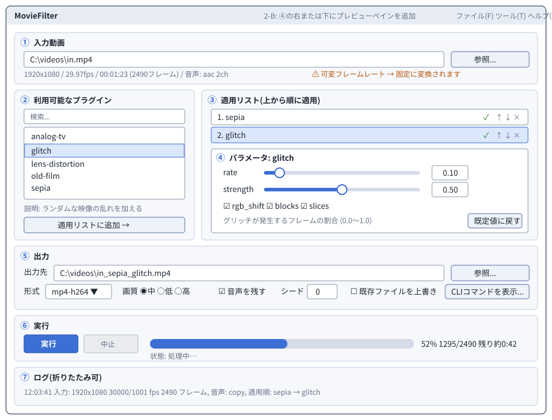

# MovieFilter

動画ファイルと「フィルタプラグイン」を選ぶだけで、エフェクトをかけた動画を保存する、簡易な動画編集ツールです。**画面(GUI)で操作できます。** コマンドラインからも同じ処理を実行できます。

> **現在の状態: v0.1.0(CLI と、GUI の第2段階 2-A を実装済み)**
> 設計書・取扱説明書・プラグイン作成ガイドに沿って実装し、結合テストを含む 270 件のテストが通っています。
> Linux(WSL を含む)で動作確認済みです。**Windows は未検証**です。

> **このプロジェクトは AI によって作成されています。** ソースコード、テスト、設計書、取扱説明書、プラグイン作成ガイドなど、**コードもドキュメントもすべて AI(Anthropic の Claude)が書いています。** 人間が内容をすべて検証しているわけではないため、利用は自己責任でお願いします。不具合や記述の誤りを見つけた場合は、お知らせください。



## 特長

- 「動画 + フィルタ → 動画」の一括変換に特化したシンプルなツール(カット・結合・テロップなどの編集機能はありません)。
- エフェクトは**プラグイン**で、本体を改修せず、ファイルを置くだけで追加できる。GUI のパラメータ入力欄も、プラグインの定義から自動で作られる。
- 複数のプラグインを重ねがけできる。映像だけを加工し、音声は元のまま引き継ぐ。
- 失敗・中断したときは、中途半端な出力ファイルを残さない。
- 第三者が、本体のソースを読まずにプラグインだけを作れる([プラグイン作成ガイド](docs/plugin_author_guide.md))。

## 必要なもの

| 項目 | 内容 |
|---|---|
| OS | Windows / Linux(WSL を含む) |
| Python | 3.11 以上。**GUI には `tkinter` が必要**(Windows の python.org 版は標準で含まれる。Debian/Ubuntu は `sudo apt install python3-tk`) |
| NumPy | `pip install numpy` |
| FFmpeg | `ffmpeg` と `ffprobe`(別途インストール。本プロジェクトには同梱しません)。Linux: `sudo apt install ffmpeg` / Windows: ビルドを展開し、`ffmpeg.exe` のあるフォルダを `PATH` に追加 |

## ダウンロードと配置

1. このリポジトリを入手します(GitHub の「Code」→「Download ZIP」して展開、または `git clone`)。
2. 中身を、好きなフォルダ(例: `C:\MovieFilter`、`~/MovieFilter`)に**そのままの構成で**置きます。

```
C:\MovieFilter\                  ← プロジェクトのルート(src と起動用スクリプトが並んでいるフォルダ)
├─ moviefilter-gui.cmd           Windows: GUI を起動(ダブルクリック。コンソール窓なし)
├─ moviefilter.cmd               Windows: コマンドライン用の起動用スクリプト
├─ moviefilter                   Linux / macOS / WSL 用の起動用スクリプト
├─ pyproject.toml                pip でインストールするときに使う
├─ README.md                     (pip でインストールするときにも必要)
├─ src\moviefilter\              本体(これが無いと動かない)。同梱プラグインは builtin_plugins\ にある
├─ docs\                         ドキュメント
├─ templates\                    プラグインのひな形
└─ tests\                        テスト(使うだけなら不要)
```

| ファイル / フォルダ | 必要か |
|---|---|
| `src/moviefilter/`(フォルダごと) | **必須** |
| `moviefilter-gui.cmd` / `moviefilter.cmd` / `moviefilter` | 起動用スクリプトで使うなら、使う OS のものが必要 |
| `pyproject.toml`、`README.md` | `pip install .` でインストールするなら必要 |
| `docs/`、`templates/`、`tests/` | 任意(使うだけなら削除してもよい) |

> **起動用スクリプトは、`src` フォルダと同じフォルダに置いたまま使ってください。** 別の場所(デスクトップなど)から起動したいときは、スクリプトを移動せず、ショートカットを作ります。ZIP を展開すると `MovieFilter-main\` のようなフォルダの中に入っていることがあります。`src` とスクリプトが並んでいるフォルダがルートです。

3. NumPy を入れます。Windows の `moviefilter-gui.cmd` は `pyw -3`(なければ `pythonw`)で起動するので、**その Python に**入れてください。
   ```
   py -3 -m pip install numpy          # Windows
   python3 -m pip install numpy        # Linux / macOS / WSL
   ```

詳しい手順(Python の導入時の注意、`pip install` を使う方法、使う Python の指定など)は [取扱説明書](docs/user_manual.md) の §2 を参照してください。

## 使い方(GUI)

### 起動

| 環境 | 操作 |
|---|---|
| Windows | プロジェクトのルートの **`moviefilter-gui.cmd` をダブルクリック** |
| Linux / macOS / WSL | ルートで `./moviefilter gui`(実行権限が無ければ `chmod +x moviefilter`)。WSL は WSLg など、画面を表示できる環境が必要 |
| `pip install` した場合 | `moviefilter gui`(コンソール窓を出さない `moviefilter-gui` もあります) |

起動して、左の「利用可能なプラグイン」に `analog-tv`、`glitch`、`lens-distortion`、`old-film`、`sepia` が並べば準備完了です。開かない場合は、PowerShell で `.\moviefilter.cmd gui` と実行すると、エラーの表示を見られます([トラブルシューティング](docs/user_manual.md#11-トラブルシューティング))。

### 操作の流れ

1. **「参照...」**で動画を選ぶ(解像度・fps・長さが表示されます)。
2. 左の一覧からプラグインを選び、**「適用リストに追加」**。**上から順**に適用されます(↑↓×で並べ替え・削除。同じプラグインを複数回追加できます)。
3. 適用リストで選んだプラグインの**パラメータ**を、スライダーなどで調整する(範囲外の値は赤字で指摘され、直るまで実行できません)。
4. 出力先・画質・音声・シードを必要に応じて変える。出力先の既定は、入力と同じフォルダの **`<入力名>_<フィルタ名>.mp4`**(複数のときは適用順に `_` でつなぐ。例: `holiday_sepia_glitch.mp4`)。
5. **「実行」**。進捗と残り時間の目安が表示され、「中止」で安全に中断できます(出力ファイルは作られません)。完了のダイアログから、出力先のフォルダを開けます。

「CLIコマンドを表示...」で、今の設定と同じ処理を実行するコマンドを確認・コピーできます。詳しい使い方は [取扱説明書](docs/user_manual.md) の §3〜§4 を参照してください。

## 同梱プラグイン

| 名前 | 内容 |
|---|---|
| `sepia` | 動画全体を一様にセピアカラーにする(`intensity` で効果の強さを調整) |
| `analog-tv` | アナログ放送時代のテレビ風の画質(ぼかし・色にじみ・走査線・ざらつき)にし、時々ノイズ(砂嵐の帯・横ずれ・ちらつき)を入れる。`softness` `scanlines` `grain` `noise_rate` `noise_strength` で調整 |
| `glitch` | デジタルグリッチ(RGBずれ・ブロックの位置ずれ・横ずれ)を時々入れる。`rate` `strength` `rgb_shift` `blocks` `slices` |
| `lens-distortion` | 樽型/糸巻き型のレンズ歪みと色収差。`curvature`(-0.4〜1.0) `aberration` |
| `old-film` | 古い映画フィルム風。`tint` `flicker` `jitter` `scratches` `dust` `grain` |

同梱プラグインは `src/moviefilter/builtin_plugins/` にあります。

## プラグインを追加する

プラグインのファイルを、**自作用のフォルダ**に置いて、そのフォルダを MovieFilter に教えます。

1. 自作用のフォルダを作る(例: `C:\MoviePlugins`)。プラグインのファイル(例: `brighten.py`)を置く。**ファイル名はプラグイン名と一致させる**(`-` は `_` に置換して比較)。
2. 次のどちらかで、そのフォルダを教える。
   - 設定ファイルに `[plugins]` の `extra_dirs = ["C:/MoviePlugins"]` と書く(設定ファイルの場所は [取扱説明書](docs/user_manual.md) の §8)。
   - 環境変数 `MOVIEFILTER_PLUGIN_PATH` に設定する(複数は、Windows は `;`、Linux は `:` 区切り)。
3. **GUI を起動し直す。** プラグインの一覧は、起動時に1回だけ読み込みます。

同梱フォルダ(`src/moviefilter/builtin_plugins/`)に置いても使えますが、リポジトリの更新と混ざるため、お勧めしません。

### 自分でプラグインを作る

`templates/plugin_template.py` をコピーし、エフェクト処理の部分だけを書けばプラグインになります。

```python
class MyEffectPlugin(VideoPlugin):
    name = "my_effect"
    ...
    def process(self, frame, ctx):      # frame: (高さ, 幅, 3) の uint8 RGB 配列
        out = self._out
        np.copyto(out, frame)
        # ここにエフェクト処理を書く
        return out
```

設計・実装・テスト・配布に必要な情報は、すべて [プラグイン作成ガイド](docs/plugin_author_guide.md) にまとめています。

## 補足: コマンドラインで使う

GUI を使わずに、コマンドで同じ処理を行えます(スクリプトからの利用や、複数ファイルのまとめ処理に向いています)。

```
moviefilter list                                    # 使えるプラグインの一覧
moviefilter info sepia                              # プラグインの詳細・パラメータ
moviefilter apply holiday.mp4 -p sepia              # セピア調にして保存 → holiday_sepia.mp4
moviefilter apply in.mp4 -p analog-tv -p glitch:rate=0.2 --quality high
moviefilter gui                                     # GUI を起動
```

- 起動用スクリプトで使う場合は、`moviefilter` を `./moviefilter`(Windows の PowerShell は **`.\moviefilter.cmd`**。`.\` と `.cmd` が必要)に読み替えます。インストール(`pip install .`)すれば `moviefilter` とだけ打てます。
- `-p` を繰り返すと、書いた順にプラグインを重ねがけします。`-p 名前:パラメータ=値,...` でパラメータを指定します。
- 乱数を使うプラグインは、`--seed` で結果を固定できます。
- `-o` で出力先を指定します(省略すると上記の既定名)。既存ファイルがあるとエラーになります(`--overwrite` で上書き)。

オプションの一覧、書式、終了コード、まとめ処理の例は [取扱説明書](docs/user_manual.md) の §5 を参照してください。

## 制約事項

| 分類 | 内容 |
|---|---|
| 入力 | FFmpeg が読めるローカルの動画ファイル。URL・デバイス・連番画像は不可。静止画は想定外 |
| 出力 | MP4(H.264)のみ |
| 色 | 内部で 8bit RGB に変換する。10bit / HDR は SDR 相当になり、色味が変わることがある。透明(アルファ)情報は失われる |
| フレームレート | 可変フレームレート(VFR)は固定フレームレートに変換される |
| ストリーム | 映像・音声とも先頭の1本のみ。字幕・チャプター・追加トラックは出力されない |
| 音声 | 加工できない(元のまま引き継ぐ)。AAC などは無劣化でコピーし、MP4 に入らない形式は AAC に変換する |
| プラグイン | 1フレームずつの処理のみ(前のフレームを覚える処理は可、未来のフレームの参照は不可)。解像度の変更は不可 |
| 編集機能 | 一部区間だけの処理、複数ファイルの一括処理、動画のプレビューはない |
| 安全性 | プラグインは任意のプログラムとして実行される。**信頼できる入手元のプラグインだけを使うこと** |

詳しくは [取扱説明書](docs/user_manual.md) の「制約事項」「エラー出力の説明」を参照してください。

## 技術構成

- Python 3.11+、NumPy(必須の依存はこれのみ)。GUI は標準ライブラリの Tkinter
- 動画の入出力は FFmpeg / FFprobe を外部コマンドとして利用(同梱しない)
- 構成: UI 層(GUI / CLI)→ 処理サービス層 → プラグイン管理 / パイプライン / 動画 I/O 層 / 出力プロファイル

## ドキュメント

| 文書 | 内容 |
|---|---|
| [取扱説明書](docs/user_manual.md) | **まずこれを読んでください。** 準備・配置、GUI の使い方、CLI(補足)、制約事項、エラー、トラブルシューティング |
| [プラグイン作成ガイド](docs/plugin_author_guide.md) | プラグインを作るために必要な情報のすべて |
| [プラグインのひな形](templates/plugin_template.py) | エフェクト部分だけを書けば完成するひな形 |
| [基本設計書](docs/basic_design.md) | 目的、要件、構成、将来拡張の方針 |
| [詳細設計書](docs/detailed_design.md) | モジュール・API・FFmpeg 連携・エラー体系・テスト計画・セピアの設計 |
| [GUI 設計書](docs/gui_design.md) | GUI の画面・状態・スレッド・テストの設計 |
| [設計レビュー記録](docs/review_log.md) | 第三者視点のレビューで見つかった指摘と対応 |

## 開発

```
pip install -e ".[dev]"
pytest                          # FFmpeg がない環境では結合テストは自動でスキップされる。表示環境がなければ GUI のスモークテストもスキップされる
```

- 性能(1080p・30fps・10秒の動画、24 コア環境): プラグインなし 約 120fps、セピア 約 35fps。Python 側のメモリ使用量は約 100MB で一定。
- 実装で見つかった設計の誤りと訂正は [設計レビュー記録](docs/review_log.md) の「第3回」、CLI・GUI のレビューは「第4回」を参照。

## 今後の予定

1. Windows での動作確認
2. GUI の第2段階(2-B): 静止フレームのプレビュー、プリセット、設定ダイアログ、ドラッグ&ドロップ
3. 将来拡張: 音声エフェクト、前後フレームを使うエフェクト、他の出力形式

## ライセンス

本プロジェクトは [Apache License 2.0](LICENSE) の下で公開します。

- 本体・設計書・ひな形(`templates/plugin_template.py`)は Apache License 2.0 が適用されます。
- ひな形をコピーして作ったプラグインのライセンスは、作者が自由に決められます。
- FFmpeg は本プロジェクトに同梱しません(別途インストールするもので、FFmpeg 自体のライセンスに従います)。
