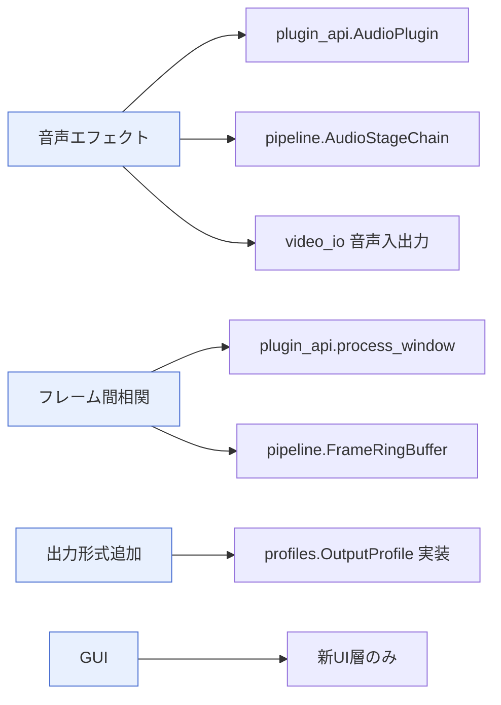
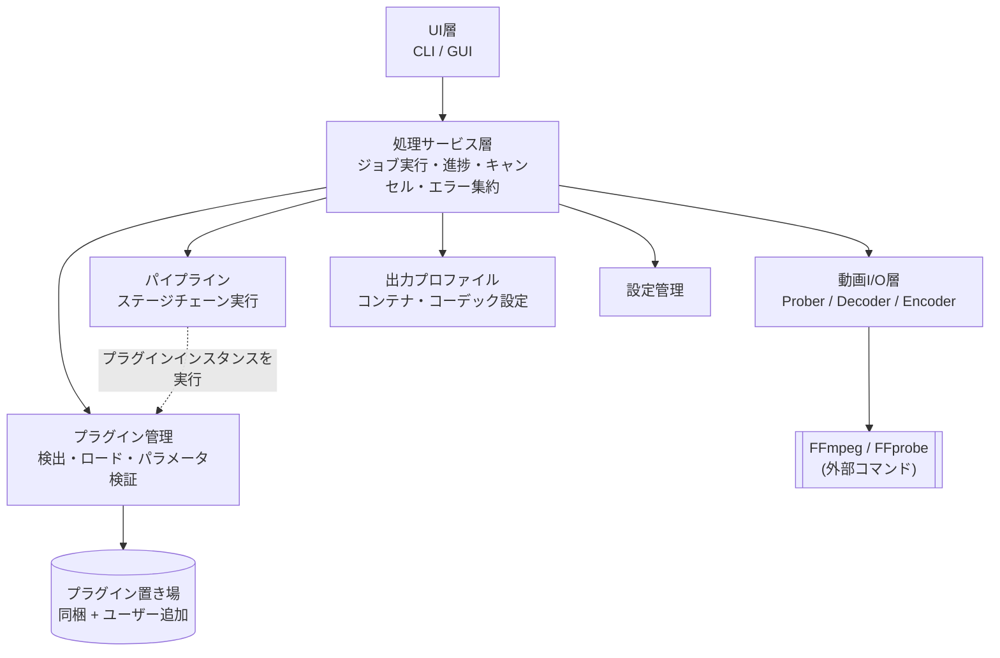
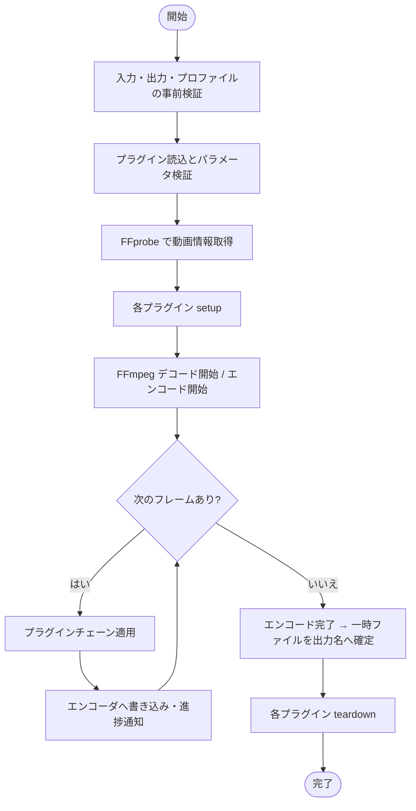
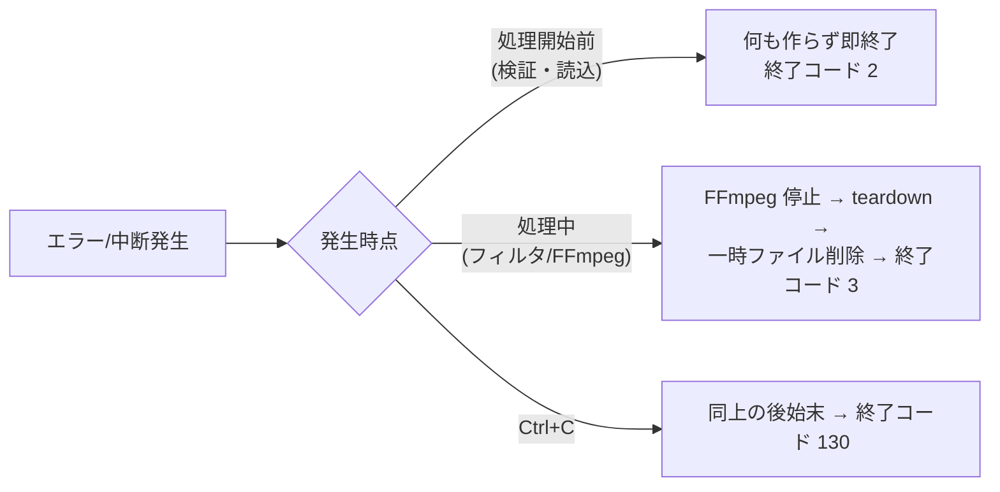

# MovieFilter 基本設計書

| 項目 | 内容 |
|---|---|
| 文書名 | MovieFilter 基本設計書 |
| 版 | 0.7(GUI の追加、出力名の規則変更) |
| 作成日 | 2026-11-14 |
| 関連文書 | `docs/detailed_design.md`(詳細設計書)、`docs/gui_design.md`(GUI 設計書)、`docs/user_manual.md`(取扱説明書)、`docs/review_log.md`(レビュー記録) |
| フェーズ | 第1段階(CLI)と GUI の第2段階 2-A を実装済み。GUI の 2-B(プレビューなど)と将来拡張(FR-10〜12)は未着手 |

### 改訂履歴

| 版 | 内容 |
|---|---|
| 0.1 | 初版 |
| 0.2 | 技術選定・将来拡張方針の確定を反映。要件ID付与、図のmermaid化、プラグイン配置方針・性能目標・制約事項の見直し(詳細は `review_log.md`) |
| 0.3 | 再現性要件(NFR-08)を追加。乱数を使うプラグイン向けに `--seed` を追加 |
| 0.4 | 実装前最終レビュー(`review_log.md` 第2回)の反映。FR-02 の表現修正、FR-14 追加、CLI 例の修正(同梱プラグインと整合) |
| 0.5 | プラグイン作者向けの資料(ガイド・ひな形・テスト支援)を追加。FR-15 を追加 |
| 0.6 | インストールなしで起動できる起動用スクリプトを追加。FR-16 を追加 |
| 0.7 | GUI(FR-13 の 2-A)を実装。出力名の既定を `<入力名>_<フィルタ名>.mp4` に変更。GUI 用の起動方法(`moviefilter gui`、`moviefilter-gui`)を追加。ディレクトリ構成・コンポーネント一覧・今後の進め方を実装の現状に更新(詳細は `gui_design.md`、`review_log.md` 第4回) |

---

## 1. 目的と概要

動画にエフェクトをかける**フィルタプラグイン**を用意しておき、ユーザーが「入力動画」と「プラグイン」を指定するだけで、自動的に処理して**加工済み動画を保存**する簡易動画編集ソフト。

- タイムライン編集・カット編集などの本格的な編集機能は対象外。「動画 + フィルタ → 動画」の一括変換に特化する。
- エフェクトの追加はプラグインの追加だけで行え、本体を改修しない。

## 2. 要件

### 2.1 機能要件

| ID | 要件 | 段階 |
|---|---|---|
| FR-01 | 動画ファイルを読み込み、フィルタ適用後の動画を保存できる | 1 |
| FR-02 | プラグインをプラグイン置き場(同梱ディレクトリ、または環境変数/設定で指定したディレクトリ)へファイルを置くだけで追加できる(本体改修不要) | 1 |
| FR-03 | プラグインごとにパラメータを指定できる(型・範囲検証つき) | 1 |
| FR-04 | 複数プラグインを指定順に連続適用できる | 1 |
| FR-05 | 元動画の音声を保持して出力できる(`--no-audio` で除外可) | 1 |
| FR-06 | 進捗(処理済みフレーム・残り時間の目安)を表示できる | 1 |
| FR-07 | 失敗・中断時に中途半端な出力ファイルを残さない | 1 |
| FR-08 | 利用可能なプラグイン・出力プロファイルを一覧/詳細表示できる | 1 |
| FR-09 | CLI で操作できる | 1 |
| FR-14 | 出力の画質(low / medium / high)と出力プロファイルを選択できる | 1 |
| FR-15 | 第三者がプラグインだけを作れるよう、作成ガイド・ひな形・テスト支援モジュールを提供する | 1 |
| FR-16 | `pip install .` で `moviefilter` コマンド(と、コンソールなしで GUI を起動する `moviefilter-gui`)をインストールできる。インストールなしでも、リポジトリ直下の起動用スクリプト(`moviefilter` / `moviefilter.cmd` / `moviefilter-gui.cmd`)で実行できる | 1 |
| FR-10 | 音声エフェクトプラグインに対応できる | 将来 |
| FR-11 | 前後フレームを参照するエフェクトに対応できる | 将来 |
| FR-12 | MP4(H.264)以外の出力形式に対応できる | 将来 |
| FR-13 | GUI で操作できる(詳細は `docs/gui_design.md`)。静止フレームのプレビューは GUI の第2段階(2-B)で追加する | 2-A(実装済み) / 2-B |

### 2.2 非機能要件

| ID | 要件 | 方針 |
|---|---|---|
| NFR-01 性能 | メモリは解像度に比例する小さな範囲に収める(全フレームをメモリに載せない)。1080p 30fps のセピア処理で**10fps 以上**を参考目標とし、実装時にベンチで確認する(保証値ではない) |
| NFR-02 画質 | 既定は中品質(CRF 23)。高品質(CRF 18)を選択可能 |
| NFR-03 信頼性 | 一時ファイル経由で書き出し、成功時のみ確定。失敗/中断時は後始末する |
| NFR-04 拡張性 | **将来拡張(FR-10〜13)が公開プラグインAPIの破壊的変更なしで追加できること**を設計の最優先制約とする |
| NFR-05 安全性 | プラグインは任意コード実行。**信頼できるプラグインのみ配置**する前提(サンドボックスは対象外) |
| NFR-06 保守性 | UI・サービス・I/O・プラグイン管理を分離し、各層を単体テスト可能にする |
| NFR-07 可搬性 | Windows / Linux(WSL含む)で動作。FFmpeg は外部コマンドとして利用(同梱しない) |
| NFR-08 再現性 | 乱数を使うプラグインは、同じ入力・同じ `--seed` で同じ結果を出せること(各フレームに決定的なシードを渡す。既定は `--seed 0`) |

### 2.3 対象外(Out of Scope)
- タイムライン編集、カット・結合、テロップ編集
- リアルタイムプレビュー(再生しながらの確認)。GUI の**静止フレームのプレビュー**(指定した1フレームだけを加工して見比べる)は範囲内とする(`docs/gui_design.md` §6)
- 複数ファイルの一括処理(将来はシェルのループ、または追加サブコマンドで対応可能)
- プラグインの配布基盤、サンドボックス実行

### 2.4 第1段階の制約事項(利用者に明示する)
- 音声は加工せず元のまま引き継ぐ(必要時のみ AAC へ再エンコード)。
- 映像は内部で 8bit RGB に変換される。10bit/HDR 動画は8bit SDR 相当になり、**色味が変化する場合がある**(トーンマッピングは行わない)。
- 映像・音声とも先頭の1ストリームのみ対象。字幕・チャプター・追加ストリームは出力されない。
- 可変フレームレート(VFR)動画は固定フレームレート(CFR)に変換される。
- 入力形式は拡張子で制限せず、**FFmpeg が読めるローカルの動画ファイル**を対象とする。URL・デバイス・連番画像は対象外。静止画は想定外(1フレームの動画になる)。
- 透明(アルファ)情報は失われる。インターレース動画のデインターレースは行わない。FFmpeg が扱えない音声コーデックを含む動画は書き出しに失敗しうる(`--no-audio` で回避可能)。
- 出力は MP4(H.264)のみ。

## 3. 確定した技術方針

| 項目 | 方針 | 備考 |
|---|---|---|
| 実装言語 | Python 3.11+ | プラグイン記述が容易 |
| 動画入出力 | FFmpeg / FFprobe(外部コマンド) | 形式対応・音声処理・エンコードを任せる |
| フレーム表現 | NumPy 配列(H×W×3, uint8, RGB) | 必須依存は `numpy` のみ |
| UI | CLI と GUI(標準の Tkinter。追加依存なし。`docs/gui_design.md`) | 処理本体とUIを分離し、GUI を後付けで追加した |
| 出力形式 | 第1段階は MP4(H.264)のみ | プロファイル機構で拡張可能に |

### 設計方針
1. **コアとプラグインの分離**:コアは入出力とパイプライン制御のみ。エフェクトは全てプラグイン。
2. **UI とロジックの分離**:CLI/GUI は同じ処理サービス層を呼ぶ。
3. **ストリーミング処理**:1フレームずつ処理し、バッファを再利用して無駄なメモリ確保を避ける。
4. **シンプルなプラグイン契約**:作者が書くのは「1フレームを受け取り1フレームを返す」関数が中心。
5. **未対応は明示的に拒否**:将来拡張用に予約した機能は、第1段階では黙って無視せずエラーにする。
6. **計測してから最適化**:マルチスレッド化等は、ベンチで必要性を確認してから導入する。

## 4. 将来拡張方針(NFR-04 の具体化)

| 将来対応 | 第1段階で入れておく仕組み | 追加時の作業 | 既存プラグインへの影響 |
|---|---|---|---|
| 音声エフェクト(FR-10) | `Plugin` 基底を種別(`VideoPlugin`/`AudioPlugin`)で分離、音声用ステージチェーン(現状パススルー) | `AudioPlugin` のメソッド定義、音声中間形式の入出力追加 | なし |
| フレーム間相関(FR-11) | `FrameContext`、プラグインの状態保持、`temporal_window` 予約属性 | `process_window` 有効化、フレームバッファ実装 | なし |
| 出力形式追加(FR-12) | `OutputProfile` / `ProfileRegistry` | プロファイル実装の追加と登録 | なし |
| GUI(FR-13) | 進捗コールバック・キャンセル機構つきのサービス層 | 新UI層の追加 | なし |



プラグインAPIは `API_VERSION = (major, minor)` で管理し、上記拡張は **minor の追加**で行う(major は上げない)。

## 5. システム構成

### 5.1 全体アーキテクチャ



### 5.2 コンポーネント一覧

| コンポーネント | 責務 |
|---|---|
| UI 層(CLI) | 引数解釈、プラグイン一覧表示、進捗表示、終了コード返却 |
| UI 層(GUI) | 画面の組み立てと表示(View)、状態・検証・`ProcessRequest` の組み立て(ViewModel)、処理のワーカースレッドとイベントキュー。処理は CLI と同じ処理サービス層を呼ぶ |
| 処理サービス層 | 入力検証、ジョブ実行、進捗・キャンセル・エラーの集約 |
| プラグイン管理 | プラグイン置き場の走査、メタ情報取得、必要なものだけのロード、パラメータ検証 |
| パイプライン | フレームを指定順にフィルタへ通す。将来は音声・前後フレーム参照にも対応 |
| 動画 I/O 層 | FFprobe による動画情報取得、FFmpeg によるデコード・エンコード、音声の結合 |
| 出力プロファイル | 出力形式ごとの FFmpeg 引数・音声方針の定義 |
| 設定管理 | ツールパス・プラグイン追加ディレクトリ・既定値の読込 |

### 5.3 ディレクトリ構成

```
33_MovieFilter/
├─ moviefilter                  起動用スクリプト(Linux / macOS / WSL。インストール不要で実行できる)
├─ moviefilter.cmd              起動用スクリプト(Windows。コマンドライン用)
├─ moviefilter-gui.cmd          起動用スクリプト(Windows。コンソール窓なしで GUI を起動)
├─ docs/                        設計書・取扱説明書・プラグイン作成ガイド・レビュー記録
│   └─ images/                  図(GUI のワイヤーフレームなど)
├─ templates/                   プラグインのひな形(plugin_template.py)
├─ src/moviefilter/             本体パッケージ
│   ├─ builtin_plugins/         同梱プラグイン(sepia / analog-tv / glitch / lens-distortion / old-film。パッケージに含まれる)
│   ├─ gui/                     GUI(UI層。tkinter)
│   └─ testing.py               プラグイン作者向けテスト支援
├─ tests/
└─ pyproject.toml
```
ユーザー独自のプラグインは、設定ファイルの `extra_dirs` または環境変数 `MOVIEFILTER_PLUGIN_PATH` で指定したディレクトリに置く(詳細は詳細設計書)。

## 6. 処理フロー

### 6.1 メイン処理



### 6.2 異常系の扱い



| 事象 | 扱い |
|---|---|
| 入力ファイルなし/非対応形式 | 処理開始前にエラー終了 |
| FFmpeg が見つからない | 起動時に検出し、導入手順を案内して終了 |
| プラグイン未検出/パラメータ不正/未対応種別 | 処理開始前にエラー終了(利用可能な一覧・パラメータを提示) |
| フィルタ実行中の例外 | 処理を中断し、フレーム番号・プラグイン名付きで報告 |
| 出力先が既存ファイル | 既定ではエラー(`--overwrite` で許可)。**確認プロンプトは出さない**(非対話実行を妨げないため) |
| 入力と出力が同一パス | エラー(入力破壊の防止) |
| ディスク容量不足 | エンコード失敗として扱い、一時ファイルを削除 |

## 7. UI(CLI)概要

```
moviefilter list                                  # 利用可能なプラグイン一覧
moviefilter info <plugin>                         # プラグインの詳細・パラメータ表示
moviefilter apply <input> -p <plugin>[:key=val,...] [-p ...] [-o <output>]
moviefilter profiles                              # 出力プロファイル一覧
moviefilter gui                                   # GUI を起動
```
例: `moviefilter apply in.mp4 -p sepia:intensity=0.8 -o out.mp4`(複数指定は `-p` を繰り返す。同梱プラグインは `sepia` / `analog-tv` / `glitch` / `lens-distortion` / `old-film`)

オプション・文法・終了コードは詳細設計書を参照。`moviefilter gui` で GUI を起動できる(同じサービス層を呼ぶ。設計は `docs/gui_design.md`)。

## 8. 主要リスクと対応

| リスク | 対応 |
|---|---|
| FFmpeg 未導入環境 | 起動時検出と案内 |
| Python 処理の速度不足 | NumPy のベクトル演算とバッファ再利用を前提とする。不足時は FFmpeg 組込フィルタをラップするプラグイン種別を検討 |
| 可変フレームレート動画 | CFR へ正規化(確定) |
| 映像・音声の同期ずれ | フレームレートを有理数で扱う、開始時刻差の補正、結合テストで長さ差を検証 |
| FFmpeg の挙動依存(パイプ入力・`-shortest` 等) | 実装着手前に最小検証(スパイク)を行う(詳細設計書 §13) |
| プラグインの品質・悪意 | 信頼済みプラグインのみ使用する旨を明記 |

## 9. 今後の進め方

実施済み: 設計のレビュー、実装前スパイク(FFmpeg 挙動の検証。詳細設計書 §13)、第1段階の実装(コア → セピア → CLI → 追加プラグイン)、テストと性能計測、GUI の 2-A、CLI・GUI のレビューと修正(`review_log.md` 第3回・第4回)。

今後:
1. Windows での動作確認
2. GUI の 2-B(静止フレームのプレビュー、プリセット、設定ダイアログ、ドラッグ&ドロップ。`gui_design.md` §3.1)
3. 将来拡張(§4): 音声エフェクト(FR-10)、前後フレームを使うエフェクト(FR-11)、他の出力形式(FR-12)
