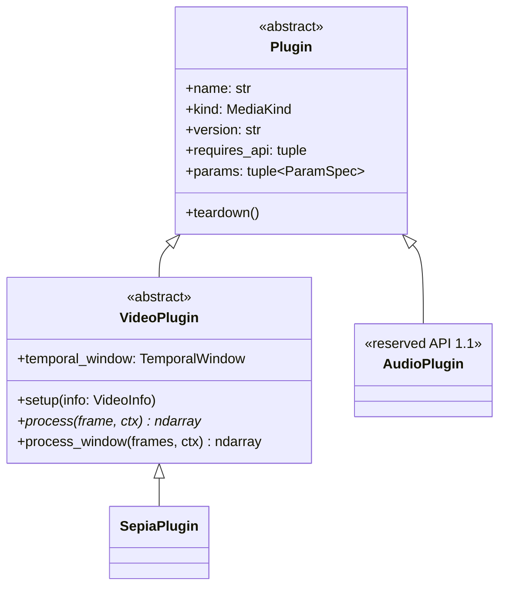
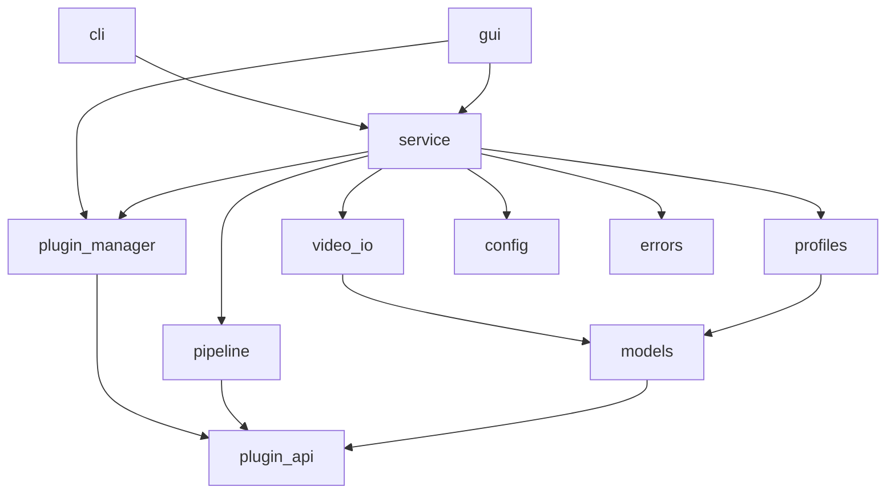
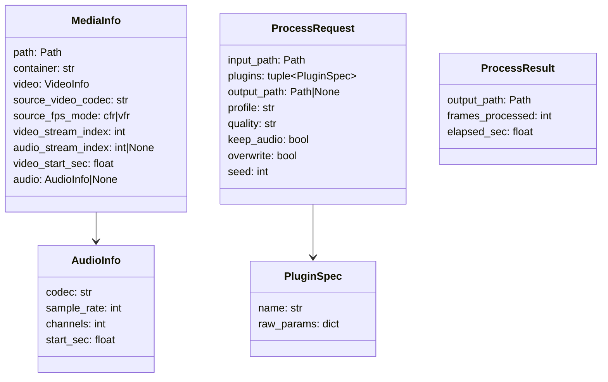
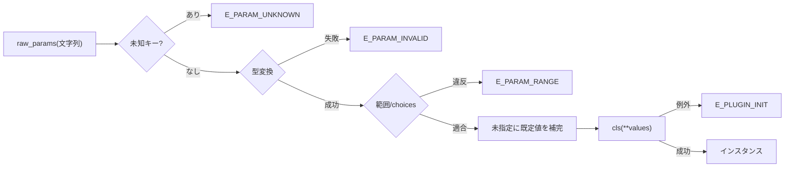
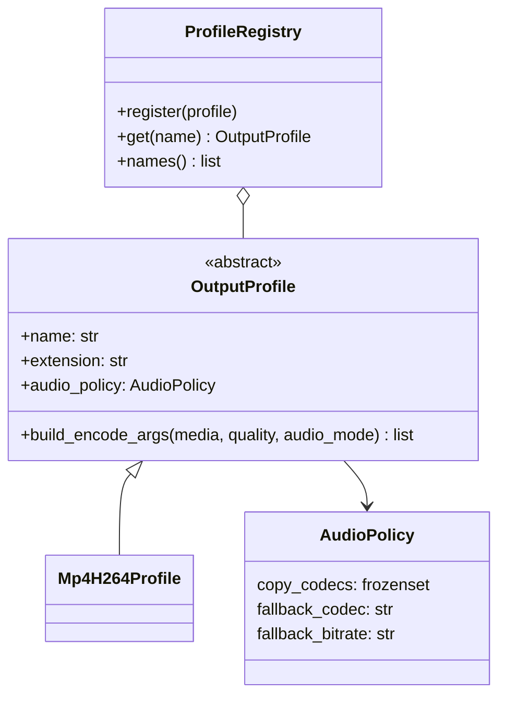
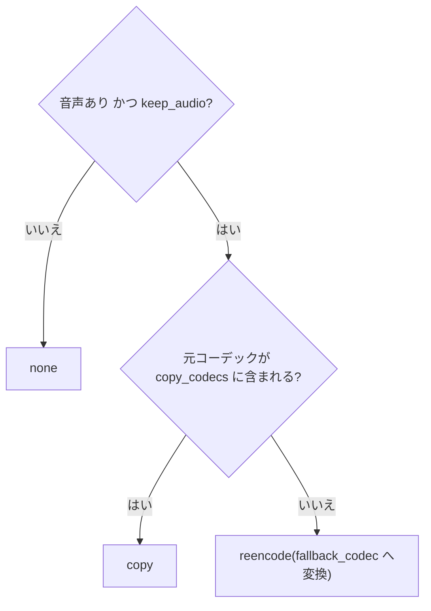
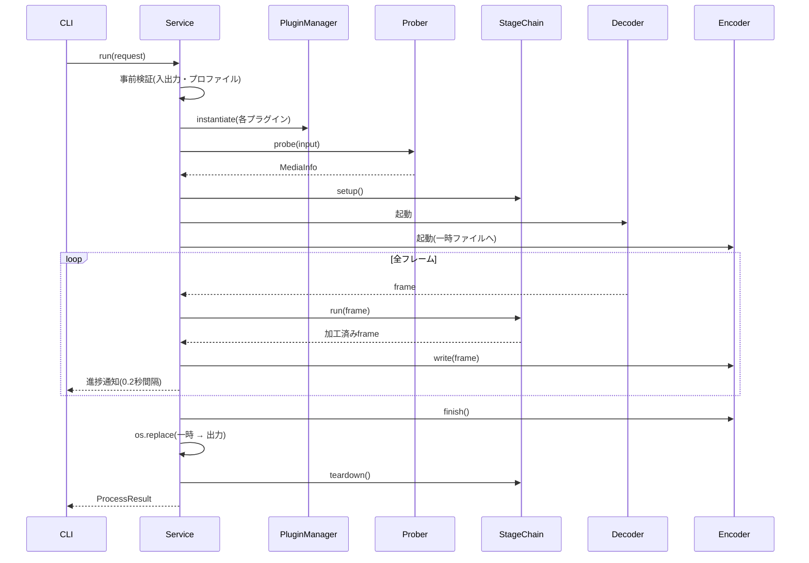
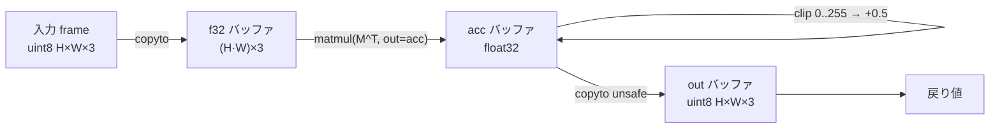
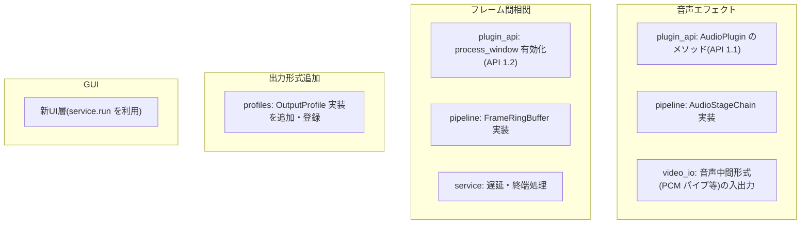

# MovieFilter 詳細設計書

| 項目 | 内容 |
|---|---|
| 文書名 | MovieFilter 詳細設計書 |
| 版 | 0.8(GUI の追加に伴う更新) |
| 作成日 | 2026-11-14 |
| 前提文書 | `docs/basic_design.md`(v0.7) |
| 関連文書 | `docs/gui_design.md`(GUI 設計書)、`docs/review_log.md`(レビュー記録・指摘 R-xx の出典) |
| フェーズ | 実装済み(本書は実装の仕様書。実装で判明した訂正は `review_log.md` 第3回・第4回に記録し、本文へ反映済み) |

### 改訂履歴

| 版 | 内容 |
|---|---|
| 0.1 | 初版 |
| 0.2 | レビュー指摘の反映(フレームレートの有理数化、バッファ所有権契約、再利用バッファによるメモリ削減、プラグインの遅延ロード、同梱プラグインの配置変更、A/V開始時刻補正、Ctrl+C の扱い、テスト期待値の具体化、実装前スパイク項目の追加、図の mermaid 化) |
| 0.3 | `FrameContext` に `seed`(決定的な乱数シード)を追加。CLI に `--seed`、`ProcessRequest` に `seed` を追加。`FrameContext.info` は入れ子のまま維持する方針を確定 |
| 0.4 | 実装前最終レビューの反映(`review_log.md` 第2回 R-18〜R-40)。主な変更: エンコード引数の修正(メタデータ/チャプター、色空間 BT.709、`-framerate`)、カバー画像の除外、エラーコード追加(`E_USAGE`, `E_OUTPUT_DIR_INVALID`)と終了コード対応表、モジュール依存の矛盾解消、`setup`/`teardown` の失敗時の扱い、パッケージング仕様、設定の優先順位、スパイク追加 |
| 0.8 | GUI(`gui/`、GUI 設計書)の追加: `cli.py` に `gui` サブコマンド、`service.validate_request` の公開、エラーコード `E_GUI_UNAVAILABLE`、`moviefilter-gui` / `moviefilter-gui.cmd`。既定の出力名を `<入力ステム>_<フィルタ名>` に変更(`service.default_output_path`)。`PluginManager` のロード結果のキャッシュ、`resolve_tools` の結果の使い回し(`review_log.md` 第4回)。`__main__.py` のコンソールなし起動でのエラー表示 |
| 0.7 | インストールなしで起動できる起動用スクリプト(`moviefilter` / `moviefilter.cmd`)の追加(§2.2)。`__main__.py` に Python バージョンと NumPy の事前チェックを追加 |
| 0.6 | 実装・結合テストで判明した点の反映(`review_log.md` 第3回 I-1〜I-6)。`-shortest` の削除、音声オフセット補正の式の訂正、`-map` をストリーム番号指定へ、`Progress.done` の追加、検証順序の訂正 |
| 0.5 | プラグイン作者向けドキュメント(`plugin_author_guide.md`)・ひな形(`templates/plugin_template.py`)の追加に伴い、テスト支援モジュール `moviefilter.testing`(§5.8)、プラグイン検出規則(モジュール内定義のクラスのみ・1ファイル1プラグイン・パッケージ形式のロード方法、§5.1.2)、予約名、`str(例外)` の形式、プラグイン用ロガー名を追加 |

---

## 0. 確定事項と位置づけ

| # | 項目 | 第1段階(実装) | 将来拡張(設計で配慮) |
|---|---|---|---|
| 1 | 言語・動画I/O | Python 3.11+ / FFmpeg | — |
| 2 | UI | CLI、および GUI の 2-A(サービス層を共用。`docs/gui_design.md`) | GUI の 2-B |
| 3 | 音声 | 元音声をそのまま引き継ぐ | 音声エフェクトプラグイン |
| 4 | フレーム処理 | 1フレーム入力→1フレーム出力(状態保持可) | フレーム間相関エフェクト |
| 5 | 出力形式 | MP4(H.264)のみ | 他コンテナ/コーデック |

## 1. 拡張性のための設計判断

プラグインAPIは公開後に変更しにくい。将来拡張を**破壊的変更なし**で行うため、以下を第1段階から組み込む。

### 1.1 クラス構成(公開API)



### 1.2 音声プラグイン対応(FR-10)
- 各プラグインは `kind: MediaKind`(`VIDEO` / `AUDIO`)を宣言する。`AudioPlugin` クラスは第1段階から存在するが、**パイプラインは拒否**する(`E_PLUGIN_KIND_UNSUPPORTED`)。
- パイプラインは `VideoStageChain` と `AudioStageChain` に分離する。第1段階の `AudioStageChain` は**パススルー**のみ。
- `MediaInfo` は音声情報(`AudioInfo`)を最初から保持する。

### 1.3 フレーム間相関対応(FR-11)
- `process(frame, ctx)` の `ctx`(`FrameContext`)にフレーム番号・時刻・動画情報を含める。
- プラグインは状態をインスタンスに保持してよい(過去フレームを覚えるエフェクトは第1段階でも書ける)。**ただし過去フレームを保持したい場合は自分でコピーすること**(§3.5 バッファ契約)。
- 前後フレーム参照用に `temporal_window: TemporalWindow(past, future)` を**予約**(既定 `(0, 0)`)。第1段階は非ゼロを `E_TEMPORAL_UNSUPPORTED` で拒否する。
- 将来(API 1.2)は `process_window(frames, ctx)` を追加する。基底の既定実装は `process` に委譲するため、既存プラグインは無改修で動く。

### 1.4 出力フォーマット拡張(FR-12)
- エンコード設定は `OutputProfile` に集約し `ProfileRegistry` で名前引きする。第1段階は `mp4-h264` のみ。
- FFmpeg 引数の生成は `OutputProfile.build_encode_args()` に閉じ込め、`video_io` は形式非依存にする。

### 1.5 APIバージョニング
- `plugin_api.API_VERSION = (1, 0)`。プラグインは `requires_api = (1, 0)` を宣言する。
- ロード条件: major 一致かつ「本体 minor ≥ 要求 minor」。拡張は minor 追加で行い、major は上げない。

## 2. モジュール構成

```
src/moviefilter/
├─ __init__.py          バージョン
├─ __main__.py          python -m moviefilter(Python 3.11 未満・NumPy 未導入を検出して分かりやすく終了)
├─ cli.py               UI層(CLI。`gui` サブコマンドで GUI を起動)
├─ gui/                 UI層(GUI。tkinter。`docs/gui_design.md` §8.2)
├─ service.py           処理サービス層
├─ models.py            データクラス
├─ errors.py            例外・エラーコード
├─ config.py            設定読込
├─ plugin_api.py        公開API(プラグイン作者が触れる唯一のモジュール)
├─ plugin_manager.py    プラグイン検出・ロード・検証
├─ pipeline.py          VideoStageChain / AudioStageChain / FrameRingBuffer
├─ video_io.py          Prober / Decoder / Encoder
├─ profiles.py          OutputProfile / ProfileRegistry / AudioPolicy
├─ logging_setup.py     ログ設定
├─ testing.py           プラグイン作者向けテスト支援(§5.8)
└─ builtin_plugins/     同梱プラグイン(パッケージに含まれる)
    └─ sepia.py / analog_tv.py / glitch.py / lens_distortion.py / old_film.py
tests/
```

依存方向は上位→下位のみ。`plugin_api` は他の本体モジュールに依存しない。


(`VideoInfo`・`FrameContext` は公開APIとして `plugin_api` に定義し、`models` がそれを利用する。`plugin_api` は他の本体モジュールに依存しない。)

### 2.1 パッケージング(`pyproject.toml`)

| 項目 | 内容 |
|---|---|
| ビルド | `setuptools`(`src` レイアウト) |
| Python | `requires-python = ">=3.11"` |
| 依存 | `numpy`(実行時の必須依存はこれのみ)。開発用に `pytest` を `[project.optional-dependencies] dev` へ |
| コマンド | `[project.scripts] moviefilter = "moviefilter.cli:main"`(`python -m moviefilter` も同じ `main` を呼ぶ)。`[project.gui-scripts] moviefilter-gui = "moviefilter.gui:gui_main"`(Windows でコンソール窓を出さずに GUI を起動。エラーはダイアログで通知) |
| 同梱プラグイン | `moviefilter/builtin_plugins/` を**パッケージデータとして含める**(`package-data` 指定を忘れると、インストール後に同梱プラグイン(`sepia` など)が見つからなくなる)。インストール後に `moviefilter list` で同梱プラグインが出ることを結合テストに含める。`readme = "README.md"` を参照するため、`pip install .` にはリポジトリ直下の `README.md` が必要 |
| 版 | `moviefilter.__version__` を `pyproject.toml` と一致させる(`--version` で表示) |

### 2.2 起動用スクリプト(インストールなしでの実行)

リポジトリ直下に3つの起動用スクリプトを置く。どちらも `PYTHONPATH` にスクリプトの隣の `src` を足し、`python -m moviefilter <引数>` を実行して**終了コードをそのまま返す**だけの薄いラッパーで、ロジックは持たない。

| ファイル | 対象 | 仕様 |
|---|---|---|
| `moviefilter` | Linux / macOS / WSL | POSIX シェルスクリプト(`#!/bin/sh`、LF、実行権限あり)。`$0` がシンボリックリンクなら辿って本来の置き場所を求める。Python は環境変数 `MOVIEFILTER_PYTHON`、なければ `python3`、`python` の順 |
| `moviefilter-gui.cmd` | Windows(GUI) | バッチファイル(CRLF、ASCII のみ)。コンソール窓を出さずに `python -m moviefilter gui` を実行する。起動に使う実行ファイルは、`MOVIEFILTER_PYTHON`(`pythonw.exe` のフルパス)、なければ `where pyw`(`pyw -3`)、`where pythonw` の順に**フルパスで解決**し、`start "" "<フルパス>" ...` で起動する(`start` に名前だけを渡すと見つからないことがあるため)。どれも無ければ案内を出して `pause` する。コンソールがなく標準エラーが見えないため、前提不足(Python 3.11 未満・NumPy なし)は `__main__.py` がダイアログで知らせる |
| `moviefilter.cmd` | Windows | バッチファイル(CRLF、**ASCII のみ**:コードページに依存しないため)。PowerShell では現在のフォルダのコマンドを名前だけでは実行できないため、`.\moviefilter.cmd` と書く(拡張子のない `moviefilter` は Linux 用のため、`.cmd` まで書く)。`%~dp0src` を `PYTHONPATH` に足す。Python は `MOVIEFILTER_PYTHON`、なければ `py -3`、`python` の順 |

- 前提の確認は `__main__.py` が行う(ランチャー側では行わない。起動が二重に遅くならないように、また `python -m` でも同じ案内を出すため)。Python が 3.11 未満、または NumPy がなければ、日本語のメッセージを出して終了コード 1 で終了する。
- `.gitattributes` で `moviefilter` は LF、`*.cmd` は CRLF に固定する(Windows 上の改行変換でシェルスクリプトの `#!` 行が壊れるのを防ぐため)。
- `pip install` で作られるコマンド(`[project.scripts]`)とは独立した別の入口であり、どちらも同じ `moviefilter.cli:main` を呼ぶ。
- スクリプトは、**自分のいるフォルダの `src` を探す**(`%~dp0src` / `$DIR/src`)。`src` と別の場所へ移動すると動かないため、利用者には移動せず**ショートカット**を作るよう案内する(取扱説明書 §2.2)。

## 3. 公開API(`plugin_api.py`)

### 3.1 補助型

```python
class MediaKind(Enum):
    VIDEO = "video"
    AUDIO = "audio"           # 予約(第1段階はロード後に適用拒否)

@dataclass(frozen=True)
class TemporalWindow:
    past: int = 0
    future: int = 0

class ParamType(Enum):
    INT = "int"; FLOAT = "float"; BOOL = "bool"; STR = "str"; CHOICE = "choice"

@dataclass(frozen=True)
class ParamSpec:
    name: str                 # [a-z][a-z0-9_]*
    type: ParamType
    default: object
    description: str = ""
    min: float | None = None  # INT/FLOAT のみ
    max: float | None = None
    choices: tuple | None = None   # CHOICE のみ
```

### 3.2 `VideoInfo` / `FrameContext`

```python
@dataclass(frozen=True)
class VideoInfo:
    width: int                # 回転適用後
    height: int
    fps_num: int              # フレームレートは有理数で保持(例 30000/1001)
    fps_den: int
    total_frames: int | None
    duration_sec: float | None

    @property
    def fps(self) -> float:   # 表示・簡易計算用。時刻計算の基準には fps_num/fps_den を使う
        return self.fps_num / self.fps_den

@dataclass(frozen=True)
class FrameContext:
    index: int                # 0始まり
    pts_sec: float            # index * fps_den / fps_num
    info: VideoInfo           # 入れ子のまま維持(width 等は ctx.info.width で参照)
    seed: int                 # このフレーム・このプラグイン専用の決定的シード (0 <= seed < 2**64)
```
将来の項目追加はキーワード専用フィールドの追加で互換を保つ。`FrameContext` を生成するのはパイプラインのみで、プラグインは生成しない(テストでは `make_frame_context()` ヘルパーを用意する)。

#### 3.2.1 `seed` の仕様

乱数を使うエフェクト(フィルムグレイン、ノイズ等)の**再現性**を保証するための値。

| 項目 | 内容 |
|---|---|
| 導出 | `seed = SeedSequence([job_seed, plugin_index, frame_index]).generate_state(1, dtype=uint64)[0]`。`job_seed` は `ProcessRequest.seed`、`plugin_index` はチェーン内の位置(0始まり) |
| 性質 | 同じ入力・同じ `--seed`・同じプラグイン構成なら、各フレームの `seed` は常に同じ。**フレームの処理順や並列度に依存しない**(将来の並列化・2パス処理でも結果が変わらない) |
| プラグインごとに異なる | 同じプラグインを2回チェーンに入れた場合や、複数のノイズ系プラグインを併用した場合に、乱数が同一になって相関することを防ぐ |
| 使い方 | `rng = np.random.default_rng(ctx.seed)` をフレームごとに生成して使う(生成コストはフレーム処理に比べ無視できる)。`random` モジュールのグローバル乱数や時刻・OS 乱数を使ってはならない(規約) |
| 既定値 | `job_seed` の既定は `0`(既定で再現可能)。実行ごとに変えたい場合は `--seed` で指定する |
| 注意 | 複数プラグインの順序を入れ替えると `plugin_index` が変わるため、そのプラグインの乱数も変わる。`SeedSequence` による導出は NumPy のバージョンをまたいで安定だが、`Generator` の乱数ストリームは NumPy のバージョンで変わりうるため、**バージョンをまたぐ完全一致は保証しない** |
| 乱数を使わないプラグイン | 無視してよい(セピア等) |

### 3.3 `Plugin` 基底

```python
class Plugin(ABC):
    name: ClassVar[str]
    description: ClassVar[str] = ""
    version: ClassVar[str] = "0.0.0"
    requires_api: ClassVar[tuple[int, int]] = (1, 0)
    kind: ClassVar[MediaKind]
    params: ClassVar[tuple[ParamSpec, ...]] = ()

    def __init__(self, **params):      # 検証済み・型変換済み・既定値補完済み
        self.params_values = params

    def teardown(self) -> None: ...
```

**予約名**: `kind`、`temporal_window`、`process_window` はプラグイン API が使う名前。プラグインはこれらを別の意味で定義しない。

### 3.4 `VideoPlugin`

```python
class VideoPlugin(Plugin):
    kind = MediaKind.VIDEO
    temporal_window: ClassVar[TemporalWindow] = TemporalWindow(0, 0)

    def setup(self, info: VideoInfo) -> None: ...

    @abstractmethod
    def process(self, frame: np.ndarray, ctx: FrameContext) -> np.ndarray: ...

    # 予約(API 1.2)。既定実装は process に委譲
    def process_window(self, frames, ctx) -> np.ndarray:
        return self.process(frames[self.temporal_window.past], ctx)
```

### 3.5 `process` の契約とバッファ所有権(R-02)

| 項目 | 契約 |
|---|---|
| 入力 `frame` | shape `(H, W, 3)`, dtype `uint8`, RGB, C連続。**読み取り専用。呼び出し中のみ有効**(パイプラインがバッファを再利用するため)。呼び出し後も保持したい場合はコピーする |
| 戻り値 | shape・dtype とも入力と同一。**プラグインが保持する再利用バッファを返してよい**(次の `process` 呼び出しまで有効)。入力 `frame` 自体を返しても良い |
| パイプライン側の義務 | 戻り値は、**同じプラグインの次の `process` 呼び出しより前に**後段プラグイン/エンコーダへ渡し切る(同期処理のため満たされる) |
| 状態 | インスタンス変数に保持可。`setup` で初期化する。単一スレッドから逐次呼ばれることを保証する |
| 乱数 | 乱数が必要なら `ctx.seed` から生成する(§3.2.1)。グローバル乱数・時刻・OS 乱数は使わない(再現性を壊すため) |
| 例外 | 送出時はフレーム番号・プラグイン名付きで `E_PLUGIN_RUNTIME` に包んで中断 |
| shape 違反 | `E_PLUGIN_BAD_OUTPUT`(第1段階はサイズ変更不可) |
| 連続性 | 戻り値が C 連続でない場合、パイプラインが連続配列へコピーする(性能低下のため DEBUG ログに記録) |
| `__init__` | 独自に定義する場合は `super().__init__(**params)` を呼ぶこと |
| `setup` の失敗 | 例外は `E_PLUGIN_INIT`(処理開始前のエラー)として扱う |
| `teardown` | `setup` が完了していないプラグインにも呼ばれうるため、未初期化の属性があっても例外を出さないこと。`teardown` の例外は警告ログに記録するだけで、他プラグインの `teardown` や元のエラーを妨げない |

この契約により、デコード・各プラグイン・エンコードの間で**フレーム単位のメモリ確保とコピーをゼロにできる**。

### 3.6 `AudioPlugin`(予約)
クラスのみ定義。メソッドは API 1.1 で追加予定(`setup(AudioInfo)`, `process(block[channels, samples], ctx)`)。第1段階では一覧表示のみ可能で、適用は拒否される。

## 4. データモデル(`models.py`)



## 5. 各モジュール詳細

### 5.1 `plugin_manager.py`

#### 5.1.1 プラグインの置き場と検索順(R-05)
1. 同梱: `moviefilter/builtin_plugins/`
2. 環境変数 `MOVIEFILTER_PLUGIN_PATH`(区切り: Linux `:` / Windows `;`)
3. 設定ファイルの `[plugins] extra_dirs`

名前重複は**先に見つかったものを採用**(同梱が優先)し、後続は警告ログで無視する。

#### 5.1.2 ロード方式(遅延ロード、R-04)
プラグインの形態は次の2通り。
- 単一ファイル: `<name>.py`
- パッケージ: `<name>/__init__.py`(リソースファイルが必要な場合)

**規約: ファイル(ディレクトリ)名の `-`→`_` 置換 = プラグイン名の `-`→`_` 置換**(例: プラグイン名 `film-grain` → `film_grain.py`)。

| 操作 | 動作 |
|---|---|
| `list` | 全モジュールをロードして一覧化(ロード失敗は `PluginLoadIssue` として理由付きで表示) |
| `info <name>` / `apply -p <name>` | 規約に基づき**該当モジュールだけ**をロード。他プラグインの import(重い依存や副作用)を起こさない |

**キャッシュ**: ロードに成功したプラグインの情報(`PluginInfo`)は `PluginManager` が保持し、同じマネージャの寿命のあいだは同じファイルを再実行しない(GUI のように 1 プロセスで何度も `resolve` / `instantiate` する場合に、import のやり直しと、検証に使ったクラスと実行に使うクラスの食い違いを避けるため)。ファイルを書き換えた場合は `clear_cache()` で読み直す。ロード失敗はキャッシュしない(直して再試行できる)。

ロード手順: `importlib.util.spec_from_file_location`(モジュール名 `moviefilter_plugin_<stem>`)→ `Plugin` の具象サブクラスを列挙 → 検証(命名規則、`kind`、`requires_api` 互換、`ParamSpec` の整合、**ファイル名と `name` の一致**)。1モジュールのロード失敗は他に波及させない。

**指定名の解決**: CLI で指定された名前 `N` について、`N` の `-` を `_` に置換した `N'` で `<N'>.py` または `<N'>/__init__.py` を検索パスの順に探し、ロードしたクラスの `name` が **`N` と完全一致**することを確認する(不一致は `E_PLUGIN_NOT_FOUND`)。見つからない場合の「利用可能: …」には、**import せずに**ファイル名(ステム)から列挙した候補を表示する(エラー経路でも他プラグインを実行しないため)。`-` と `_` の違いだけで衝突する名前(`a-b` と `a_b`)は同じファイル名になるため、後から見つかった方を無視する(重複扱い)。

**検出規則(プラグイン作者向けガイドの根拠)**
- 検出対象は、**そのモジュールで定義された**(`cls.__module__` がそのモジュール名と一致する)`Plugin` の具象サブクラスのみ。他モジュールから import されたクラスと、抽象クラス(`abstractmethod` が残るもの)は対象外。
- **1モジュールに具象クラスが複数ある場合はロード失敗**(「プラグインクラスが複数あります」)。0個の場合も失敗(「プラグインクラスが見つかりません」)。
- パッケージ形式(`<stem>/__init__.py`)は、`spec_from_file_location(..., submodule_search_locations=[<stem のフォルダ>])` でロードし、`sys.modules` に登録してから実行する(相対 import を可能にするため)。単一ファイル形式は同じフォルダの他ファイルを import できない。
- ロード失敗の理由(`PluginLoadIssue`)の種別: 構文エラー、import 失敗、クラスなし、クラス複数、ファイル名と `name` の不一致、`name` の命名規則違反、API 非互換、`ParamSpec` 不正(重複名・既定値が型/範囲/選択肢に不適合・`min > max`・型に合わない `min`/`max`/`choices`)。
- `apply` で指定したプラグインのファイルは見つかったがロードに失敗した場合は `E_PLUGIN_NOT_FOUND` とし、**「詳細」にロード失敗の理由を表示する**。
- 予約名: `kind`、`temporal_window`、`process_window` は本体が使う名前のため、プラグイン側で別の意味に使わない(ガイドで禁止を明記)。

#### 5.1.3 パラメータ検証・変換(`instantiate`)


BOOL の表記は `true/false/1/0/yes/no`(大小無視)。非ゼロの `temporal_window` は `E_TEMPORAL_UNSUPPORTED`、`kind == AUDIO` は `E_PLUGIN_KIND_UNSUPPORTED`。

### 5.2 `video_io.py`

#### 5.2.1 外部ツール
- `apply` の開始時に(`list` / `info` / `profiles` では確認しない)`shutil.which`、または設定の `ffmpeg` / `ffprobe` パスを解決。無ければ `E_FFMPEG_NOT_FOUND`(導入案内つき)。
- `ffmpeg -version` を実行しバージョンをログに残す(動作確認を兼ねる)。**同じパスについては 1 プロセスにつき 1 回だけ**実行し、結果を使い回す(GUI で実行のたびに子プロセスを起動しないため)。パスの解決(`shutil.which`)は毎回行う。
- **子プロセスは Ctrl+C を直接受けないよう別プロセスグループで起動する**(Linux: `start_new_session=True`、Windows: `CREATE_NEW_PROCESS_GROUP`)。中断は Python 側が受け、`terminate()` で停止して後始末する(R-06)。

#### 5.2.2 `Prober`
```
ffprobe -v error -print_format json -show_streams -show_format <input>
```
- 先頭の映像ストリームと先頭の音声ストリームのみ採用。**`disposition.attached_pic = 1` の映像ストリーム(カバー画像・アルバムアート)は映像として扱わず除外する**(音声ファイルに付いた画像を1フレームの動画として処理しないため)。除外後に映像がなければ `E_NO_VIDEO_STREAM`。
- フレームレート: `avg_frame_rate` を**分数のまま** `fps_num/fps_den` に保持(R-01)。`r_frame_rate` と不一致なら `vfr`。
- 開始時刻: 映像・音声の `start_time` を `video_start_sec` / `AudioInfo.start_sec` に保持。
- 回転: FFmpeg の自動回転適用(既定動作)に任せる。`VideoInfo.width/height` は**回転適用後**の寸法とし、displaymatrix の回転角が 90°/270° の場合は幅高さを入れ替えて算出する(回転角は `side_data` の `rotation`、旧式のファイルでは `tags.rotate` から取得)。出力に回転メタデータは付かない(適用済みのため特別な処理は不要)(R-08)。
- `total_frames`: `nb_frames` があれば採用。なければ `duration × fps`(概算)。それも不明なら `None`(進捗は経過フレーム数のみ)。
- 映像なし → `E_NO_VIDEO_STREAM`、ffprobe 失敗 → `E_PROBE_FAILED`。

#### 5.2.3 `Decoder`
```python
class Decoder:
    def __init__(self, ffmpeg, media: MediaInfo): ...
    def __enter__(self) / __exit__(...)
    def frames(self) -> Iterator[np.ndarray]
```
```
ffmpeg -v error -nostdin -i <input> -map 0:<video_stream_index> -an -sn -dn
       [-vf "fps=<fps_num>/<fps_den>"]        # VFR のときのみ
       -f rawvideo -pix_fmt rgb24 pipe:1
```
- **単一の再利用バッファ**(`bytearray(H*W*3)`)に `stdout.readinto` で読み込み、`np.frombuffer` のビューを yield する(R-03)。yield されたフレームは次の反復まで有効(§3.5 の契約と一致)。配列は `flags.writeable = False` にして、プラグインによる入力の書き換えを実行時に検出する。
- stderr は別スレッドで常時読み出し、末尾 16KB を保持(デッドロック防止・エラー報告用)。
- 末尾の端数バイトは破棄(警告ログ)。終了コード非0 は `E_DECODE_FAILED`(stderr末尾付き)。

#### 5.2.4 `Encoder`
```python
class Encoder:
    def __init__(self, ffmpeg, media, profile, quality, audio_mode, tmp_output): ...
    def write(self, frame: np.ndarray) -> None   # memoryview をそのまま stdin へ(コピーなし)
    def finish(self) -> None
    def abort(self) -> None
```
`mp4-h264`・音声 copy の場合:
```
ffmpeg -v error -nostdin -y
  -f rawvideo -pix_fmt rgb24 -s <W>x<H> -framerate <fps_num>/<fps_den> -i pipe:0
  [-itsoffset <audio_start - video_start>]  -i <input>      # 常に追加(メタデータ取得用)。itsoffset は音声ありのときのみ
  -map 0:v:0 [-map 1:<audio_stream_index>]                   # 音声なしのときは -an(入力 1 のストリーム番号は ffprobe の index)
  -vf "[pad=ceil(iw/2)*2:ceil(ih/2)*2,]scale=out_color_matrix=bt709:out_range=tv"   # pad は幅または高さが奇数のときのみ
  -c:v libx264 -crf <q> -preset medium -pix_fmt yuv420p
  -colorspace bt709 -color_primaries bt709 -color_trc bt709 -color_range tv
  -c:a copy                                                  # reencode 時は -c:a aac -b:a 192k
  -movflags +faststart -map_metadata:g 1 -map_chapters -1          # -shortest は付けない(S-2: 付けると映像が途中で切れる)
  <tmp_output>
```
- `audio_mode == none` のときは `-map 1:<index>`・`-itsoffset` を付けず `-an`(`-i <input>` はメタデータ取得のため残す。これを省くと `-map_metadata:g 1` が存在しない入力を参照してエラーになる)。
- **A/V 開始時刻補正(R-07、実装で訂正)**: 入力ファイルの音声は元の開始時刻を保ったまま読み込まれる一方、パイプ経由の映像は常に 0 から始まる。映像と音声の相対位置を保つため、**映像の `start_time` の絶対値が 1 フレーム時間を超える場合のみ、音声入力に `-itsoffset -<video_start_sec>` を付ける**(音声が遅れて始まる入力は、ファイル内のタイムスタンプがそのまま保たれるため補正不要。`audio.start_sec - video_start_sec` を加えると二重に効いてずれる)。
- `-map_metadata:g 1` で元動画のグローバルメタデータ(タイトル等)を引き継ぐ。`-map_chapters -1` でチャプターは引き継がない(指定しないと FFmpeg が入力のチャプターを自動でコピーするため、「チャプターは出力されない」という制約と矛盾する)。
- **色空間**: RGB から YUV への変換は BT.709・TV レンジで明示し、出力にも同じ色情報を付ける。指定しないと、変換行列(BT.601)とプレーヤーの解釈(HD は BT.709)が食い違い、色味がずれる。デコード側(YUV→RGB)は入力に付いた色情報に従う(FFmpeg の既定。スパイク S-8 で往復の色一致を確認する)。
- `BrokenPipeError` は FFmpeg 異常終了とみなし `E_ENCODE_FAILED`(stderr末尾付き)へ変換。1フレームも書かれずに終了した場合は `E_NO_FRAMES`。
- 品質: `low=28`, `medium=23`, `high=18`(CRF)。

### 5.3 `profiles.py`


- `Mp4H264Profile`: `.mp4`、`copy_codecs={aac, mp3, ac3, eac3, alac}`、`fallback_codec=aac`、`192k`。
- `audio_mode` の決定(サービス層):


- 出力拡張子がプロファイルと不一致なら `E_OUTPUT_EXT_MISMATCH`。

### 5.4 `pipeline.py`

```python
@dataclass
class Frame:
    pixels: np.ndarray
    index: int
    pts_sec: float

class VideoStageChain:
    def setup(self) -> None
    def run(self, frame: Frame) -> Frame
    def teardown(self) -> None        # 例外時も全プラグインに必ず呼ぶ

class AudioStageChain:                # 第1段階はパススルー
    mode = "passthrough"
```

`VideoStageChain` は生成時に `job_seed` を受け取る。`run`: ①フレーム共通の値(`index`, `pts_sec`, `info`)を用意 → ②プラグインごとに `seed` を導出(§3.2.1)して `FrameContext` を作り、順に `process`(第1段階は `process_window` ではなく `process` を直接呼ぶ)→ ③各出力の検証(ndarray / shape / dtype。`==` 比較のみで低コスト)→ ④例外は `PluginRuntimeError(plugin, frame_index, cause)` に包む。

**将来予約 `FrameRingBuffer(past, future)`**: 第1段階は `past=future=0` でパススルー。将来は `temporal_window` 非ゼロのプラグインの前段に挿入して `process_window` を呼ぶ。保持するフレームはコピー(バッファ契約のため)。先読みでパイプライン出力が `future` 分遅延し、終端は末尾フレームを複製して補う(`edge_mode` として将来選択可能にする)。

### 5.5 `service.py`

```python
class ProcessingService:
    def run(self, req: ProcessRequest,
            on_progress: Callable[[Progress], None] | None = None,
            cancel: threading.Event | None = None) -> ProcessResult
```



**seed**: `ProcessRequest.seed`(CLI の `--seed`、既定 `0`)を `VideoStageChain` へ渡す。範囲は `0 <= seed < 2**32`(範囲外は `E_PARAM_INVALID`)。

**進捗通知**: `Progress(frames_done, total_frames, elapsed_sec, eta_sec, done=False)`。0.2 秒以上の間隔で通知し、全フレーム完了時に `done=True` で最後に1回通知する(非 TTY の表示でも最終行を必ず出すため)。

**失敗時の後始末の順序**: 例外・中断が起きたら、①Decoder/Encoder の子プロセスを停止(`terminate` → 一定時間後に `kill`)→ ②全プラグインの `teardown`(各自 try/except で警告ログのみ)→ ③一時ファイル削除 → ④元の例外を再送出。`teardown` の失敗が元のエラーを隠さないこと。

**中断の仕組み**: CLI ではサービスがメインスレッドで動くため、Ctrl+C は `KeyboardInterrupt` として直接送出され、上記の後始末後に CLI が終了コード130で終了する。`cancel`(`threading.Event`)は、別スレッドから中断を指示する GUI など将来のUI向け。プラグインの `process` が送出する `Exception` は `E_PLUGIN_RUNTIME` に包むが、`KeyboardInterrupt` は包まずそのまま伝える。

**公開メソッド**: `ProcessingService.run(req, on_progress, cancel)`(処理本体)と `validate_request(req)`(下記の事前検証だけを行い、(プロファイル, 確定した出力パス)を返す。GUI が「実行できるか」の判定と上書き確認に使う。`run` もこれを呼ぶ)。

**事前検証(失敗時は何も作らない)**: 入力存在・読取可 → プロファイル解決 → 出力パス決定(未指定: 入力と同じディレクトリの `<入力ステム>_<フィルタ名>[_<フィルタ名>...]<プロファイル拡張子>`(適用順。フィルタ名が無い、または長すぎる(入力ステム+フィルタ名が 120 文字超)ときは `_filtered`。`service.default_output_path`))→ 出力先ディレクトリの存在・書込可(不可なら `E_OUTPUT_DIR_INVALID`)→ **入力=出力なら `E_OUTPUT_SAME_AS_INPUT`**(`Path.resolve()` 比較、同一ファイルの別名・シンボリックリンクも検出するため `os.path.samefile` も併用。**既存ファイルの確認より先に行う**: 先に行わないと `--overwrite` なしで入力自身を指定したとき、より重大な「入力の破壊」でなく「既存ファイル」のエラーになる)→ 既存ファイル(`overwrite=False` なら `E_OUTPUT_EXISTS`)。品質(`--quality`)・`--seed` の範囲もこの段階で検証し、不正なら `E_PARAM_INVALID`。

**一時ファイル**: `<出力ディレクトリ>/.<出力ステム>.<pid>.tmp<プロファイル拡張子>`(例: `.out.1234.tmp.mp4`)(同一ボリュームなので `os.replace` が原子的)。正常/例外/Ctrl+C では必ず削除される。プロセスが強制終了(`kill -9` 等)された場合は残る可能性があり、利用者向けドキュメントに記載する(自動掃除は対象外)(R-17)。

### 5.6 `config.py`
TOML。探索順: `--config` → `./moviefilter.toml` → `~/.config/moviefilter/config.toml`(Windows: `%APPDATA%\moviefilter\config.toml`)。無ければ既定値。

```toml
[tools]
ffmpeg  = "ffmpeg"
ffprobe = "ffprobe"

[plugins]
extra_dirs = ["~/my_moviefilter_plugins"]

[defaults]
profile = "mp4-h264"
quality = "medium"
```
未知キーは警告のみ、型不正は `E_CONFIG_INVALID`。**値の優先順位は「コマンドライン引数 > 設定ファイル > 組み込みの既定値」**(`profile` と `quality` が対象)。

### 5.7 `errors.py`

```mermaid
classDiagram
    MovieFilterError <|-- UsageError
    MovieFilterError <|-- InputError
    MovieFilterError <|-- OutputError
    MovieFilterError <|-- PluginError
    MovieFilterError <|-- ToolError
    MovieFilterError <|-- ConfigError
    MovieFilterError <|-- CancelledError
    class MovieFilterError { code; message; detail }
    class UsageError { E_USAGE }
    class InputError { E_INPUT_NOT_FOUND / E_NO_VIDEO_STREAM / E_PROBE_FAILED }
    class OutputError { E_OUTPUT_EXISTS / E_OUTPUT_SAME_AS_INPUT / E_OUTPUT_EXT_MISMATCH / E_OUTPUT_DIR_INVALID / E_PROFILE_UNKNOWN }
    class PluginError { E_PLUGIN_NOT_FOUND / E_PARAM_UNKNOWN / E_PARAM_INVALID / E_PARAM_RANGE / E_PLUGIN_INIT / E_PLUGIN_KIND_UNSUPPORTED / E_TEMPORAL_UNSUPPORTED / E_PLUGIN_BAD_OUTPUT / E_PLUGIN_RUNTIME }
    class ToolError { E_FFMPEG_NOT_FOUND / E_DECODE_FAILED / E_ENCODE_FAILED / E_NO_FRAMES }
    class ConfigError { E_CONFIG_INVALID }
    class CancelledError { E_CANCELLED }
```



### 5.8 テスト支援(`testing.py`)

プラグイン作者が、動画・FFmpeg なしでプラグインを単体テストするための公開モジュール(プラグイン API の一部として互換性を保つ)。

```python
make_video_info(width=64, height=48, fps_num=30, fps_den=1, total_frames=None) -> VideoInfo
make_frame_context(index=0, info=None, seed=0) -> FrameContext
make_test_frames(count=5, width=64, height=48, pattern="gradient") -> list[np.ndarray]
    # pattern: "gradient" | "noise"(固定シード) | "black" | "white"
run_plugin(plugin_cls, frames, params=None, info=None, job_seed=0) -> list[np.ndarray]
```

`run_plugin` は本番のサービス層・パイプラインと**同じ部品**(パラメータの変換・検証、`VideoStageChain`、`seed` の導出)を使って、`__init__` → `setup` → `process`(各フレーム)→ `teardown` を実行する。
- `params` は型付きの値でも CLI と同じ文字列でもよい(検証・変換は `PluginManager.instantiate` と共通)。不正なら本番と同じ例外を送出する。
- 入力フレームは読み取り専用にして渡す(書き換えは例外になる)。
- 出力は各フレームの**コピー**のリストとして返す(再利用バッファの上書きの影響を受けない)。
- 戻り値の shape / dtype の違反は `E_PLUGIN_BAD_OUTPUT` になる。
- `info` 省略時は先頭フレームの寸法と `len(frames)` から作る。`job_seed` は `--seed` に相当し、本番と同じ導出で各フレームの `ctx.seed` が決まる。

**例外の文字列表現**: `str(MovieFilterError)` は `"[E_XXXX] メッセージ"` の形式とする(テストでエラーコードを検査しやすくするため。CLI の表示形式 `エラー [E_XXXX]: ...` とも整合する)。

## 6. 設計判断

| 項目 | 決定 |
|---|---|
| 内部フレーム形式 | RGB24 uint8 固定。10bit/HDR は8bit SDR 相当になり色味が変わりうる(制約として明記) |
| VFR | FFmpeg の `fps` フィルタで CFR に正規化。**`WARNING` ログで利用者に通知**(既定のログレベルで表示される) |
| 複数ストリーム | 先頭の映像1・音声1のみ。字幕・チャプター等は引き継がない |
| スレッドモデル | メインスレッドで逐次処理。デコーダ/エンコーダは別プロセスのため重なって動く。stderr 読み出しのみ別スレッド。読込スレッド+キューなどの並列化は、**ベンチで必要性が確認されてから**導入する(R-10)。公開API の「逐次・単一スレッド呼び出し」契約は並列化後も維持する |
| メタデータ | グローバルメタデータは引き継ぐ。ストリーム単位メタデータは引き継がない |
| `FrameContext.info` | 入れ子のまま維持し、`width` 等のショートカットプロパティは追加しない。フレームサイズは `setup(info)` で取得して保存する(プラグイン作者向けドキュメントに明記) |
| 乱数の再現性 | `FrameContext.seed` で提供(§3.2.1)。`rng` オブジェクトは渡さない(生成は呼び出し側に任せ、API を小さく保つ) |

## 7. CLI 詳細(`cli.py`)

### 7.1 コマンド

| コマンド | 動作 |
|---|---|
| `moviefilter list` | プラグイン一覧(名前・種別・バージョン・説明)。ロード失敗は末尾に理由付きで表示 |
| `moviefilter info <plugin>` | 名前・説明・バージョン・種別・パラメータ(型・既定値・範囲・説明) |
| `moviefilter apply <input> -p SPEC ...` | 加工を実行 |
| `moviefilter profiles` | 出力プロファイル一覧 |
| `moviefilter gui` | GUI を起動(`--config`、`-v` を受け付ける)。tkinter が無い、または表示環境がない場合は `E_GUI_UNAVAILABLE`(終了コード 2)。`cli.py` が実行時に初めて `moviefilter.gui` を import するため、tkinter が無くても他のコマンドは動く |

**グローバルオプション**: `--version`(版を表示して終了)、`-h, --help`(各サブコマンドにも有効)。

**引数エラーの扱い**: `argparse` の既定のエラー表示(英語の usage 出力)は使わず、`ArgumentParser.error` を上書きして `UsageError`(`E_USAGE`)を送出し、他のエラーと同じ形式(`エラー [E_USAGE]: ...`)で表示して終了コード2とする。対象: 必須引数の欠落(`-p` 未指定など)、不明なオプション、`--quality` の不正値、サブコマンド未指定。

### 7.2 `apply` オプション

| オプション | 説明 | 既定 |
|---|---|---|
| `-p, --plugin SPEC` | 繰り返し可、指定順に適用 | 必須(1つ以上) |
| `-o, --output PATH` | 出力ファイル | `<入力ステム>_<フィルタ名>.mp4`(入力と同じ場所。複数は適用順に `_` でつなぐ) |
| `--profile NAME` | 出力プロファイル | `mp4-h264` |
| `--quality {low,medium,high}` | 品質 | `medium` |
| `--no-audio` | 音声を出力しない | 無効 |
| `--seed N` | 乱数を使うプラグイン用のシード(0 以上 2³² 未満の整数)。同じ値なら同じ結果になる | `0` |
| `--overwrite` | 既存ファイルの上書き許可 | 無効 |
| `--config PATH` | 設定ファイル | 探索順 |
| `-v, --verbose` | DEBUGログ、FFmpegコマンド表示 | 無効 |
| `-q, --quiet` | 進捗表示を抑止 | 無効 |

### 7.3 `SPEC` 文法
```
SPEC  := NAME [ ":" PARAM { "," PARAM } ]
PARAM := KEY "=" VALUE
```
`NAME`: `[a-z][a-z0-9_-]*`、`KEY`: `[a-z][a-z0-9_]*`、`VALUE`: `,` と `=` を含まない文字列(引用符・エスケープは第1段階では未対応)。型変換は `PluginManager` が行う(UI 層は型を知らない)。文法エラーは `E_PARAM_INVALID`。

### 7.4 表示
- 進捗(stderr, TTY のとき行更新): `[#####-----]  52%  1040/2000 frames  ETA 00:00:31`。総数不明時は `frames N  elapsed mm:ss`。非TTYは10秒ごとに1行。
- 成功: `完了: <出力パス> (<frames> フレーム, <時間>)`。
- エラー: `エラー [E_XXXX]: <メッセージ>` と必要に応じ `詳細:` 行。`-v` でスタックトレース。

### 7.5 終了コード

| コード | 意味 |
|---|---|
| 0 | 成功 |
| 1 | 予期しない内部エラー |
| 2 | 引数・設定・入出力・プラグイン指定の誤り、FFmpeg 未導入(`E_FFMPEG_NOT_FOUND`)、GUI を使えない環境(`E_GUI_UNAVAILABLE`)。いずれも処理開始前に検出 |
| 3 | 処理中のエラー(`E_DECODE_FAILED`、`E_ENCODE_FAILED`、`E_NO_FRAMES`、`E_PLUGIN_RUNTIME`、`E_PLUGIN_BAD_OUTPUT`) |
| 130 | ユーザー中断 |

Ctrl+C: §5.5 の「中断の仕組み」に従い、後始末後に 130 で終了する。

### 7.6 エラーコードと終了コードの対応(実装の正とする)

| 終了コード | エラーコード |
|---|---|
| 2 | `E_USAGE`, `E_INPUT_NOT_FOUND`, `E_NO_VIDEO_STREAM`, `E_PROBE_FAILED`, `E_OUTPUT_EXISTS`, `E_OUTPUT_SAME_AS_INPUT`, `E_OUTPUT_EXT_MISMATCH`, `E_OUTPUT_DIR_INVALID`, `E_PROFILE_UNKNOWN`, `E_PLUGIN_NOT_FOUND`, `E_PARAM_UNKNOWN`, `E_PARAM_INVALID`, `E_PARAM_RANGE`, `E_PLUGIN_INIT`, `E_PLUGIN_KIND_UNSUPPORTED`, `E_TEMPORAL_UNSUPPORTED`, `E_CONFIG_INVALID`, `E_FFMPEG_NOT_FOUND`, `E_GUI_UNAVAILABLE`(GUI 用。`docs/gui_design.md` §9) |
| 3 | `E_DECODE_FAILED`, `E_ENCODE_FAILED`, `E_NO_FRAMES`, `E_PLUGIN_BAD_OUTPUT`, `E_PLUGIN_RUNTIME` |
| 130 | `E_CANCELLED` |
| 1 | 上記以外の予期しない例外 |

各例外クラスが `exit_code` 属性を持ち、CLI はそれを返すだけにする(対応表が複数箇所に散らばらないようにする)。

## 8. ログ
メッセージの言語は第1段階では日本語固定(エラーコードは言語によらず安定)。コンソールの文字コードで表示できない文字が含まれても落ちないよう、標準出力・標準エラー出力は `errors="replace"` で扱う。VFR 変換などの利用者への通知は `WARNING` で出す。標準 `logging`、ロガー名 `moviefilter.<module>`(プラグインには `moviefilter.plugin.<ファイル名>` を使うよう案内する。`-v` で DEBUG が有効になるよう、`moviefilter` ロガー配下に置く)。既定 `WARNING`、`-v` で `DEBUG`、出力先 stderr(進捗行と競合しないよう、ログ出力時に進捗行を消去)。INFO で残す項目: FFmpeg バージョン、`MediaInfo` 概要、プラグイン適用順、音声モード、A/V オフセット補正の有無、`job_seed` の値。

## 9. サンプルプラグイン: セピア(`builtin_plugins/sepia.py`)

### 9.1 仕様

| 項目 | 内容 |
|---|---|
| `name` / `kind` | `sepia` / `VIDEO` |
| 目的 | 動画**全体を一様に**セピアカラーにする(全フレーム・全画素に同一の変換) |
| 状態・時間依存 | なし(`temporal_window=(0,0)`) |

| パラメータ | 型 | 既定 | 範囲 | 説明 |
|---|---|---|---|---|
| `intensity` | FLOAT | `1.0` | 0.0〜1.0 | 効果の強さ(0.0=元画像、1.0=完全なセピア) |

### 9.2 アルゴリズム

```
        | 0.393  0.769  0.189 |
   S =  | 0.349  0.686  0.168 |        M = (1 - intensity)·I + intensity·S
        | 0.272  0.534  0.131 |

   [R' G' B']ᵀ = clip( M · [R G B]ᵀ , 0, 255 )
```
`M` は `setup` で一度だけ計算する。各行の和が 1 を超える(R: 1.351, G: 1.203)ため明るい色では飽和するが、一般的なセピアの特性として許容する。

### 9.3 処理の流れ(再利用バッファ版、R-03)


`setup(info)` で `f32`・`acc`・`out` の3バッファを1回だけ確保し、`process` は毎フレームこれらを使い回す(フレームごとのメモリ確保なし)。戻り値は `out` バッファ(§3.5 の契約により次の呼び出しまで有効)。丸めは「クリップ後に +0.5 して切り捨て」で四捨五入と等価。

### 9.4 骨子(擬似コード)

```python
SEPIA = np.array([[0.393, 0.769, 0.189],
                  [0.349, 0.686, 0.168],
                  [0.272, 0.534, 0.131]], dtype=np.float32)

class SepiaPlugin(VideoPlugin):
    name = "sepia"
    description = "動画全体を一様にセピアカラーにします"
    version = "1.0.0"
    requires_api = (1, 0)
    params = (ParamSpec("intensity", ParamType.FLOAT, 1.0,
                        "効果の強さ (0.0=元画像, 1.0=完全なセピア)", min=0.0, max=1.0),)

    def setup(self, info):
        a = self.params_values["intensity"]
        self._mt = np.ascontiguousarray(((1 - a) * np.eye(3, dtype=np.float32) + a * SEPIA).T)
        n = info.width * info.height
        self._f32 = np.empty((n, 3), np.float32)
        self._acc = np.empty((n, 3), np.float32)
        self._out = np.empty((info.height, info.width, 3), np.uint8)

    def process(self, frame, ctx):
        np.copyto(self._f32, frame.reshape(-1, 3), casting="unsafe")
        np.matmul(self._f32, self._mt, out=self._acc)
        np.clip(self._acc, 0, 255, out=self._acc)
        np.add(self._acc, 0.5, out=self._acc)
        np.copyto(self._out, self._acc.reshape(self._out.shape), casting="unsafe")
        return self._out
```

### 9.5 テスト観点(期待値は `intensity=1.0`、四捨五入後)

| 入力画素 (R,G,B) | 期待出力 |
|---|---|
| (0, 0, 0) | (0, 0, 0) |
| (255, 255, 255) | (255, 255, 239) |
| (255, 0, 0) | (100, 89, 69) |
| (0, 255, 0) | (196, 175, 136) |
| (0, 0, 255) | (48, 43, 33) |

- `intensity=0.0` の出力が入力と完全一致する。
- 出力 shape/dtype が入力と同一。入力配列が変更されない。
- 同一画素値は、フレーム番号・位置によらず常に同一の出力になる(一様性)。
- 任意の画素で `R' ≥ G' ≥ B'` が成り立つ(変換行列の性質)。動画経由の検証では圧縮誤差を考慮し、フレーム平均値で確認する。
- `intensity` が `-0.1` / `1.1` のとき `E_PARAM_RANGE`。
- 連続2フレームの出力が互いに上書きされない(戻り値を後段が消費してから次を呼ぶ前提の契約テスト)。

## 10. 性能設計(NFR-01)

| 対策 | 内容 |
|---|---|
| ゼロコピー入出力 | デコーダは再利用バッファへ `readinto`、エンコーダは `memoryview` をそのまま書き込み |
| 中間配列の排除 | プラグインは `out=` 付き演算で事前確保バッファを使う(同梱プラグインの実装指針) |
| 遅延ロード | `apply` は必要なプラグインだけを import |
| 並列性 | デコード・エンコードは別プロセスで並走。Python 側の逐次処理がボトルネックになるか、ベンチで判断 |
| ベンチ手順 | 1080p/30fps/10秒の合成動画で、(a) プラグインなし(パススルー)、(b) `sepia` の2条件の fps を計測。(a) が下限(I/O 限界)、(b) がプラグイン実処理を表す。**目標: (b) で 10fps 以上**(参考値) |
| 最適化の順序 | 計測 → ボトルネック特定(I/O かプラグインか)→ 読込スレッド+キューを検討 |

## 11. テスト計画

### 11.1 単体テスト

| 対象 | 主なケース |
|---|---|
| `plugin_api` | `ParamSpec` の整合検証、`VideoInfo.fps` の算出 |
| `plugin_manager` | 検索順と優先、遅延ロード(他モジュールが import されないこと)、ファイル名≠`name` の拒否、API 互換判定、ロード失敗の隔離、型変換、範囲外、未知パラメータ、`AUDIO` 拒否、`temporal_window` 非ゼロ拒否 |
| `cli`(SPEC 解析) | 正常、パラメータなし、複数、文法エラー |
| `profiles` | 引数生成(音声 copy/reencode/none)、未登録名、拡張子不一致 |
| `pipeline` | 順序適用、出力検証、例外のラップ、teardown が例外時にも全プラグインに呼ばれる、`seed` の導出(同じ入力で同じ値/`job_seed`・`plugin_index`・`frame_index` のいずれが違っても別の値/呼び出し順に依存しない) |
| `video_io`(引数生成) | FFmpeg 引数の組み立て(奇数サイズの pad、VFR の fps フィルタ、`-itsoffset` の有無) |
| `config` | 探索順、既定値、型不正、優先順位(引数 > 設定 > 既定) |
| `video_io`(Prober) | `attached_pic` の除外、回転角(`side_data` / `tags.rotate`)による幅高さの入れ替え、音声なし、VFR 判定 |
| `errors` / `cli` | 全エラーコードが §7.6 の対応表どおりの終了コードを返す、引数エラーが `E_USAGE` 形式で出る、`--version` |
| パッケージング | インストール後(別ディレクトリから)に `moviefilter list` で `sepia` が表示される |
| `plugin_manager`(検出規則) | 他モジュールから import したクラスは無視される、1ファイルに複数クラスで失敗、クラス0個で失敗、パッケージ形式の相対 import、ロード失敗理由の各種別 |
| `testing` | `run_plugin` が本番と同じ検証を行う(入力の読み取り専用化、shape/dtype 検査、文字列パラメータの変換、範囲外で例外)、`job_seed` で結果が再現される、`make_test_frames` の各 pattern |
| 起動用スクリプト | 任意のカレントディレクトリから実行できる、引数と終了コードがそのまま伝わる、シンボリックリンク経由でも動く、隣の `src` を使う(偽のパッケージで検証)、`moviefilter` は LF・実行権限あり、`moviefilter.cmd` は CRLF・ASCII のみ。手動確認: NumPy だけを入れた別の環境(moviefilter 未インストール)で実行できる、Python 3.10 と NumPy なしの環境で案内メッセージが出る |
| ひな形 | `templates/plugin_template.py` が、そのままロードでき、`run_plugin` で入力と同一の出力(パススルー)になる |

### 11.2 結合テスト
FFmpeg が必要。`pytest` マーカー(`@pytest.mark.ffmpeg`)を付け、FFmpeg が無い環境ではスキップする。テスト動画は `testsrc` + `sine` で都度生成する(大きな動画をリポジトリに置かない)。

| ケース | 検証内容 |
|---|---|
| 基本(音声あり) | 解像度・fps・フレーム数が入力と一致、音声が存在し長さが近い |
| 29.97fps(30000/1001) | 出力のフレームレートが有理数で一致し、映像と音声の長さ差が 1 フレーム以内 |
| 音声なし入力 / `--no-audio` | エラーなく、出力に音声なし |
| 音声コーデック非互換(opus) | 出力音声が AAC |
| 奇数サイズ(321×241) | 偶数サイズに補正され正常終了 |
| VFR 入力 | CFR で出力される |
| 映像・音声の開始時刻がずれた入力(音声が遅れる/映像が遅れる両方) | 出力の A/V の相対位置が入力と 0.06 秒以内で一致する |
| 回転メタデータ付き(90°) | 出力の縦横が回転後の寸法で、回転メタデータが残らない |
| プラグイン連鎖 | 適用順が反映される |
| セピア動画 | 出力フレーム平均で R ≥ G ≥ B |

### 11.3 異常系テスト

| ケース | 期待 |
|---|---|
| 入力ファイルなし | 終了コード2、`E_INPUT_NOT_FOUND`、出力・一時ファイルなし |
| 壊れた動画 | `E_PROBE_FAILED` または `E_DECODE_FAILED`、一時ファイルなし |
| 存在しないプラグイン | 終了コード2、利用可能名を提示 |
| 実行中に例外を投げるプラグイン | 終了コード3、フレーム番号付き、一時ファイル削除、出力なし |
| shape を変えるプラグイン | `E_PLUGIN_BAD_OUTPUT` |
| 既存出力 | `--overwrite` なしで `E_OUTPUT_EXISTS`、ありで成功 |
| 入力=出力(シンボリックリンク経由含む) | `E_OUTPUT_SAME_AS_INPUT` |
| Ctrl+C | 一時ファイル削除、FFmpeg 子プロセスが残らない、終了コード130 |
| FFmpeg 未導入 | `E_FFMPEG_NOT_FOUND` |

### 11.4 将来拡張の互換性テスト
- `tests/contract/`: 「`process` だけを実装した最小プラグイン」が API の各版で動くことを検証するコントラクトテスト。
- `AudioPlugin` ダミー: 一覧表示はされるが適用は `E_PLUGIN_KIND_UNSUPPORTED`。
- `temporal_window=(1,1)` ダミー: `E_TEMPORAL_UNSUPPORTED`。
- 乱数ダミープラグイン(`default_rng(ctx.seed)` でノイズを加える): 同じ `--seed` で2回処理したとき、**エンコード前のフレーム**が完全一致する。`--seed` を変えると一致しない。同じダミーを2段重ねた場合、各段のノイズが互いに異なる(エンコード後のファイルのバイト一致は、エンコーダ依存のため検証対象にしない)。
- `--seed` の範囲外(`-1`, `2**32`)と非整数で `E_PARAM_INVALID`。

## 12. 将来拡張時の変更点


いずれも既存プラグインの改修は不要。

## 13. 実装前スパイク(最小検証項目)

実装着手前に、設計の前提となる FFmpeg の挙動を小さなスクリプトで確認する。結果次第で §5.2 を修正する。

| # | 検証項目 | 確認内容 |
|---|---|---|
| S-1 | `-nostdin` + `-i pipe:0` | rawvideo のパイプ入力が `-nostdin` と併用できるか |
| S-2 | 音声別入力の合成 | 映像(パイプ)と音声(ファイル)の合成で長さが揃うか。**【結果】`-shortest` を付けると、ファイル入力(音声)が先に終端に達するため映像が途中で打ち切られる(3秒の動画が 1.4 秒になった)。`-shortest` は使わない**。付けない場合は 90 フレーム全部が出力され、長さの差は 1 フレーム以内だった |
| S-3 | `-itsoffset` | 開始時刻がずれた入力で補正が効くか。**【結果】音声が遅れて始まる入力(音声 start_time=0.476)に `audio.start - video.start` を `-itsoffset` で足すと 0.952 と二重に効いた。補正が必要なのは映像の開始が遅れる入力だけで、値は `-video_start`。結合テスト `test_av_relative_offset_is_preserved` で両方向を検証** |
| S-4 | 自動回転 | デコード出力サイズが `VideoInfo` の算出と一致するか |
| S-5 | `readinto` + `frombuffer` | 再利用バッファで正しくフレームが読めるか、速度が `read` と比べ劣化しないか |
| S-6 | 別プロセスグループ | Ctrl+C で子プロセスが残らず、一時ファイルが削除されるか(Linux / Windows) |
| S-7 | 29.97fps の長尺 | 有理数フレームレートで音声とのずれが累積しないか。rawvideo 入力のレート指定が `-framerate` で正しく効くか(`-r` との差も確認) |
| S-8 | 色の往復 | 既知の色パッチ動画(白・赤・緑・青・グレー)を、プラグインなし(パススルー)で処理し、出力を再デコードして元と色が許容誤差内で一致するか(BT.709 指定の効果、601/709 入力の両方) |
| S-9 | メタデータ・チャプター | `-map_metadata:g 1` でタイトルが引き継がれ、`-map_chapters -1` でチャプターが除外されるか。音声なし(`-an`)でも同じ引数構成が成立するか |
| S-10 | カバー画像 | カバー画像付き MP3 と、画像ストリームを含む動画で、`attached_pic` の判定が期待どおり動くか |

## 14. 実装時の注意
- 第1段階で未対応のものは必ず**明示的なエラーコードで拒否**する。
- 公開API(`plugin_api.py`)の変更は、本書の改訂とセットで行う。
- 必須依存は `numpy` のみ。同梱プラグインで追加依存が必要な場合は、そのプラグインの任意依存とする。

## 15. 確認事項(実装で確定)

| # | 内容 | 結果 |
|---|---|---|
| 1 | セピアの変換方式 | 一般的な行列方式で確定(§9) |
| 2 | 出力の既定名・既定の保存先 | 保存先は入力と同じフォルダ。名前は `<入力ステム>_<フィルタ名>[_<フィルタ名>...]`(適用順。フィルタ名が無い、または長すぎるときは `_filtered`)に確定(当初案は `_filtered` 固定) |
| 3 | `--seed` の既定値 | `0`(毎回同じ結果)で確定。実行ごとに変えたい場合は値を変える |

(`FrameContext` の項目は `index` / `pts_sec` / `info` / `seed` で確定。)
