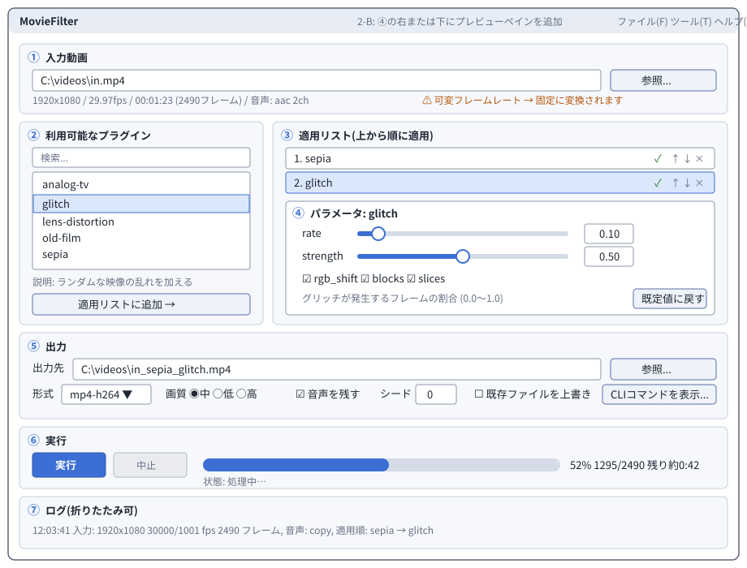
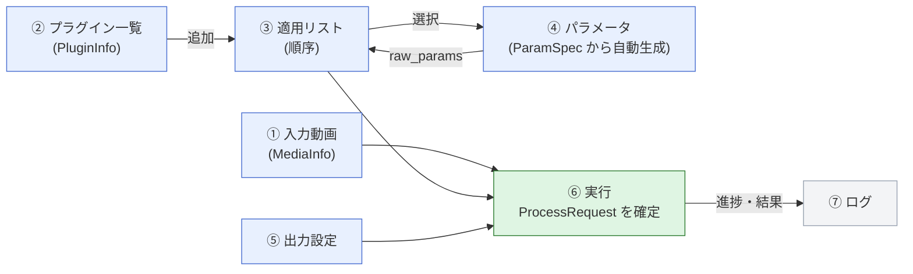
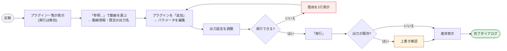
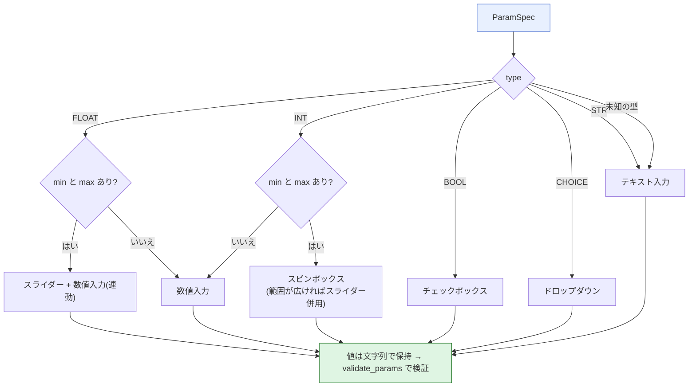
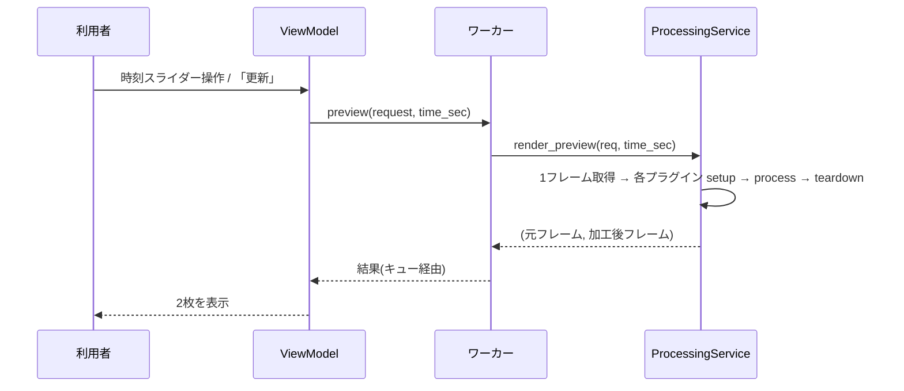
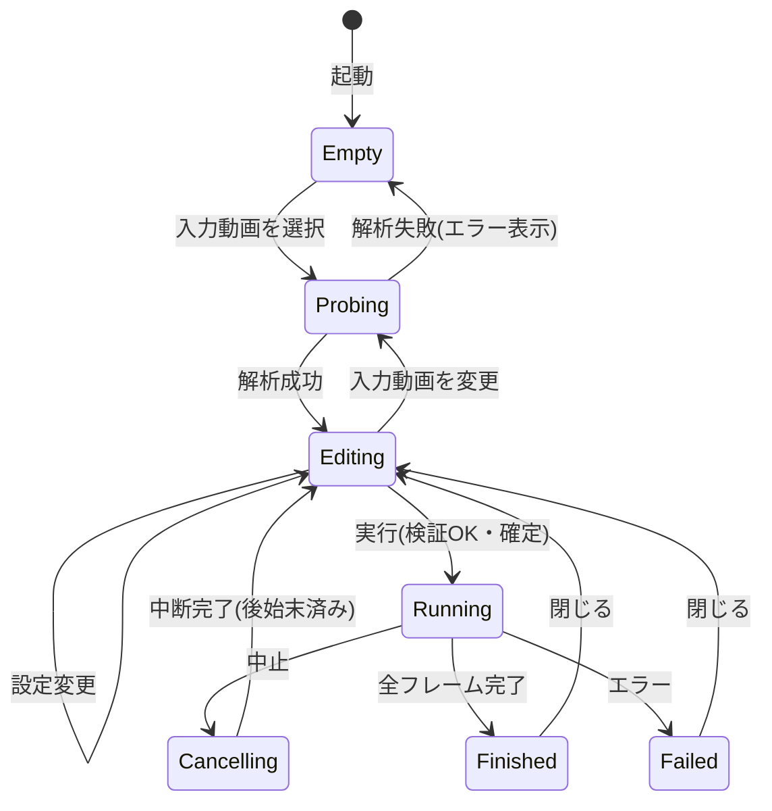
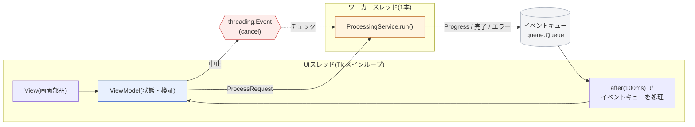
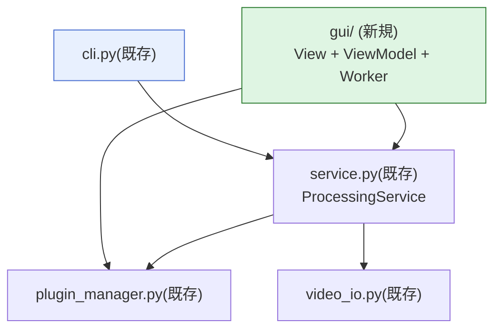

# MovieFilter GUI 設計書

| 項目 | 内容 |
|---|---|
| 文書名 | MovieFilter GUI 設計書 |
| 版 | 0.4(ドキュメント再点検: 実装の現状に合わせて更新) |
| 作成日 | 2026-11-15 |
| 対象要件 | FR-13「GUI で操作できる」(基本設計書 §2.1 で「将来」としていたもの) |
| 関連文書 | `docs/basic_design.md`、`docs/detailed_design.md`(特に §5.5 処理サービス層、§7 CLI)、`docs/user_manual.md` |
| フェーズ | **2-A は実装済み**(§15 に実装との対応を記す)。2-B は未着手 |

---

## 1. 目的と方針

CLI と同じ「動画 + フィルタ → 動画」の一括変換を、コマンドを覚えなくても行えるようにする GUI を追加する。
基本設計書の方針どおり、**処理本体には手を入れず、UI 層だけを追加する**(NFR-04、設計方針2)。

| 方針 | 内容 |
|---|---|
| G-1 サービス層の再利用 | GUI は CLI と同じ `ProcessingService.run()` を呼ぶ。処理ロジックを GUI 側に複製しない |
| G-2 CLI と同じ結果 | GUI で組んだ設定は「等価な CLI コマンド」として表示でき、コピーして再現できる |
| G-3 依存を増やさない | 必須依存は `numpy` のみ(詳細設計書 §14)。GUI は標準ライブラリの Tkinter を使い、追加インストールを要求しない |
| G-4 CLI を壊さない | tkinter が無い環境でも CLI は従来どおり動く(GUI モジュールは `gui` サブコマンド実行時に初めて import) |
| G-5 テスト容易性 | 画面部品(View)と状態・ロジック(ViewModel)を分け、ViewModel は GUI 無しで単体テストできる(NFR-06) |
| G-6 プラグイン追加で GUI も自動対応 | パラメータ入力欄はプラグインの `ParamSpec` から**自動生成**する。プラグイン作者は GUI 用コードを書かない |

### 1.1 対象外(第2段階 GUI では行わない)
- タイムライン編集・カット・テロップ(基本設計書 §2.3 のとおり)
- 動画のリアルタイム再生プレビュー(§6 の「静止フレームのプレビュー」は別物として扱う)
- 複数動画の一括処理(キュー機能)
- プラグインの導入・削除・配布(プラグイン置き場にファイルを置く運用は従来どおり)
- 音声エフェクト(FR-10)・フレーム間エフェクト(FR-11)の専用 UI(対応時に別途追加)

## 2. 技術選定

| 候補 | 利点 | 欠点 | 判断 |
|---|---|---|---|
| **Tkinter(標準)** | 追加依存なし。Windows の Python に同梱。Linux は `python3-tk` で導入 | 見た目が素朴。D&D は標準では不可 | **採用(推奨)** |
| PySide6 / PyQt | 見た目・機能が豊富 | 数十〜百MB超の依存。ライセンス確認が必要。配布が重い | 不採用(G-3 に反する) |
| Web UI(ローカルサーバ + ブラウザ) | 見た目の自由度が高い | サーバ・フロントの二重構成。安全面(ローカルポート)の検討が増える | 不採用 |

- **画像表示**: Tk 8.6 の `PhotoImage` は PPM/PGM/PNG データを直接受け取れるため、Pillow なしでプレビュー表示が可能(`numpy` 配列 → PPM バイト列 → `PhotoImage(data=...)`)。
- **ドラッグ&ドロップ**: 標準 Tkinter では未対応。第2段階では「参照...」ボタンとファイルダイアログのみとし、D&D は任意依存 `tkinterdnd2` が導入されている場合のみ有効にする(§11 の確認事項)。
- **Python / OS**: Python 3.11+、Windows / Linux(WSL は WSLg 等の表示環境が必要)。環境の tkinter は動作確認済み(Tk 8.6)。

## 3. 要件

### 3.1 機能要件

| ID | 要件 | 段階 | 対応する CLI 機能 |
|---|---|---|---|
| GUI-01 | 入力動画をファイルダイアログで選択でき、選択直後に動画情報(解像度・fps・長さ・音声の有無・VFR か)を表示する | 2-A | `Prober` |
| GUI-02 | 利用可能なプラグインを一覧表示し、名前・説明・バージョンを確認できる。読み込みに失敗したプラグインはその理由を表示する | 2-A | `list` / `info` |
| GUI-03 | プラグインを「適用リスト」に追加・削除・並べ替えできる(同じプラグインを複数回追加できる) | 2-A | `-p` の繰り返し |
| GUI-04 | 適用リストで選んだプラグインのパラメータを、型に応じた入力部品(スライダー・チェック等)で編集できる。範囲外・不正値は入力時点で指摘する | 2-A | `-p name:key=val` |
| GUI-05 | 出力先ファイル・出力プロファイル・画質・音声の有無・シード・上書きを指定できる。出力先の既定は CLI と同じ(`<入力名>_<フィルタ名>.mp4`。`service.default_output_path` を共用し、適用リストの変更に追従する) | 2-A | `-o` `--profile` `--quality` `--no-audio` `--seed` `--overwrite` |
| GUI-06 | 「実行」で処理を開始し、進捗バー・処理済みフレーム数・経過時間・残り時間の目安を表示する。処理中も画面は固定せず操作に応答する | 2-A | FR-06 |
| GUI-07 | 「中止」で安全に中断できる(中途半端な出力ファイルを残さない) | 2-A | FR-07 / Ctrl+C |
| GUI-08 | エラーはエラーコード・メッセージ・対処(`detail`)を分かりやすく表示する。フィルタ実行中の例外はフレーム番号・プラグイン名つきで表示する | 2-A | 終了コード 2/3 |
| GUI-09 | 完了時に出力ファイルの場所を示し、「フォルダを開く」「ファイルを開く」ができる | 2-A | — |
| GUI-10 | 現在の設定に相当する CLI コマンドを表示・コピーできる | 2-A | G-2 |
| GUI-11 | 出力ファイルが既存の場合、確認ダイアログで上書きの可否を選べる(CLI は確認せずエラーにするが、GUI は対話的であるため確認を出す) | 2-A | `--overwrite` |
| GUI-12 | 静止フレームのプレビュー:入力動画の任意の時刻の1フレームに、現在の適用リストを掛けた結果を「元 / 加工後」で見比べられる | 2-B | (新規) |
| GUI-13 | 設定(適用リスト・出力設定)をプリセットとして保存・読み込みできる | 2-B | (新規) |
| GUI-14 | 設定ダイアログで FFmpeg のパス、プラグインの追加ディレクトリ、既定の画質を変更できる | 2-B | `config.toml` |
| GUI-15 | 動画ファイルのドラッグ&ドロップに対応する(任意依存がある場合のみ) | 2-B | — |

段階: **2-A** = GUI の最初のリリースで実装する範囲 / **2-B** = 続けて追加する範囲(2-A の画面構成を変えずに足せるよう設計する)。

### 3.2 非機能要件

| ID | 要件 | 方針 |
|---|---|---|
| GUI-N1 応答性 | 処理中も画面が固まらない | 処理はワーカースレッドで実行。進捗は UI スレッドへ**キュー経由**で渡し、画面更新は 100〜200ms 周期に間引く(サービス層の通知間隔 0.2 秒と同じ) |
| GUI-N2 安全性 | 処理中に設定を変えて実行内容が食い違わない | 実行開始時に設定を `ProcessRequest` として**確定(スナップショット)**し、処理中は設定欄を無効化する |
| GUI-N3 性能 | 処理速度が CLI より劣化しない | 進捗表示以外の負荷をかけない。プレビューは処理中は無効 |
| GUI-N4 信頼性 | GUI を閉じても出力・一時ファイルが壊れない | 処理中に閉じる操作は「中止して閉じる」確認を挟み、中断完了(後始末)を待ってから終了 |
| GUI-N5 可搬性 | Windows / Linux で同じ操作 | OS 依存部(フォルダを開く等)は 1 モジュールに隔離 |
| GUI-N6 言語 | 表示は日本語 | 文言は 1 ファイルに集約(将来の多言語化に備える。第2段階は日本語のみ) |

## 4. 画面設計

### 4.1 画面構成(メインウィンドウ 1 枚 + ダイアログ)

ウィンドウは縦に「入力 → 加工 → 出力 → 実行」の順に並べ、操作の流れが上から下へ一方向になるようにする。



*図 4-1 メインウィンドウ(丸数字は §4.2 の領域番号に対応)*

領域どうしのデータの流れ:



2-B で追加する要素(2-A の画面構成を崩さない位置に確保しておく):
- ④ の右(または下)に **プレビューペイン**(元 / 加工後の2枚と、時刻スライダー、「更新」ボタン)。
- メニュー「ファイル」にプリセットの保存・読み込み、「ツール」に設定ダイアログ。

### 4.2 各領域の仕様

| 領域 | 部品 | 仕様 |
|---|---|---|
| ① 入力動画 | 入力欄+参照ボタン+情報ラベル | 選択直後に `Prober.probe()` を**ワーカースレッドで**実行(長尺・ネットワークドライブでも画面を固めない)。失敗時はエラーコード付きで情報ラベルに赤字表示し、実行を無効のままにする。VFR は警告表示(制約事項 §2.4) |
| ② プラグイン一覧 | リスト+検索欄+説明欄 | 起動時に `PluginManager.discover_all()` の結果を表示。`MediaKind.AUDIO` のプラグインは**グレー表示・追加不可**(「音声プラグインは現在適用できません」と理由をツールチップ表示)。読み込み失敗(`PluginLoadIssue`)は一覧の末尾に警告行として表示し、クリックで理由を表示。ダブルクリックまたは「追加」で適用リストへ |
| ③ 適用リスト | リスト+並べ替えボタン | 順序が処理順。ドラッグでの並べ替えは 2-B。同一プラグインの複数追加を許可(CLI の `-p` 繰り返しと同じ)。行ごとに入力検証の状態(✓/⚠)を表示 |
| ④ パラメータ | 自動生成フォーム | §5 参照。選択行が変わるとフォームを切り替え、**各行の入力値は保持**する |
| ⑤ 出力 | 各種入力部品 | 形式は `ProfileRegistry.names()`、画質は `QUALITIES`。出力先は入力選択時に既定名を自動入力(ユーザーが一度手で編集したら、以後は入力を変えても上書きしない)。形式の拡張子と出力先の拡張子が食い違う場合は即時に指摘 |
| ⑥ 実行 | ボタン+進捗バー | 状態に応じた有効/無効は §7.1 の表。進捗は `Progress` の `frames_done / total_frames`。`total_frames` が不明(None)のときは不確定(往復)バーにし、フレーム数と経過時間のみ表示 |
| ⑦ ログ | テキスト(読み取り専用) | 既存の `logging`(`moviefilter.*`)を GUI 用ハンドラでここへ流す。既定は折りたたみ。エラー時は自動展開 |

### 4.3 ダイアログ

| ダイアログ | 内容 |
|---|---|
| 上書き確認 | 「出力ファイルが既に存在します。上書きしますか?」[上書きして実行][キャンセル]。「上書き」を選んだときだけ、その実行に限り `overwrite=True` とする(チェック欄と別。GUI-11) |
| エラー | 見出し=メッセージ、本文=`detail`(対処)、[詳細を表示]でエラーコードとフレーム番号・プラグイン名。[ログをコピー] |
| 完了 | 「完了しました」+ 出力パス・処理フレーム数・所要時間。[フォルダを開く][ファイルを開く][閉じる] |
| 中止確認(閉じる時のみ) | 処理中にウィンドウを閉じようとした場合。[中止して閉じる][続ける] |
| CLI コマンド表示 | 現在設定と等価な `moviefilter apply ...` を表示。[コピー]。パスに空白があれば引用符を付与 |
| 設定(2-B) | FFmpeg / FFprobe のパス、プラグイン追加ディレクトリ、既定の画質・形式。保存先は既存の `config.toml`(§8.3) |

### 4.4 操作の流れ(基本シナリオ)



「実行」は、**入力が読め・適用リストが 1 つ以上あり・全パラメータが有効・出力先が有効**になった時点で有効になる(§7.2)。無効のときは、ボタン横に「なぜ実行できないか」を1行で表示する。

## 5. パラメータ入力欄の自動生成(G-6)

`ParamSpec`(`name / type / default / description / min / max / choices`)から入力部品を決める。




| `ParamType` | 条件 | 入力部品 | 備考 |
|---|---|---|---|
| `FLOAT` | `min` と `max` あり | スライダー + 数値入力(連動) | 刻みは `(max-min)/100` を既定、数値入力は任意の小数を許可 |
| `FLOAT` | 範囲なし | 数値入力のみ | |
| `INT` | `min` と `max` あり | スピンボックス(範囲が広い場合はスライダー併用) | |
| `INT` | 範囲なし | 数値入力のみ | |
| `BOOL` | — | チェックボックス | |
| `CHOICE` | `choices` あり | ドロップダウン(読み取り専用) | |
| `STR` | — | テキスト入力 | |

- ラベルは `name`、補足は `description` を入力部品の下(またはツールチップ)に表示。`min`/`max` は説明に併記する(例: `0.0〜1.0`)。
- 各部品の横に「既定値に戻す」(`default` へ)を用意する。既定値のままのパラメータは CLI コマンド表示(GUI-10)から**省略**して短くする。
- **検証は `PluginManager` の既存ロジックに任せる**:GUI は値を**文字列(`raw_params: dict[str, str]`)**として保持し、`validate_params()` を呼んで結果(エラー文)をそのまま入力欄の下に表示する。型変換・範囲判定の規則を GUI 側に複製しない(CLI との結果の食い違いを防ぐ)。
- スライダーは範囲内の値しか作れないが、数値入力に範囲外を打ち込めるので、検証は常に行う。
- 未知の `ParamType` が将来追加された場合は、テキスト入力にフォールバックして `validate_params` に検証を任せる(NFR-04 の趣旨:プラグイン API の拡張で GUI が壊れない)。

## 6. 静止フレームのプレビュー(GUI-12、段階 2-B)

「リアルタイムプレビューは対象外」(基本設計書 §2.3)との整合のため、再生ではなく**指定した 1 フレームだけを加工して表示**する機能として位置づける。



- サービス層に**追加**する関数(§8.1):FFmpeg で指定時刻の 1 フレームだけをデコードし、現在の適用リストを順に通す。**既存の公開 API は変更しない**。
- 自動更新はしない(「更新」ボタン、または値の変更後 600ms の無操作で更新)。連続操作中は古い要求を破棄する(最新のみ実行)。
- 処理(`run`)中は無効化する(GUI-N3)。
- **制約として明記する**:フレームを跨いで状態を持つプラグイン、将来の前後フレーム参照プラグイン(FR-11)は、1 フレーム単独では本番の出力と一致しないことがある。ランダム性のあるプラグインは `seed` とフレーム番号が本番と同じになるよう、**表示時刻に対応するフレーム番号**を `FrameContext.index` に渡す。
- 表示用に大きな動画は縮小する(長辺 960px 程度。縮小は表示用コピーに対してのみ行い、プラグインには原寸を渡す)。

## 7. 状態管理

### 7.1 アプリケーション状態



| 状態 | 設定欄 | 実行 | 中止 | 備考 |
|---|---|---|---|---|
| Empty | 入力のみ有効 | 無効 | 無効 | 動画未選択 |
| Probing | 無効 | 無効 | 無効 | 動画情報の取得中(数百ms) |
| Editing | 全て有効 | 条件を満たせば有効 | 無効 | |
| Running | **全て無効** | 無効 | 有効 | 設定はスナップショット済み(GUI-N2) |
| Cancelling | 全て無効 | 無効 | 無効 | 「中止しています…」。後始末の完了を待つ |
| Finished / Failed | — | — | — | ダイアログ表示後に Editing へ。適用リストなどは保持する |

### 7.2 スレッドモデル



- **Tk のウィジェットはワーカースレッドから一切触らない**(Tkinter はスレッドセーフでない)。ワーカー → UI の通信は `queue.Queue` のみ。UI は `after()` で定期的にキューを取り出して反映する。
- ワーカーは 1 本のみ。処理中は新しいジョブを受け付けない(キューは対象外)。動画情報の取得(Probing)・プレビューも同じワーカーで直列に実行し、同時実行しない。
- `ProcessingService.run(req, on_progress, cancel)` の `on_progress` はワーカー側で呼ばれるため、そこでは**キューへ積むだけ**にする。
- 例外は `MovieFilterError`(`code / message / detail`)を原則とし、それ以外の予期しない例外は「内部エラー」としてトレースバックをログに出し、エラーダイアログに「ログをコピー」を出す。
- 中止:`cancel.set()` → サービス層が次のフレーム境界で `CancelledError` → 一時ファイル削除・`teardown` → キューへ「中断完了」。**GUI からプロセスを強制終了しない**(後始末を保証するため)。

## 8. ソフトウェア構成

### 8.1 層構成と追加するもの



GUI は、CLI と同様に UI 層に位置する。**2-A では既存モジュールの変更を最小限**にする方針とし、実際の変更は `validate_request` の公開(改名のみ)、エラーコード `E_GUI_UNAVAILABLE`、`gui` サブコマンドだけだった:

| GUI が必要とする機能 | 既存の対応物 | 追加の要否 |
|---|---|---|
| 動画情報の取得 | `Prober(tools.ffprobe).probe(path)` / `resolve_tools()` | 不要(GUI から直接呼ぶ) |
| プラグイン一覧・失敗理由 | `PluginManager.discover_all()` → `(infos, issues)` | 不要 |
| パラメータ検証 | `plugin_manager.validate_params(cls, raw)` | 不要 |
| 処理の実行・進捗・中止 | `ProcessingService.run(req, on_progress, cancel)` | 不要 |
| 出力プロファイル・画質 | `ProfileRegistry.names()` / `QUALITIES` | 不要 |
| 設定の読み込み | `load_config()` | 不要 |
| 実行前の事前検証(出力先の衝突など)のみを行う | `ProcessingService.validate_request(req)`(旧 `_validate` を公開) | **実施済み**:改名のみ。`run()` もこれを呼ぶ。挙動は不変 |
| 静止フレームのプレビュー(2-B) | なし | **追加**:`render_preview(req, time_sec)`(新規メソッド。既存 API は不変) |
| 設定ファイルの書き込み(2-B) | `load_config()` のみ(読み取り専用) | **追加**:`save_config()` |

> 上記の「追加」は**いずれも後方互換な追加**であり、プラグイン API(`API_VERSION`)や CLI の挙動には影響しない。2-A の `validate_request` 公開化だけは既存コードの軽微なリファクタになるため、実装時にテストで挙動不変を確認する。

### 8.2 モジュール構成(案)

```
src/moviefilter/
├─ cli.py                    既存。`gui` サブコマンドを追加(§9)
└─ gui/                      新規
   ├─ __init__.py            main(): tkinter の有無を確認して起動
   ├─ app.py                 メインウィンドウの組み立て(View の配置)と run_gui()
   ├─ viewmodel.py           状態・検証・ProcessRequest の組み立て(tkinter 非依存)
   ├─ worker.py              ワーカースレッドとイベントキュー(tkinter 非依存)
   ├─ param_form.py          ParamSpec → 入力部品の自動生成(View)
   ├─ param_kind.py          ParamSpec → 入力部品の種別の決定(tkinter 非依存)
   ├─ state_store.py         ウィンドウサイズ・最後に開いたフォルダの保存(§8.4)
   ├─ dialogs.py             上書き確認・エラー・完了・設定など
   ├─ cli_text.py            設定 → 等価な CLI コマンド文字列(tkinter 非依存)
   ├─ strings.py             表示文言の集約(GUI-N6)
   └─ platform_utils.py      フォルダ/ファイルを開く等の OS 依存処理(GUI-N5)
```

**tkinter 非依存**とするモジュール(`viewmodel` / `worker` / `cli_text`)に、画面を持たないテスト可能なロジックを集約する(G-5)。`app.py` / `param_form.py` / `widgets.py` / `dialogs.py` は薄い View とする。

### 8.3 ViewModel の責務

| 項目 | 内容 |
|---|---|
| 保持する状態 | 入力パス・`MediaInfo`・適用リスト(`[{plugin_name, raw_params}]`)・出力設定・アプリ状態(§7.1)・実行進捗 |
| 提供する操作 | 入力設定、プラグイン追加/削除/移動、パラメータ更新、出力設定変更、`start()`、`cancel()` |
| 派生する情報 | 「実行できるか」と「できない理由」、各行の検証エラー、等価な CLI コマンド、出力先の既定名 |
| 通知 | 状態変化を View に伝えるコールバック(View は購読するだけで、ロジックを持たない) |
| 変換 | 適用リストと出力設定 → `ProcessRequest`(`PluginSpec(name, raw_params)` の配列) |

### 8.4 設定・プリセットの保存

| 対象 | 保存先 | 形式 | 段階 |
|---|---|---|---|
| ツールパス・プラグイン追加ディレクトリ・既定値 | 既存の `config.toml`(CLI と共有) | TOML(既存の `[tools]` `[plugins]` `[defaults]`) | 2-B |
| プリセット(適用リスト + 出力設定) | 利用者が選んだ場所(拡張子 `.mfpreset`) | JSON | 2-B |
| ウィンドウサイズ・最後に開いたフォルダ | GUI 専用の状態ファイル(設定ディレクトリ配下) | JSON | 2-A |

- プリセットには**入力動画のパスと出力先は含めない**(使い回しのため)。`{"version": 1, "plugins": [{"name": "sepia", "params": {"intensity": "0.8"}}], "output": {"profile": ..., "quality": ..., "keep_audio": ..., "seed": ...}}`。
- 読み込み時に存在しないプラグイン・不正なパラメータは、**黙って捨てずに**一覧で警告し、有効な部分だけ読み込む(設計方針5)。
- `config.toml` の書き込みは、既存のコメントを失わせうるため、2-B で方式(書き換えか、GUI 専用の別ファイルか)を決める(§11)。

## 9. 起動方法

| 方法 | 内容 |
|---|---|
| `moviefilter gui` | `cli.py` にサブコマンドを追加。内部で `moviefilter.gui.main()` を遅延 import |
| 起動用スクリプト | 既存の `moviefilter` / `moviefilter.cmd` から同じ `gui` サブコマンドを使える。Windows でコンソール窓を出さないダブルクリック起動用に、`moviefilter-gui.cmd` を追加した(`pyw -3`、なければ `pythonw` を**フルパスで解決**して `start` で起動。`MOVIEFILTER_PYTHON` で上書き可。詳細設計書 §2.2)。コンソールがなく標準エラーが見えないため、前提不足(Python 3.11 未満・NumPy なし)は `__main__.py` がダイアログで知らせる |
| インストール後 | `pyproject.toml` の `[project.gui-scripts]` に `moviefilter-gui = moviefilter.gui:gui_main` を追加した(Windows でコンソール窓を出さない。エラーはダイアログで通知) |

- tkinter が無い環境では、`gui` サブコマンドが「GUI には tkinter が必要です」と**導入手順つき**で終了する(終了コード 2、エラーコード `E_GUI_UNAVAILABLE` を新設)。CLI の他のサブコマンドには影響しない。
- 起動時に FFmpeg が見つからない場合は、メインウィンドウは開き、**画面上部に警告バナー**(導入手順)を出して入力選択を無効にする(CLI の `E_FFMPEG_NOT_FOUND` と同じ案内文を再利用)。

## 10. エラー表示の対応

`MovieFilterError.code` に応じて、GUI での見せ方を決める。

| 区分 | エラーコード(例) | GUI での扱い |
|---|---|---|
| 入力 | `E_INPUT_NOT_FOUND` `E_NO_VIDEO_STREAM` `E_PROBE_FAILED` | ① の情報欄に赤字表示。実行は無効 |
| 出力先 | `E_OUTPUT_EXISTS` | 上書き確認ダイアログ(GUI-11)。他(`E_OUTPUT_SAME_AS_INPUT` `E_OUTPUT_EXT_MISMATCH` `E_OUTPUT_DIR_INVALID`)は ⑤ の該当欄に赤字表示 |
| プラグイン/パラメータ | `E_PARAM_INVALID` `E_PARAM_RANGE` `E_PARAM_UNKNOWN` `E_PLUGIN_NOT_FOUND` | ④ の該当入力欄の下に表示(入力時点で検出)。実行は無効 |
| 未対応 | `E_PLUGIN_KIND_UNSUPPORTED` `E_TEMPORAL_UNSUPPORTED` | 一覧で追加不可にする(§4.2)ため通常は発生しない。発生時はエラーダイアログ |
| 実行時 | `E_DECODE_FAILED` `E_ENCODE_FAILED` `E_NO_FRAMES` `E_PLUGIN_BAD_OUTPUT` `E_PLUGIN_RUNTIME` | エラーダイアログ。`E_PLUGIN_RUNTIME` はプラグイン名とフレーム番号を見出しに出す |
| ツール | `E_FFMPEG_NOT_FOUND` | 警告バナー(§9) |
| 設定 | `E_CONFIG_INVALID` | 起動時にダイアログで通知し、既定値で起動する |
| 中断 | `E_CANCELLED` | エラーとして扱わず、「中止しました(出力は作成されていません)」と状態欄に表示 |

## 11. 確認事項と決定

> 利用者から「設計に即して実装に進む」との指示があったため、**推奨案をすべて採用**して 2-A を実装した(✅)。2-B に関わる項目は 2-B の着手時に再確認する。

| # | 確認内容 | 推奨(採用) |
|---|---|---|
| Q-1 | GUI のツールキットは標準 Tkinter でよいか(見た目より依存の少なさを優先) | Tkinter ✅ |
| Q-2 | リリース範囲:最初は 2-A(プレビューなし)でよいか。プレビュー(GUI-12)を最初から含めるか | 2-A → 2-B の順 ✅ |
| Q-3 | 「リアルタイムプレビューは対象外」(基本設計書 §2.3)に対し、**静止フレームのプレビュー**は範囲内としてよいか(§2.3 に注記を追記する) | 範囲内とし、注記を追記 ✅ |
| Q-4 | D&D のために任意依存 `tkinterdnd2` を許容するか | 許容(無くても動く) ✅ |
| Q-5 | Windows 向けのコンソール窓なし起動(`moviefilter-gui.cmd` / gui-scripts)を提供するか | 提供する ✅ |
| Q-6 | 設定ダイアログからの `config.toml` 書き込み方式(既存ファイルを書き換える / GUI 専用の別ファイルにする) | GUI 専用の別ファイル(既存コメントを壊さない) ✅ |
| Q-7 | 出力先が既存のとき、GUI では確認ダイアログを出す(CLI は出さない)方針でよいか | 出す(GUI は対話的であるため) ✅ |
| Q-8 | `validate_request` の公開化(`service.py` の軽微なリファクタ)を許容するか | 許容(挙動不変・テストで担保) ✅ |

## 12. テスト計画

| 区分 | 対象 | 内容 |
|---|---|---|
| 単体(GUI 不要) | `viewmodel` | 状態遷移(§7.1 の全遷移)、「実行できるか/理由」の判定、`ProcessRequest` の組み立て、出力先の既定名と手動編集後の保持、適用リストの追加・削除・並べ替え |
| 単体(GUI 不要) | `worker` | ダミーのサービスで、進捗がキュー経由で届くこと、中止が `cancel` に伝わること、例外が `MovieFilterError` / 内部エラーに分類されること、UI へ直接触れないこと |
| 単体(GUI 不要) | `cli_text` | 既定値の省略、空白を含むパスの引用、**生成した文字列を `parse_plugin_spec` で解析し直すと元の設定と一致すること**(往復テスト) |
| 単体 | パラメータ検証 | 同梱 5 プラグインの全 `ParamSpec` について、入力部品の種別が §5 の表どおりに決まること(部品を作らずに「種別の決定関数」のみをテスト) |
| 単体 | プリセット(2-B) | 保存 → 読み込みの往復、存在しないプラグイン・不正値の警告 |
| 結合 | 実処理 | `ffmpeg` マーカー付き。ViewModel + 実サービスで短い動画を処理し、出力が CLI の同条件の出力と**フレーム単位で一致**すること |
| 結合 | 中止 | 処理中に `cancel` → 出力・一時ファイルが残らないこと |
| GUI 起動 | スモーク | tkinter と表示環境がある場合のみ、メインウィンドウを生成して破棄できること(CI など表示環境が無い場合はスキップ) |
| 手動 | 画面確認 | Windows と WSL(WSLg)で、§4.4 の基本シナリオ、長いファイル名・日本語パス、画面縮小時のレイアウト、処理中の応答性、処理中にウィンドウを閉じる操作 |

## 13. 実装時の注意
- Tkinter のウィジェットは UI スレッド以外から操作しない(§7.2)。ワーカーからのコールバックでは必ずキューに積む。
- GUI のために `service.py` / `plugin_api.py` に**破壊的変更をしない**(§8.1)。追加はすべて後方互換とする。
- 型変換・範囲検証の規則は GUI に複製せず、`PluginManager` の検証関数を呼ぶ(§5)。
- ViewModel / worker / cli_text は `import tkinter` をしない(G-5。単体テストを表示環境なしで実行するため)。
- 表示文言は `strings.py` に集約し、画面部品に直書きしない(GUI-N6)。
- ドキュメント(`docs/user_manual.md`、`docs/basic_design.md`、`docs/detailed_design.md`、`README.md`)は GUI の実装に合わせて更新済み。仕様を変えるときは、本書と取扱説明書の GUI の章(§3〜§4)を一緒に更新する。

## 14. 今後の進め方
1. ~~本書のレビュー・承認~~ → 済(§11 の推奨案をすべて採用)
2. ~~2-A の実装(`viewmodel` / `worker` / `cli_text` とテスト → View → `gui` サブコマンド)~~ → 済(§15)
3. ~~CLI・GUI のレビューと修正~~ → 済(§16、`review_log.md` 第4回)
4. **Windows での手動確認**(§12 の「手動」。未実施)
5. 2-B の実装(プレビュー、プリセット、設定ダイアログ、D&D。プラグインの再読み込みボタンもここで検討する)
6. ~~ドキュメント更新(取扱説明書・基本設計書)~~ → 済

## 15. 実装との対応(2-A)

| 設計 | 実装 | 備考 |
|---|---|---|
| GUI-01〜11 | `src/moviefilter/gui/` | 下表のとおり。GUI-12〜15 は 2-B(未実装) |
| `validate_request` の公開化(§8.1) | `service.py` | 旧 `_validate` の改名のみ。挙動は不変(既存 219 件のテストが通ることで確認) |
| `E_GUI_UNAVAILABLE`(§9) | `errors.py`(終了コード 2) | tkinter が無い、または表示環境がない場合 |
| `gui` サブコマンド | `cli.py` | `moviefilter gui [--config FILE] [-v]` |
| `moviefilter-gui`(コンソールなし) | `pyproject.toml` の `gui-scripts`、`moviefilter-gui.cmd` | エラーはダイアログで通知 |

| モジュール | 責務 | tkinter |
|---|---|---|
| `viewmodel.py` | 状態遷移(§7.1)、実行可否と理由、`ProcessRequest` の組み立て、パラメータ検証の呼び出し、表示用の整形 | 不要 |
| `worker.py` | ワーカースレッド 1 本、イベントキュー、エラー分類(`ErrorInfo`) | 不要 |
| `cli_text.py` | 設定 → 等価な CLI コマンド(既定値は省略) | 不要 |
| `param_kind.py` | `ParamSpec` → 入力部品の種別 | 不要 |
| `param_form.py` / `dialogs.py` / `app.py` | 画面(View) | 必要 |
| `strings.py` / `platform_utils.py` / `state_store.py` | 文言、OS 依存処理、状態ファイル | 不要(`strings` 等) |

**設計からの差分・実装時の判断**
- **適用リストの「値」の持ち方**:`PluginEntry.values` には「既定値と異なる、または不正な入力」だけを文字列で保持する。既定値と同じ値を入力すると保持から外れ、CLI コマンドが短くなる(§5)。
- **出力先の `-o`**:GUI は出力先を常に決めるため、表示する CLI コマンドには常に `-o` が付く(省略しない)。
- **スクロール**:パラメータが多いプラグイン(例: `glitch` は 5 個)でも収まるよう、④ は縦スクロール領域にした(設計の「領域」は変えていない)。
- **進捗が不明なとき**:`total_frames` が None の場合は不確定(往復)バーにする(§4.2)。
- **完了・エラーのダイアログ**:`pump` の中から直接開かず、`after(0)` で次のイベントループに回す(入れ子のイベントループで `pump` が再入するのを避ける)。
- **ツール不在**:FFmpeg が無いときは、起動時に警告バナーを出し、入力選択を無効にする(`E_FFMPEG_NOT_FOUND` と同じ案内文)。

**テスト(`tests/test_gui_*.py`)**
- `test_gui_logic.py`:`cli_text`(**生成した文字列を実際の CLI パーサで解析し直す往復テスト**を含む)、`param_kind`(同梱 5 プラグインの全パラメータ)、`worker`(進捗・中止・エラー分類・二重実行の拒否)、tkinter 無し環境での `gui` サブコマンド。
- `test_gui_viewmodel.py`:状態遷移、実行可否の理由、パラメータ検証、既定名の保持、上書き確認、**GUI で処理した出力が CLI と同条件の出力とフレーム単位で一致**すること、処理中の中止で出力・一時ファイルが残らないこと、プラグインの例外がプラグイン名・フレーム番号つきで伝わること。
- `test_gui_smoke.py`:メインウィンドウの生成、全プラグインのフォーム生成、処理中の設定欄の無効化(表示環境が無ければスキップ)。
- 手動確認が必要な項目(§12 の「手動」)のうち、**Windows での確認は未実施**。Linux(WSL)の仮想ディスプレイ上で、起動・動画選択・プラグイン追加・パラメータ検証・実行・上書き確認・完了までの動作を確認した。

## 16. リソース面の改善(第4回レビュー、`review_log.md` R-17〜R-20)

| 項目 | 内容 |
|---|---|
| フォームの作り直し | `ParamForm.destroy()` で `trace_add` を解除する。解除しないと、選択を切り替えるたびに Tcl 変数が残り続ける(実測: 300 回で 44 → 1184 個、GC でも回収されない)。修正後は 27 個のまま増えない |
| 実行可否の判定 | `ViewModel.check()` は、メモリ上で決まる検査(パラメータ・シード・適用リスト)を毎回行い、**ファイルシステムを見る検査**(入力の存在・出力先・既存ファイル)は、入力・出力・形式・画質・上書きが同じなら前回の結果を使い回す。スライダー操作のたびに遅いドライブへ問い合わせない。`start()` と「実行」ボタンは `check(fresh=True)` で必ず確かめ直す。処理の完了・失敗の通知でキャッシュは捨てる |
| ログ | `logbuf.py`:取り込み待ちのキューは最大 5000 行(超過分は捨てて「N 行を省略」と表示)、1 回の取り込みは 500 行まで、画面と保持は直近 2000 行まで |
| 重複処理 | `ffmpeg -version` は同じパスなら 1 プロセスに 1 回。プラグインはマネージャの寿命のあいだ 1 回だけロード。`ViewModel.reload_plugins()` はキャッシュを捨てて読み直す |

プラグインのファイルを GUI の起動後に書き換えても、再読み込み(`reload_plugins()`)をしない限り反映されない。起動時の一覧と実行時のクラスは常に同じものになる。
