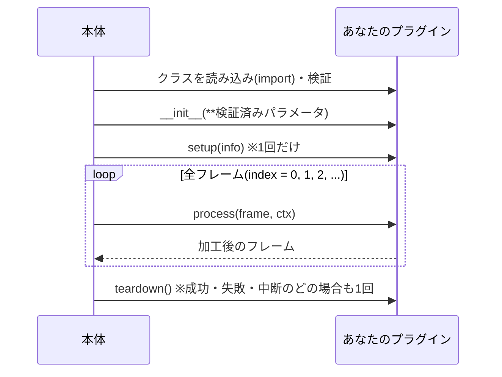
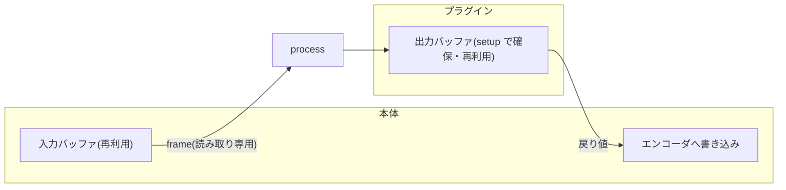

# MovieFilter プラグイン作成ガイド

| 項目 | 内容 |
|---|---|
| 対象読者 | MovieFilter 本体のソースを読まずに、フィルタプラグインだけを作る人 |
| 対象 API | プラグイン API 1.0(`requires_api = (1, 0)`) |
| 根拠文書 | `docs/detailed_design.md` v0.5(§3 公開API、§5.1 プラグイン管理) |
| 関連ファイル | ひな形: `templates/plugin_template.py` |
| 注記 | 本書は実装前の設計に基づく。例外メッセージなどの文言は実装時に変わりうるが、エラーコード・API の契約は本書のとおり |

このガイドだけで、プラグインの設計・実装・テスト・配布までできるように書いています。急ぐ場合は §1〜§2、§6〜§7 を読めば最初のプラグインを作れます。

---

## 1. プラグインとは

プラグインは「動画の1フレームを受け取り、加工した1フレームを返す」部品です。本体が動画の読み込み・書き出し・音声の引き継ぎ・進捗表示・エラー処理をすべて行うため、作者は**エフェクトの計算だけ**を書けば完成します。


**できること(第1段階)**
- 映像の1フレームごとの加工(色調整、ぼかし、ノイズ、モザイク など)
- 過去のフレームを覚える加工(残像、時間方向の平均 など。§9)
- 乱数を使う加工(§10。同じ `--seed` なら同じ結果になる)
- パラメータの受け取り(型・範囲の検証は本体が行う)

**できないこと(第1段階)** — 詳細は §14
- 音声の加工(音声プラグイン)
- 前後のフレームをまとめて参照する加工(未来フレームの先読みなど)
- フレームのサイズ(解像度)の変更
- 1回の実行中に複数のプラグインへまたがる情報の受け渡し

## 2. 5分で作る(手順)

1. ひな形 `templates/plugin_template.py` を、プラグイン名に合わせたファイル名でコピーします。
   例: `film_grain.py`(プラグイン名 `film-grain` または `film_grain`)
2. ファイル内の「★ 書き換える」箇所(クラス名、`name`、`description`、`params`)を編集します。
3. 「★ エフェクト処理」の箇所に、`out`(出力バッファ)を加工するコードを書きます。
4. プラグイン置き場(§4.1)にファイルを置きます。
5. 確認します。
   ```
   moviefilter list                                   # 一覧に表示される
   moviefilter info film_grain                        # パラメータが正しく表示される
   moviefilter apply sample.mp4 -p film_grain --quality low
   ```

ひな形は**何も加工しない状態でも動作します**。まず置いて `list` に表示されることを確認してから、エフェクトを書き足すと確実です。

## 3. 動作の仕組み(ライフサイクル)



| 呼び出し | 回数 | 内容 |
|---|---|---|
| import | `list` では毎回 / `apply` では指定したプラグインのみ | モジュールの読み込み。**重い処理や副作用を書かない**(§4.4) |
| `__init__` | 1 | 検証済みのパラメータ(`params_values`)が渡される |
| `setup(info)` | 1 | 動画の情報を受け取る。バッファ確保・テーブル作成・状態の初期化をここで行う |
| `process(frame, ctx)` | フレーム数ぶん、**index 昇順に1回ずつ** | 加工の本体 |
| `teardown()` | 1 | 後始末。`setup` が完了していなくても呼ばれうる(§6.4) |

- 1回の実行ごとに**新しいインスタンス**が作られます。インスタンスを複数の実行で使い回しません。
- `process` は**単一スレッドから順番に**呼ばれます。スレッドセーフにする必要はありません。
- 呼び出し回数を数えるより、`ctx.index` を使ってください(§8)。

## 4. 配置とファイルの規則

### 4.1 置き場所(検索順)

| 順 | 場所 | 備考 |
|---|---|---|
| 1 | 本体に同梱のプラグイン | 同名のプラグインがあれば最優先 |
| 2 | 環境変数 `MOVIEFILTER_PLUGIN_PATH` のフォルダ | Linux は `:`、Windows は `;` 区切り |
| 3 | 設定ファイル `[plugins] extra_dirs` のフォルダ | `~` は展開される |

同じ名前のプラグインが複数見つかった場合は、**先に見つかったものだけ**が使われ、後のものは警告とともに無視されます。

### 4.2 ファイル名の規則(重要)

**ファイル名(拡張子を除く)= プラグイン名の `-` を `_` に置き換えたもの**でなければなりません。一致しないとロードされません。

| プラグイン名(`name`) | ファイル名 |
|---|---|
| `sepia` | `sepia.py` |
| `film-grain` | `film_grain.py` |
| `film_grain` | `film_grain.py` |

- 名前に使える文字は `[a-z][a-z0-9_-]*`(小文字英字で始まり、小文字英数字・`_`・`-`)。
- `film-grain` と `film_grain` は同じファイル名になるため、同時には使えません。
- **1つのファイルに定義するプラグインは1つだけ**にしてください。

### 4.3 2つの形式

| 形式 | 構成 | 使いどころ |
|---|---|---|
| 単一ファイル | `<名前>.py` | 標準。外部ファイル不要のエフェクト |
| パッケージ(フォルダ) | `<名前>/__init__.py` ほか | 補助モジュールやデータファイル(LUT、テクスチャなど)が必要なとき |

パッケージ形式では、`__init__.py` にプラグインクラスを定義(または import)し、同じフォルダのモジュールを相対 import(`from . import helpers`)できます。データファイルは `Path(__file__).parent / "lut.npy"` で参照します(読み込みは `setup` で行う)。単一ファイル形式では、同じフォルダの他のファイルを import できません。

### 4.4 モジュール(ファイル)の書き方の規則

`moviefilter list` は置き場の**全プラグインを import** します。次を守ってください。

| 規則 | 理由 |
|---|---|
| import 時に重い処理(大きなファイル読み込み、ネットワーク、モデルのロード)をしない | `list` が遅くなる。データの読み込みは `setup` で行う |
| import 時に `print`・ファイル書き込み・環境の変更をしない | 副作用が出る |
| そのファイルで**定義した**クラスだけが検出される。他のプラグインのクラスを import して名前空間に置かない | 検出対象が増えて「プラグインが複数ある」状態になる |
| 抽象クラス(`abstractmethod` が残っているクラス)は検出されない。共通処理を基底クラスにまとめるのは可 | 同上 |
| 構文エラー・import 失敗があっても他のプラグインには影響しないが、`list` にロード失敗として表示される | §18 参照 |

## 5. プラグインクラスの仕様

### 5.1 最小の構成

```python
import numpy as np
from moviefilter.plugin_api import ParamSpec, ParamType, VideoPlugin

class BrightenPlugin(VideoPlugin):
    name = "brighten"
    description = "明るさを加算します"
    version = "1.0.0"
    requires_api = (1, 0)
    params = (
        ParamSpec("amount", ParamType.INT, 30, "加算する値", min=-255, max=255),
    )

    def process(self, frame, ctx):
        out = frame.astype(np.int16) + self.params_values["amount"]
        return np.clip(out, 0, 255).astype(np.uint8)
```
`from moviefilter.plugin_api import ...` が、プラグイン作者が使う**唯一の公開モジュール**です(テスト用に `moviefilter.testing` もあります。§15)。それ以外の本体モジュールは import しないでください(内部実装であり、予告なく変わります)。

### 5.2 クラス属性

| 属性 | 型 | 必須 | 説明 |
|---|---|---|---|
| `name` | str | 必須 | CLI で指定する名前。`[a-z][a-z0-9_-]*`。ファイル名と対応(§4.2) |
| `description` | str | 推奨 | `moviefilter list` に表示される1行の説明 |
| `version` | str | 推奨 | プラグイン自身のバージョン(例: `"1.0.0"`)。既定は `"0.0.0"` |
| `requires_api` | (int, int) | 必須 | 必要なプラグイン API のバージョン。**`(1, 0)` を指定する**(§14.3) |
| `params` | tuple[ParamSpec, ...] | 任意 | パラメータ定義。なければ `()`(既定) |
| `kind` | — | 設定不要 | `VideoPlugin` を継承すれば自動で映像用になる。**自分で定義しない** |
| `temporal_window` | — | 設定不要 | 将来用の予約。**定義しない**(§14) |

### 5.3 `ParamSpec`(パラメータ定義)

```python
ParamSpec(name, type, default, description="", min=None, max=None, choices=None)
```

| 引数 | 説明 |
|---|---|
| `name` | パラメータ名。`[a-z][a-z0-9_]*`。クラス内で重複不可 |
| `type` | `ParamType.INT / FLOAT / BOOL / STR / CHOICE` |
| `default` | 既定値。**その型・範囲・選択肢に合っていること**(合わないとプラグインがロードされない) |
| `description` | `moviefilter info` に表示される説明 |
| `min`, `max` | INT / FLOAT のみ。範囲外の指定はエラー(`E_PARAM_RANGE`)。`min <= max` |
| `choices` | CHOICE のみ。文字列のタプル(1つ以上)。`default` はこの中の1つ |

利用者が `-p brighten:amount=50` と書いたとき、本体が次のように変換・検証してから `params_values` に渡します。

| 型 | 利用者の書き方 | Python での値 | 変換・検証の規則 |
|---|---|---|---|
| `INT` | `amount=50` | `int` | 整数表記のみ(`1.5` はエラー)。範囲検証あり |
| `FLOAT` | `strength=0.5` / `strength=1` | `float` | 整数表記も可。範囲検証あり |
| `BOOL` | `invert=true` | `bool` | `true/false/1/0/yes/no`(大小無視) |
| `STR` | `label=abc` | `str` | **値に `,` と `=` は使えない**(CLI の制約)。空文字は `label=` で指定 |
| `CHOICE` | `channel=red` | `str` | `choices` のいずれかと完全一致(大小区別) |

- 指定されなかったパラメータは `default` で補完されます。**`params_values` には全パラメータのキーが必ず入っています**(`KeyError` を気にする必要はありません)。
- 定義にないパラメータを利用者が指定すると、本体が `E_PARAM_UNKNOWN` でエラーにします(プラグイン側の処理は不要)。
- 複数のパラメータにまたがる制約(例: `low < high`)は検証できないため、`__init__` で確認して `ValueError` を送出します(§6.1)。

### 5.4 `params_values`

`self.params_values` は `dict[str, int|float|bool|str]` です。`__init__` の後ならどこからでも読めます。毎フレーム `self.params_values["x"]` と辞書を引くのは避け、`setup` で `self._x = ...` に取り出しておくと速く、読みやすくなります。

## 6. メソッドの仕様

### 6.1 `__init__(self, **params)`

- 通常は**定義しない**でください(基底が `params_values` を設定します)。
- 追加の検証が必要な場合のみ定義します。必ず `super().__init__(**params)` を最初に呼びます。
- パラメータの組み合わせが不正なら `ValueError("low は high より小さくしてください")` のように、**利用者向けの分かりやすいメッセージ**で送出します。本体が `E_PLUGIN_INIT` として表示します。
- 重い処理(バッファ確保、ファイル読み込み)は `setup` で行います。

```python
def __init__(self, **params):
    super().__init__(**params)
    if self.params_values["low"] >= self.params_values["high"]:
        raise ValueError("low は high より小さくしてください")
```

### 6.2 `setup(self, info)`

- 処理開始前に1回呼ばれます。`info` は `VideoInfo`(§8.1)。
- ここで行うこと: 出力バッファの確保、ルックアップテーブルの作成、カーネルの準備、状態の初期化、リソースファイルの読み込み。
- **フレームサイズが必要なら `info.width` / `info.height` をここで取得して保存**します(`process` の `ctx.info` でも参照できますが、バッファはここで作るのが基本)。
- 例外を送出すると `E_PLUGIN_INIT`(処理開始前のエラー、終了コード2)になります。
- 基底の `setup` は何もしません。使わなければ定義不要です。

### 6.3 `process(self, frame, ctx)`

プラグインの本体で、**必ず実装**します。

| 項目 | 内容 |
|---|---|
| 引数 `frame` | `numpy.ndarray`、shape `(高さ, 幅, 3)`、dtype `uint8`、**RGB 順**、C 連続。**読み取り専用** |
| 引数 `ctx` | `FrameContext`(§8.2) |
| 戻り値 | `numpy.ndarray`、**入力と同じ shape**、dtype `uint8`(§7) |
| 呼び出し | フレーム 0 から順に1回ずつ、単一スレッド、前のフレームの処理が終わってから次を呼ぶ |

### 6.4 `teardown(self)`

- 成功・失敗・中断のどの場合も、処理の終了時に1回呼ばれます。
- **`setup` が完了していない状態でも呼ばれる**ことがあります(例: 他のプラグインの `setup` が失敗した場合)。`setup` で作る属性を `teardown` で触る場合は `getattr(self, "_x", None)` などで存在を確認してください。
- ここで例外を送出しても処理結果には影響せず、警告ログに記録されるだけです。
- ファイルやネットワークなどの外部リソースを閉じる用途で使います。NumPy のバッファだけなら定義不要です。

## 7. 入出力の契約(最重要)

### 7.1 フレームの形式

| 項目 | 内容 |
|---|---|
| 配列 | `(H, W, 3)` の `uint8`。値は 0〜255 |
| 色の並び | **R, G, B の順**(OpenCV の標準は B, G, R。OpenCV の関数をチャンネル順に依存して使う場合は注意) |
| 元の動画 | 10bit・HDR・アルファ付きでも、本体が 8bit RGB に変換してから渡す(アルファは渡されない) |
| 解像度 | 動画全体で一定(`setup` の `info` と同じ) |

### 7.2 入力は読み取り専用

`frame` に書き込むとエラーになります(`ValueError: assignment destination is read-only`)。これは `E_PLUGIN_RUNTIME` として報告されます。**加工は出力用のバッファに対して行い**、入力はコピー元としてのみ使います。

また、`frame` は**その `process` の呼び出し中だけ有効**です。本体は次のフレームを読むときに同じメモリを再利用します。**後のフレームで使うために `frame` への参照を保存してはいけません**。保存したいときは `frame.copy()` で複製します(§9)。

### 7.3 戻り値のルール

| ルール | 内容 |
|---|---|
| shape | **入力と同じ**。違うと `E_PLUGIN_BAD_OUTPUT`(第1段階では解像度の変更はできない) |
| dtype | `uint8`。`float` のまま返すと `E_PLUGIN_BAD_OUTPUT`。0〜255 に収めて `uint8` へ変換してから返す(はみ出した値は `np.clip` で処理。`astype` だけでは桁あふれする) |
| 型 | `numpy.ndarray`(リストや PIL 画像は不可) |
| 連続性 | C 連続が望ましい。非連続なら本体が自動でコピーする(その分遅くなる) |
| バッファの再利用 | **プラグインが保持している配列を毎フレーム使い回して返してよい**(推奨)。次の `process` が呼ばれるまで有効であれば足りる。入力 `frame` をそのまま返す(加工しない)のも可 |



### 7.4 してはいけないこと

| 禁止事項 | 理由 |
|---|---|
| 入力 `frame` の書き換え | 読み取り専用。バッファは本体が再利用する |
| 入力 `frame` への参照の保存 | 次のフレームで中身が変わる |
| `process` から返した配列を、返したあとで書き換える | 本体がまだ使っている可能性がある。**次の `process` 呼び出しの中でだけ書き換える** |
| `print` / `sys.exit` / `os._exit` / 標準出力への書き込み | 進捗表示を壊す・処理を異常終了させる |
| グローバル乱数・時刻・OS の乱数 | 再現性が失われる(§10) |
| 例外の握りつぶし | 壊れた映像が出力されるため。失敗したら例外を送出する(§12) |
| 別スレッド・別プロセスでのフレーム処理の持ち越し | `process` が戻った時点で結果が完成している必要がある |

## 8. 本体から渡される情報

### 8.1 `VideoInfo`(`setup` の引数、`ctx.info`)

| 属性 | 型 | 内容 |
|---|---|---|
| `width` | int | 幅(画素)。回転メタデータ適用後 |
| `height` | int | 高さ(画素) |
| `fps_num`, `fps_den` | int | フレームレート(分数)。例: 29.97fps は `30000`, `1001` |
| `fps` | float | `fps_num / fps_den`(プロパティ。時刻計算には `pts_sec` を使うこと) |
| `total_frames` | int \| None | 総フレーム数。**不明な場合は `None`**(フェードアウトなど、総数に依存する処理は `None` のときの動作を決めておく) |
| `duration_sec` | float \| None | 動画の長さ(秒)。不明なら `None` |

`total_frames` は概算の場合があります(可変フレームレート動画を固定フレームレートへ変換する場合など)。厳密な終端判定には使わないでください。

### 8.2 `FrameContext`(`process` の引数 `ctx`)

| 属性 | 型 | 内容 |
|---|---|---|
| `index` | int | フレーム番号(0 始まり) |
| `pts_sec` | float | 出力動画上の時刻(秒)= `index × fps_den / fps_num` |
| `info` | VideoInfo | 上の `VideoInfo`(`setup` に渡されたものと同じ) |
| `seed` | int | このフレーム・このプラグイン用の乱数シード(§10) |

`ctx` は読み取り専用です。`width` などは `ctx.width` ではなく `ctx.info.width` と書きます。

**時刻について**: `pts_sec` は変換後の固定フレームレート上の時刻です。元の動画が可変フレームレートでも、均等な間隔になります。点滅やフェードなど時間で変化する効果は、`index` か `pts_sec` から計算してください。

## 9. 状態を持つエフェクト(前のフレームを覚える)

インスタンス変数に状態を持てます。状態は `setup` で初期化します。

**守ること**
- 前のフレームを覚えたいときは、`frame` への参照ではなく**コピー**(または演算結果)を保持します。
- 状態のバッファも `setup` で確保して使い回します。
- 状態は `ctx.index == 0` から始まる前提で作ります(途中から始まることはありません)。

```python
class TrailsPlugin(VideoPlugin):
    """明るい部分が尾を引く残像効果"""
    name = "trails"
    description = "明るい部分が尾を引く残像効果"
    version = "1.0.0"
    requires_api = (1, 0)
    params = (
        ParamSpec("decay", ParamType.FLOAT, 0.8, "残像の残り具合 (大きいほど長く残る)", min=0.0, max=0.99),
    )

    def setup(self, info):
        self._decay = self.params_values["decay"]
        self._acc = np.zeros((info.height, info.width, 3), np.float32)   # 状態
        self._out = np.empty((info.height, info.width, 3), np.uint8)

    def process(self, frame, ctx):
        np.multiply(self._acc, self._decay, out=self._acc)    # 前フレームまでの残像を弱める
        np.maximum(self._acc, frame, out=self._acc)           # 現フレームと比べて明るい方を残す
        np.copyto(self._out, self._acc, casting="unsafe")     # uint8 へ変換
        return self._out
```

※ 現フレームより**未来**のフレームは参照できません(§14)。

## 10. 乱数と再現性

乱数を使うエフェクトは、**`ctx.seed` から乱数生成器を作る**ことで、同じ入力・同じ `--seed` なら同じ結果になります。

```python
rng = np.random.default_rng(ctx.seed)       # フレームごとに生成する(生成コストは小さい)
noise = rng.normal(0.0, sigma, size=frame.shape[:2]).astype(np.float32)
```

| 規則 | 内容 |
|---|---|
| 乱数の元 | `ctx.seed`(0 以上 2⁶⁴ 未満の整数)。フレームごと・プラグインの位置ごとに異なる決定的な値 |
| 使ってはいけないもの | `random` モジュール、`np.random.rand()` などのグローバル乱数、`time`、`os.urandom`、`id()`、`hash()`(文字列のハッシュは実行ごとに変わる) |
| 生成器をインスタンスに持たない | `setup` で作った生成器を使い続けると、フレームの処理順や途中経過に結果が依存してしまう。**毎フレーム `ctx.seed` から作り直す** |
| 注意 | プラグインの順序を入れ替えると `seed` が変わる。NumPy のバージョンが違うと乱数列が変わることがある(完全一致は同一環境内のみ保証) |

乱数を使わないプラグインは `ctx.seed` を無視して構いません。

```python
class GrainPlugin(VideoPlugin):
    name = "grain"
    description = "フィルムグレイン(ざらつき)"
    version = "1.0.0"
    requires_api = (1, 0)
    params = (ParamSpec("sigma", ParamType.FLOAT, 12.0, "ノイズの強さ", min=0.0, max=100.0),)

    def setup(self, info):
        self._sigma = self.params_values["sigma"]
        self._acc = np.empty((info.height, info.width, 3), np.float32)
        self._out = np.empty((info.height, info.width, 3), np.uint8)

    def process(self, frame, ctx):
        rng = np.random.default_rng(ctx.seed)
        noise = rng.normal(0.0, self._sigma, size=frame.shape[:2]).astype(np.float32)
        np.add(frame, noise[:, :, None], out=self._acc)    # 明るさノイズを3チャンネルに同じ値で加える
        np.clip(self._acc, 0, 255, out=self._acc)
        np.copyto(self._out, self._acc, casting="unsafe")
        return self._out
```

## 11. 性能ガイド

動画は何千〜何万フレームあるため、1フレームあたりの時間が全体の処理時間を決めます。**本体のバッファ再利用の恩恵を活かすため、次を守ってください**(目安: 1080p で 1 フレーム 50ms 以下なら快適、100ms を超えると長い動画に時間がかかる)。

| 指針 | 内容 |
|---|---|
| Python のループで画素を回さない | NumPy のベクトル演算を使う(1フレーム 200 万画素。ループは数百倍遅い) |
| バッファは `setup` で確保して使い回す | `process` の中で `np.empty` / `np.zeros` / `astype` を毎回呼ぶとメモリ確保が毎フレーム発生する |
| `out=` 引数を使う | `np.add(a, b, out=buf)` のように中間配列を作らない |
| 型に注意 | `uint8` 配列に Python の float を掛けると `float64` の巨大な中間配列ができる。**`float32` のバッファを用意**して `out=` で計算する |
| 計算を前倒しする | 変換行列・ルックアップテーブル・カーネルなど、フレームによらない値は `setup` で一度だけ作る |
| ルックアップテーブル(LUT) | チャンネルごとの値の変換は、256 要素のテーブルを `setup` で作り、`np.take(lut, frame, out=out, mode="clip")` で一括変換すると速い |
| 不要なコピーをしない | 加工しないフレームはそのまま `return frame` してよい |
| 外部ライブラリの利用 | OpenCV・SciPy・Pillow は使える(追加インストールが必要。§13)。大きなカーネルのぼかしなどは NumPy だけより速い |

**速度の確認**: テストヘルパー(§15)で数十フレームを処理して時間を測ります。

```python
import time, numpy as np
from moviefilter.testing import make_test_frames, run_plugin
frames = make_test_frames(count=30, width=1920, height=1080)
t = time.perf_counter()
run_plugin(MyPlugin, frames)
print((time.perf_counter() - t) / 30 * 1000, "ms/frame")
```

## 12. エラー処理

### 12.1 例外はどう扱われるか

| 場所 | 例外が起きると | 終了コード | 利用者への表示 |
|---|---|---|---|
| import 時(構文エラー、import 失敗、定義の不整合) | そのプラグインがロード失敗。他のプラグインは影響なし | — | `moviefilter list` の末尾に理由が表示。そのプラグインを指定すると `E_PLUGIN_NOT_FOUND` |
| `__init__` / `setup` | 処理開始前に中止 | 2 | `E_PLUGIN_INIT`(例外メッセージが「詳細」に出る) |
| `process`(`Exception`) | 処理を中止し、一時ファイルを削除 | 3 | `E_PLUGIN_RUNTIME`(プラグイン名・フレーム番号・原因の例外) |
| `process` の戻り値が不正 | 処理を中止 | 3 | `E_PLUGIN_BAD_OUTPUT`(期待する shape と実際の shape など) |
| `teardown` | 警告ログに記録するだけ | 影響なし | 警告 |
| `KeyboardInterrupt`(Ctrl+C) | 包まずそのまま伝わり、中断処理 | 130 | 「中断しました」 |

### 12.2 書き方の指針

- **想定外のことが起きたら例外を送出**します(`ValueError` など)。黙って壊れた映像を出力するより、止めて原因を伝える方が利用者のためになります。
- 例外メッセージは、利用者が読んで対処できるように書きます(「何が」「どうあるべきか」)。
- `try/except Exception: pass` や `except:`(裸の except)は書かないでください。`KeyboardInterrupt` まで握りつぶす恐れがあります。
- `sys.exit()` を呼ばないでください。
- ログを出したい場合は `logging` を使います。標準出力・標準エラー出力への `print` は禁止です。

```python
import logging
log = logging.getLogger("moviefilter.plugin.film_grain")   # "moviefilter.plugin." + ファイル名
log.debug("sigma=%s", sigma)       # -v のときだけ表示される
log.warning("入力が小さすぎるため効果が弱くなります")
```

## 13. 外部ライブラリとリソースファイル

| 項目 | 内容 |
|---|---|
| 本体が保証する依存 | **NumPy のみ**。それ以外(OpenCV、Pillow、SciPy など)を使うプラグインは、利用者が別途インストールする必要がある |
| 外部ライブラリを使う場合 | ファイル先頭で通常どおり `import cv2` などと書く。未インストール環境では `list` にロード失敗(`ModuleNotFoundError: cv2`)として表示される。**必要なライブラリを `description` や配布物の説明に明記する** |
| チャンネル順 | OpenCV は B, G, R 順を前提とする関数が多い。MovieFilter は R, G, B。色を扱う関数では `cv2.cvtColor` の変換コード(`COLOR_RGB2GRAY` など)を選ぶ。単なる畳み込みやぼかしはチャンネル順に依存しない |
| データファイル | パッケージ形式(§4.3)にして `Path(__file__).parent / "ファイル名"` で参照する。読み込みは `setup` で行う |
| ネットワーク・外部への書き込み | しないこと。MovieFilter はローカルでの変換ツールであり、処理中に外部へ通信するプラグインは想定外 |
| Python のバージョン | Python 3.11 以上で動くこと |

## 14. 現時点でできないこと・将来の拡張との互換性

### 14.1 予約されている機能(第1段階では使えない)

| 機能 | 状況 | 使おうとしたとき |
|---|---|---|
| 音声プラグイン(`AudioPlugin`) | 将来対応予定(API 1.1) | `list` には表示されるが、適用しようとすると `E_PLUGIN_KIND_UNSUPPORTED` |
| 前後フレームを参照する処理(`temporal_window`、`process_window`) | 将来対応予定(API 1.2) | `temporal_window` を `(0, 0)` 以外にすると `E_TEMPORAL_UNSUPPORTED` |
| フレームサイズの変更 | 未定 | 戻り値の shape が違うと `E_PLUGIN_BAD_OUTPUT` |
| パラメータの自由形式の値(`,` `=` を含む文字列、配列など) | 未定 | 対応する方法がない。複数の値は個別のパラメータに分ける |

**予約された名前**: `kind`、`temporal_window`、`process_window` は本体が使います。**これらの名前を自分のクラスで別の意味に使わない**でください。

### 14.2 過去のフレームを参照する処理はいま作れる
前のフレームに依存する効果(残像・時間方向の平均・フレーム差分)は、**状態を持つ形で今でも実装できます**(§9)。将来 API 1.2 で前後参照が追加されても、今のプラグインはそのまま動作します。

### 14.3 互換性の約束

| 項目 | 内容 |
|---|---|
| バージョンの意味 | `requires_api = (1, 0)` は「API 1.0 以降の 1.x で動く」ことを表す。API 1.x の間は、既存の項目の削除・意味の変更をしない(追加のみ) |
| 新しい API を使うとき | 将来の機能(例: API 1.2 の `process_window`)を使うプラグインは `requires_api = (1, 2)` を指定する。古い本体ではロードが拒否され、`list` に理由が出る |
| 本体より新しい要求 | 本体の API が自分の要求より古いとロード失敗(`list` に表示) |
| major が違う場合 | 互換性なし。ロードされない |
| 依存してはいけないもの | `moviefilter.plugin_api` と `moviefilter.testing` 以外のモジュール、アンダースコアで始まる名前、例外メッセージの文言、ログの文言 |

## 15. テスト

### 15.1 テスト支援モジュール `moviefilter.testing`

動画も FFmpeg もなしにプラグインをテストできます。本番と同じ検証(パラメータの変換と範囲検証、`setup`→`process`→`teardown` の呼び出し順、入力の読み取り専用化、戻り値の shape と dtype の検査、乱数シードの導出)を行います。

| 関数 | 内容 |
|---|---|
| `make_video_info(width=64, height=48, fps_num=30, fps_den=1, total_frames=None)` | `VideoInfo` を作る |
| `make_frame_context(index=0, info=None, seed=0)` | `FrameContext` を作る(`process` を直接呼ぶ単体テスト用) |
| `make_test_frames(count=5, width=64, height=48, pattern="gradient")` | テスト用フレームのリストを作る。`pattern`: `"gradient"`(グラデーション)/ `"noise"`(固定シードの乱数)/ `"black"` / `"white"` |
| `run_plugin(plugin_cls, frames, params=None, info=None, job_seed=0)` | プラグインを本番と同じ手順で実行し、**加工後の各フレームのコピー**のリストを返す |

`run_plugin` の `params` には、型付きの値(`{"amount": 50}`)か、CLI と同じ文字列(`{"amount": "50"}`)のどちらでも渡せます。不正な値は本番と同じ例外(`E_PARAM_RANGE` など)になります。`job_seed` は `--seed` に相当します。

### 15.2 pytest の例

```python
import numpy as np
import pytest
from moviefilter.testing import make_test_frames, run_plugin
from brighten import BrightenPlugin           # テスト対象(プラグインのあるフォルダを PYTHONPATH に)

def test_adds_amount():
    frames = [np.full((4, 4, 3), 100, np.uint8)]
    out = run_plugin(BrightenPlugin, frames, {"amount": 50})
    assert (out[0] == 150).all()

def test_clips_to_255():
    frames = [np.full((4, 4, 3), 250, np.uint8)]
    out = run_plugin(BrightenPlugin, frames, {"amount": 50})
    assert (out[0] == 255).all()

def test_out_of_range_param_is_rejected():
    with pytest.raises(Exception) as e:
        run_plugin(BrightenPlugin, make_test_frames(1), {"amount": 999})
    assert "E_PARAM_RANGE" in str(e.value)

def test_same_seed_gives_same_result():       # 乱数を使うプラグインの場合
    frames = make_test_frames(3)
    a = run_plugin(GrainPlugin, frames, job_seed=7)
    b = run_plugin(GrainPlugin, frames, job_seed=7)
    assert all((x == y).all() for x, y in zip(a, b))
```

### 15.3 確認しておくべき観点(チェック表)

| 観点 | 確認内容 |
|---|---|
| 出力の形式 | shape・dtype が入力と同じ。0〜255 に収まっている |
| 既定値 | すべてのパラメータが既定値のまま動く |
| パラメータの端 | `min` / `max` の値で動く(ゼロ除算、オーバーフローがない) |
| 極端な画像 | 全黒・全白・1×1 に近い小さな画像でも落ちない |
| 奇数サイズ | 幅・高さが奇数(例: 33×25)でも動く |
| 状態 | 1フレーム目から正しく動く。状態が異常に増え続けない(メモリ増加) |
| 再現性 | 同じ `job_seed` で同じ結果、違う `job_seed` で乱数部分が変わる |
| 入力の不変 | 入力を書き換えていない(`run_plugin` が検出する) |
| 速度 | 1080p で 1 フレームの時間を測った(§11) |

### 15.4 実際の動画での確認

```
# 10秒のテスト動画を作る(FFmpeg)
ffmpeg -f lavfi -i testsrc=duration=10:size=1280x720:rate=30 -f lavfi -i sine=duration=10 -shortest -c:v libx264 -c:a aac sample.mp4

# プラグインが認識されているか
moviefilter list
moviefilter info my_effect

# 実行
moviefilter apply sample.mp4 -p my_effect:strength=0.5 --quality low -o out.mp4 --overwrite
```
出力動画を動画プレーヤーで開き、効果と音声(元のまま)を確認します。

## 16. プラグイン設計の手順(実装前の考え方)

1. **効果を「1フレームの入力 → 1フレームの出力」の式にする**。前のフレームが必要なら、覚える量(状態)を決める。
2. **パラメータを決める**。利用者が調整したい値だけを公開し、範囲(`min`/`max`)を必ず付ける。迷ったら、効果がなくなる値(元画像のまま)を端にして、強さ(0.0〜1.0)にすると扱いやすい。
3. **型を決める**: 強さ・割合 → FLOAT、個数・画素数 → INT、オン/オフ → BOOL、選択肢 → CHOICE、自由な文字列は原則避ける。
4. **計算を整理する**: フレームによらない値は `setup`(テーブル・行列・カーネル)、フレームごとの計算は `process`。
5. **バッファを決める**: 出力用(uint8)と、必要なら計算用(float32)。`setup` で確保。
6. **まず素朴に動かし、テストを書き、速度を測ってから最適化する**。

## 17. 実装例集

### 17.1 パラメータの全種類(INT / FLOAT / BOOL / STR / CHOICE)

```python
import numpy as np
from moviefilter.plugin_api import ParamSpec, ParamType, VideoPlugin

class TintPlugin(VideoPlugin):
    name = "tint"
    description = "指定したチャンネルを強める"
    version = "1.0.0"
    requires_api = (1, 0)
    params = (
        ParamSpec("channel", ParamType.CHOICE, "red", "強めるチャンネル", choices=("red", "green", "blue")),
        ParamSpec("amount", ParamType.INT, 40, "加える量 (0〜255)", min=0, max=255),
        ParamSpec("invert", ParamType.BOOL, False, "先に色を反転する"),
    )
    _CHANNELS = {"red": 0, "green": 1, "blue": 2}

    def setup(self, info):
        self._ch = self._CHANNELS[self.params_values["channel"]]
        self._amount = self.params_values["amount"]
        self._invert = self.params_values["invert"]
        self._out = np.empty((info.height, info.width, 3), np.uint8)
        self._tmp = np.empty((info.height, info.width), np.int16)

    def process(self, frame, ctx):
        out = self._out
        if self._invert:
            np.subtract(255, frame, out=out)
        else:
            np.copyto(out, frame)
        np.add(out[:, :, self._ch], self._amount, out=self._tmp, dtype=np.int16)
        np.clip(self._tmp, 0, 255, out=self._tmp)    # 桁あふれ防止
        out[:, :, self._ch] = self._tmp
        return out
```
使い方: `moviefilter apply in.mp4 -p tint:channel=blue,amount=60,invert=true`
(STR 型の例: `ParamSpec("label", ParamType.STR, "", "メモ")` — 値に `,` と `=` は使えない)

### 17.2 ルックアップテーブル(LUT)で全チャンネルを一括変換(ガンマ補正)

```python
class GammaPlugin(VideoPlugin):
    name = "gamma"
    description = "ガンマ補正"
    version = "1.0.0"
    requires_api = (1, 0)
    params = (ParamSpec("gamma", ParamType.FLOAT, 1.0, "1.0 より大きいと明るくなる", min=0.1, max=5.0),)

    def setup(self, info):
        g = self.params_values["gamma"]
        x = np.arange(256, dtype=np.float32) / 255.0
        self._lut = np.rint(255.0 * x ** (1.0 / g)).astype(np.uint8)   # フレームによらない → setup で1回
        self._out = np.empty((info.height, info.width, 3), np.uint8)

    def process(self, frame, ctx):
        np.take(self._lut, frame, out=self._out, mode="clip")        # 全画素を一括変換
        return self._out
```

### 17.3 時間で変化する効果(フェードイン)

```python
class FadeInPlugin(VideoPlugin):
    name = "fade-in"        # ファイル名は fade_in.py
    description = "冒頭で黒からフェードイン"
    version = "1.0.0"
    requires_api = (1, 0)
    params = (ParamSpec("seconds", ParamType.FLOAT, 2.0, "フェードインの長さ(秒)", min=0.1, max=60.0),)

    def setup(self, info):
        self._sec = self.params_values["seconds"]
        self._out = np.empty((info.height, info.width, 3), np.uint8)

    def process(self, frame, ctx):
        k = min(ctx.pts_sec / self._sec, 1.0)       # 0.0 → 1.0
        if k >= 1.0:
            return frame                            # 効果が終わったらそのまま返す(コピー不要)
        np.multiply(frame, k, out=self._out, casting="unsafe")
        return self._out
```

### 17.4 その他
- 状態を持つ例は §9(`trails`)、乱数を使う例は §10(`grain`)、最小の例は §5.1(`brighten`)。
- ひな形 `templates/plugin_template.py` は、`setup` で出力バッファを確保し、`process` でコピーして加工する構成の動作可能な雛形です。

## 18. トラブルシューティング(作者向け)

### 18.1 `moviefilter list` の末尾に表示されるロード失敗

| 表示される原因(例) | 意味 | 対処 |
|---|---|---|
| `構文エラー (file.py:12)` | Python の構文エラー | 該当行を修正 |
| `import に失敗: ModuleNotFoundError: cv2` | 必要なライブラリが未インストール | インストールする |
| `プラグインクラスが見つかりません` | そのファイルで定義した `VideoPlugin` の具象クラスがない | クラスが `VideoPlugin` を継承しているか、`process` を実装しているか確認 |
| `プラグインクラスが複数あります` | 1ファイルに複数定義、または他のプラグインを import している | 1ファイル1プラグインにする |
| `ファイル名と name が一致しません` | `name="film-grain"` なのにファイル名が `grain.py` など | §4.2 の規則に合わせる |
| `name が命名規則に合いません` | 大文字・記号・数字始まりなど | `[a-z][a-z0-9_-]*` にする |
| `API バージョンが非互換です (要求 1.5 / 本体 1.0)` | 新しい API を要求している | `requires_api` を見直す、または本体を更新 |
| `ParamSpec が不正です: amount` | 既定値が範囲外、型違い、`choices` なしの CHOICE など | §5.3 の規則に合わせる |
| `AudioPlugin` として表示される | 音声用として定義されている | 第1段階では適用不可(§14) |

### 18.2 実行時のエラー

| 症状 | 原因と対処 |
|---|---|
| `E_PLUGIN_RUNTIME` で `assignment destination is read-only` | 入力 `frame` を書き換えている。出力バッファへ `np.copyto` してから加工する |
| `E_PLUGIN_BAD_OUTPUT`(dtype) | `float` のまま返している。`np.clip` してから `uint8` へ変換する |
| `E_PLUGIN_BAD_OUTPUT`(shape) | サイズを変えている、または転置している。`(高さ, 幅, 3)` を保つ |
| 出力が真っ黒/ノイズだらけ | `uint8` の桁あふれ(`frame * 2` が 256 を超えて巻き戻る)。`np.clip` する、`float32` / `int16` で計算する |
| 色が青っぽい/赤っぽい | RGB と BGR の取り違え(OpenCV 使用時) |
| 前のフレームの絵が混ざる | 出力バッファを返したあとで書き換えている、または入力 `frame` への参照を保存している |
| 実行ごとに結果が変わる | グローバル乱数・時刻を使っている。`ctx.seed` から生成する |
| 遅い | §11。`process` 内でのメモリ確保・Python ループ・`float64` への昇格を確認 |
| 変更したのに反映されない | ファイル名と `name` の一致、置き場の優先順位(同名の同梱プラグインが優先される)、`list` のロード失敗表示を確認 |

## 19. 公開前チェックリスト

- [ ] ファイル名 = `name`(`-` を `_` に置換)で、`moviefilter list` に表示される
- [ ] `description` が一覧で意味の分かる1行になっている
- [ ] `moviefilter info <name>` で、パラメータの型・既定値・範囲・説明が正しい
- [ ] すべてのパラメータに `description` と(INT/FLOAT なら)`min`/`max` がある
- [ ] 既定値のまま実行して意図した効果になる
- [ ] 入力 `frame` を書き換えていない・参照を保存していない
- [ ] 戻り値は同じ shape の `uint8`、0〜255 に収まっている
- [ ] 乱数は `ctx.seed` から生成している(`--seed` で再現できる)
- [ ] `process` 内で `print` / `sys.exit` をしていない。例外を握りつぶしていない
- [ ] `setup` で確保できるものは `setup` で確保している
- [ ] 奇数サイズ・小さい画像・全黒/全白でテストした
- [ ] 1080p での 1フレームの処理時間を測った
- [ ] 外部ライブラリを使う場合、必要なライブラリとバージョンを説明に書いた
- [ ] `requires_api = (1, 0)`、`version` を設定した
- [ ] 配布する場合: 「信頼できる入手元のプラグインだけを置く」ことを利用者に伝える(プラグインは任意のコードとして実行される)

## 20. 早見表(コピペ用)

```python
# 必須の import
import numpy as np
from moviefilter.plugin_api import ParamSpec, ParamType, VideoPlugin

# クラスの骨格
class XxxPlugin(VideoPlugin):
    name = "xxx"; description = "..."; version = "1.0.0"; requires_api = (1, 0)
    params = (ParamSpec("p", ParamType.FLOAT, 1.0, "説明", min=0.0, max=1.0),)

    def setup(self, info):                     # 1回: バッファ・テーブル・状態を用意
        self._out = np.empty((info.height, info.width, 3), np.uint8)

    def process(self, frame, ctx):             # 毎フレーム: frame は読み取り専用
        np.copyto(self._out, frame)            # → self._out を加工して返す
        return self._out

    # def teardown(self): ...                  # 任意
```

| やりたいこと | 書き方 |
|---|---|
| パラメータを読む | `self.params_values["p"]`(`setup` で取り出して保存) |
| 幅・高さ | `setup(info)` の `info.width`, `info.height` |
| 時刻・番号 | `ctx.pts_sec`, `ctx.index` |
| 乱数 | `np.random.default_rng(ctx.seed)` |
| 0〜255 に収める | `np.clip(a, 0, 255, out=a)` のあと `np.copyto(out, a, casting="unsafe")` |
| 前フレームを覚える | `setup` でバッファを作り、`process` で更新(コピーして保持) |
| ログを出す | `logging.getLogger("moviefilter.plugin.<ファイル名>")` |
| 利用者にエラーを伝える | `raise ValueError("分かりやすい説明")` |
