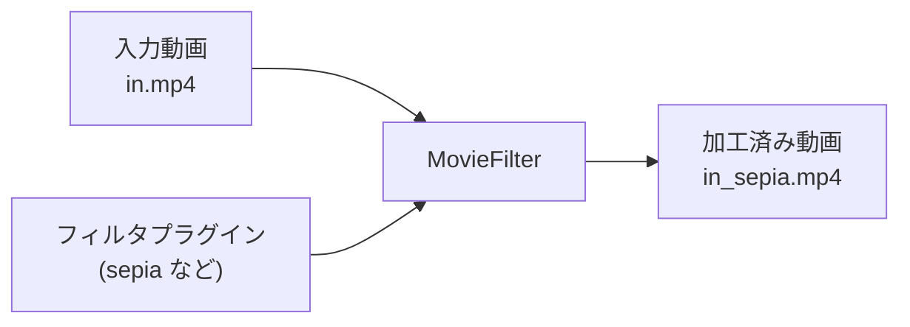
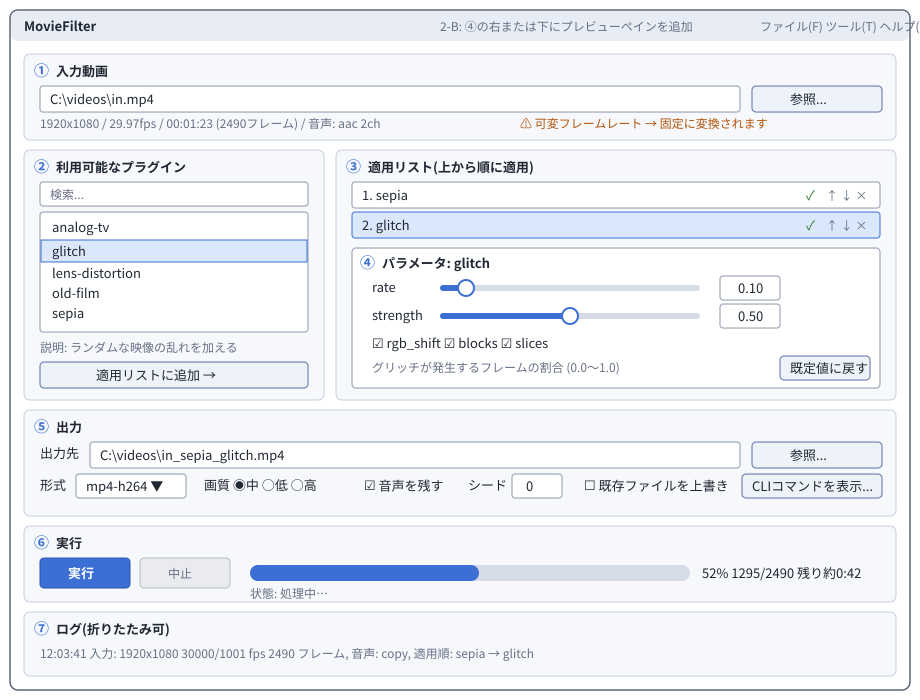
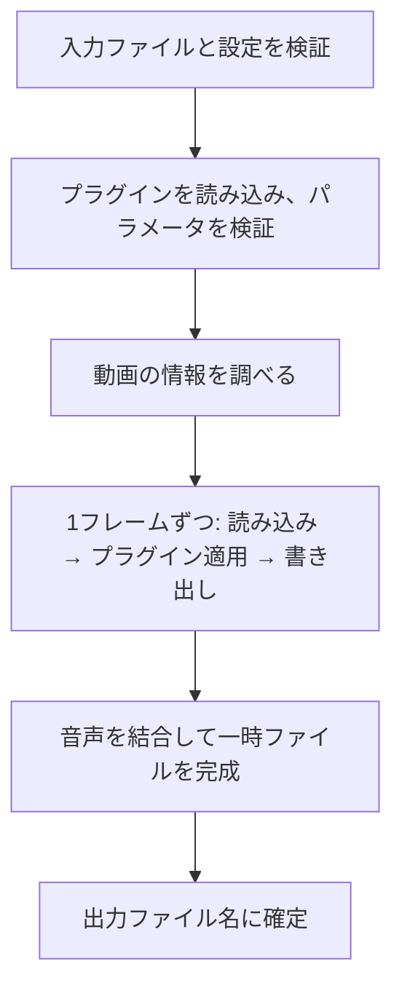

# MovieFilter 取扱説明書

| 項目 | 内容 |
|---|---|
| 対象バージョン | v0.1.0(CLI と、GUI の第2段階 2-A。`docs/basic_design.md` v0.7 / `docs/detailed_design.md` v0.8 / `docs/gui_design.md` v0.4 に基づく) |
| 位置づけ | **GUI(画面)での操作を中心にした**取扱説明書。コマンドライン(CLI)の使い方は補足として §5 にまとめている。表示例は実際の出力に合わせてある |
| 動作確認 | Linux(WSL を含む)で確認済み。**Windows は未検証** |

---

## 1. MovieFilter とは

動画ファイルと「フィルタプラグイン」を選ぶだけで、エフェクトをかけた動画を保存するツールです。画面(GUI)で操作できます。コマンドラインからも同じ処理を実行できます。



- 動画の**映像だけ**を加工し、音声は元のまま引き継ぎます。
- 複数のプラグインを順番に重ねがけできます。
- プラグインはファイルを置くだけで追加できます(§9)。

できないこと: カット・結合などの編集、動画のプレビュー表示(いずれも対象外。§7 参照)。

## 2. 動作環境と準備

リポジトリをダウンロードして使うための準備です。「何を用意し、どのファイルをどこに置くか」を順に説明します。

### 2.1 必要なもの

| 項目 | 内容 |
|---|---|
| OS | Windows / Linux(WSL を含む) |
| Python | 3.11 以上。**GUI を使う場合は `tkinter`(Python 標準の GUI 部品)も必要** |
| NumPy | Python のライブラリ。`pip install numpy` で入れる(§2.4) |
| FFmpeg | `ffmpeg` と `ffprobe`。MovieFilter には同梱されないため、別途インストールする(§2.5) |
| 画面 | GUI にはディスプレイが必要。WSL では WSLg など、画面を表示できる環境が必要 |

### 2.2 リポジトリの入手と配置

**入手**: GitHub のリポジトリページで「Code」→「Download ZIP」を選んで展開するか、`git clone` で取得します。

**配置**: 展開した中身を、好きなフォルダ(例: Windows は `C:\MovieFilter`、Linux は `~/MovieFilter`)に**そのままの構成で**置きます。フォルダ名や場所は自由ですが、パスは短い英数字にしておくと問題が起きにくくなります。

```
C:\MovieFilter\                  ← 好きな場所(以降「プロジェクトのルート」と呼ぶ)
├─ moviefilter-gui.cmd           Windows: GUI を起動(コンソール窓なし)
├─ moviefilter.cmd               Windows: コマンドライン用。GUI をコンソール付きで起動することもできる
├─ moviefilter                   Linux / macOS / WSL 用の起動用スクリプト
├─ pyproject.toml                pip でインストールするときに使う
├─ README.md                     pip でインストールするときにも必要(pyproject.toml が参照する)
├─ LICENSE
├─ src\moviefilter\              本体(これが無いと動かない)
│   └─ builtin_plugins\          同梱プラグイン(sepia など)
├─ docs\                         ドキュメント(取扱説明書・設計書・プラグイン作成ガイド)
├─ templates\                    プラグインのひな形
└─ tests\                        テスト(使うだけなら不要)
```

| ファイル / フォルダ | 必要か | 役割 |
|---|---|---|
| `src/moviefilter/`(フォルダごと) | **必須** | 本体。同梱プラグイン(`builtin_plugins/`)を含む |
| `moviefilter-gui.cmd` | Windows で GUI をダブルクリック起動するなら必要 | `src` を見つけて GUI を起動する |
| `moviefilter.cmd` | Windows でコマンドラインを使うなら必要 | `moviefilter.cmd gui` で GUI も起動できる |
| `moviefilter` | Linux / macOS / WSL で起動用スクリプトを使うなら必要 | 同上 |
| `pyproject.toml`、`README.md` | `pip install .` でインストールするなら必要 | インストール方法を定義する(`README.md` も読み込まれる) |
| `docs/`、`templates/`、`tests/`、`LICENSE` | 任意 | 使うだけなら削除してもよい(`LICENSE` は配布するときは残す) |

**配置の注意**
- **起動用スクリプト(`*.cmd`、`moviefilter`)は、`src` フォルダと同じフォルダに置いたまま使います。** スクリプトは、自分のいるフォルダの `src` を探して動くためです。デスクトップなどから起動したいときは、スクリプトを移動せず、**ショートカットを作って**ください(右クリック →「ショートカットの作成」)。
- ZIP を展開すると `MovieFilter-main\` のようなフォルダが 1 つ作られ、その中に `src` などが入っていることがあります。**`src` と `moviefilter-gui.cmd` が並んでいるフォルダ**がプロジェクトのルートです。
- Linux / WSL では、起動用スクリプトに実行権限が必要な場合があります: `chmod +x moviefilter`

### 2.3 Python の導入

- **Windows**: <https://www.python.org/> のインストーラーで Python 3.11 以上を入れます。インストーラーの画面で、**「Add python.exe to PATH」にチェック**し、**「tcl/tk and IDLE」(既定で有効)を外さない**でください(GUI に必要です)。Microsoft Store 版でも使えます。
- **Linux(Debian/Ubuntu)**: `sudo apt install python3 python3-tk`。Python が 3.11 未満の環境(Ubuntu 22.04 の標準は 3.10)では、3.11 以上を別途用意し、使う Python を `MOVIEFILTER_PYTHON` で指定します(§2.6)。

確認: `python --version`(Windows は `py -3 --version`)で 3.11 以上と表示されればよい。

### 2.4 NumPy の導入

```
# Windows(PowerShell / コマンドプロンプト)
py -3 -m pip install numpy

# Linux / macOS / WSL
python3 -m pip install numpy
```

- Windows の `moviefilter-gui.cmd` は、`pyw -3`(Python ランチャー。見つからなければ `pythonw`)で起動します。**NumPy は、その Python に入れてください。** Python を複数入れている場合、ランチャーは新しい方の 3.x を選びます。
- 仮想環境(venv)を使う場合は、有効にした状態で入れ、`MOVIEFILTER_PYTHON` にその Python を指定します(§2.6)。

### 2.5 FFmpeg の導入

- **Windows**: 公式配布のビルドを展開し、`ffmpeg.exe` / `ffprobe.exe` のあるフォルダを `PATH` に追加します。`PATH` に追加できない場合は、設定ファイルでパスを指定できます(§8)。
- **Linux(Debian/Ubuntu)**: `sudo apt install ffmpeg`

確認: `ffmpeg -version` と `ffprobe -version` が実行できればよい。FFmpeg が見つからない場合、GUI は起動時に画面上部へ警告を出します。

### 2.6 起動用スクリプトが使う Python の指定(任意)

環境変数 `MOVIEFILTER_PYTHON` に、Python 実行ファイルの**フルパス**を指定すると、起動用スクリプトはその Python を使います。

| 環境 | 設定例 |
|---|---|
| Windows(PowerShell) | `$env:MOVIEFILTER_PYTHON = "C:\Python312\pythonw.exe"`(GUI 用は `pythonw.exe`、コマンドライン用は `python.exe`) |
| Linux / WSL | `MOVIEFILTER_PYTHON=~/.venvs/mf/bin/python ./moviefilter gui` |

Python が 3.11 未満、または NumPy が無い場合は、その旨のメッセージを表示して終了します(コマンドラインでは標準エラー出力へ、コンソールのない GUI 起動ではダイアログで表示します)。

### 2.7 `pip install` でインストールして使う(任意)

起動用スクリプトの代わりに、`moviefilter` コマンドとして使えるようにする方法です。プロジェクトのルートで実行します(NumPy も自動で入ります)。

```
# Linux / macOS / WSL
pip install .

# Windows(PowerShell / コマンドプロンプト)
py -3 -m pip install .
```

- 作られるコマンド: `moviefilter`(コマンドライン、GUI は `moviefilter gui`)と、コンソール窓を出さずに GUI を起動する `moviefilter-gui`。どのフォルダからでも実行できます。
- Windows で「`moviefilter` が認識されません」と出る場合は、Python の `Scripts` フォルダが `PATH` に入っていません(インストール時に pip が警告を出します)。`py -3 -m moviefilter gui` のように `-m moviefilter` で呼べば、`PATH` に関係なく動きます。
- 仮想環境(venv)を使う場合は、有効にした状態で実行してください。コマンドはその環境の中に作られます。
- ソースを編集しながら使う場合は `pip install -e .` を使います。

## 3. クイックスタート(GUI)

### 3.1 起動する

| 環境 | 操作 |
|---|---|
| Windows | プロジェクトのルートの **`moviefilter-gui.cmd` をダブルクリック**(またはそのショートカット)。コンソール窓は出ません |
| Windows(PowerShell から) | `.\moviefilter-gui.cmd`(`.\` と `.cmd` が必要)。エラーの表示を見たいときは `.\moviefilter.cmd gui`(コンソール付き) |
| Linux / macOS / WSL | プロジェクトのルートで `./moviefilter gui` |
| `pip install` した場合 | `moviefilter gui`、またはコンソールなしの `moviefilter-gui` |

ウィンドウが開き、左の「利用可能なプラグイン」に `analog-tv`、`glitch`、`lens-distortion`、`old-film`、`sepia` が並べば準備完了です。開かない場合は §11 を見てください。

### 3.2 セピア調にする(最初の1本)

1. 「入力動画」の「参照...」で、加工する動画を選ぶ。解像度・fps・長さが表示され、出力先に `<入力名>_filtered.mp4` が仮に入る。
2. 左の一覧で `sepia` を選び、「適用リストに追加」を押す(ダブルクリックでも可)。出力先が `<入力名>_sepia.mp4` に変わる。
3. 右の「パラメータ」で `intensity` のスライダーを動かすと、効果の強さを変えられる(0.0 で元のまま、1.0 で完全なセピア)。
4. 「実行」を押す。進捗バーと残り時間の目安が出る。
5. 完了のダイアログが出たら、「フォルダを開く」で出力先を確認する。

出力は、**入力と同じフォルダ**に `<入力名>_<フィルタ名>.mp4` として保存されます(複数のフィルタを重ねたときは、適用順に `_` でつなぎます。例: `holiday_sepia_glitch.mp4`)。出力先は画面で変更できます。

## 4. GUI の使い方

### 4.1 画面の構成



画面は、上から「入力 → 加工 → 出力 → 実行」の順に並んでいます(丸数字は図と対応します)。

| 領域 | 内容 |
|---|---|
| ① 入力動画 | 動画ファイルの指定と、動画情報の表示 |
| ② 利用可能なプラグイン | 使えるプラグインの一覧(検索、説明の表示) |
| ③ 適用リスト | 適用するプラグインを、**上から順**に並べたもの |
| ④ パラメータ | ③で選んだプラグインのパラメータ編集 |
| ⑤ 出力 | 出力先・形式・画質・音声・シード・上書き |
| ⑥ 実行 | 実行・中止・進捗 |
| ⑦ ログ | 処理内容や警告(通常は折りたたまれている) |

### 4.2 入力動画を選ぶ(①)

- 「参照...」でファイルを選ぶか、入力欄にパスを貼って Enter を押します。FFmpeg が読める動画ファイルなら、拡張子は問いません。
- 選ぶと、解像度・fps・長さ・フレーム数・音声の有無が表示されます。可変フレームレート(VFR)の動画には警告が出ます(固定フレームレートに変換されます。§7)。
- 読めないファイルを選んだ場合は、エラーコードと理由が赤字で表示され、実行はできません。
- 入力欄は、処理中は無効になります。

### 4.3 プラグインを追加・並べ替えする(②③)

- ②の一覧から選ぶと、下に説明が表示されます。「適用リストに追加」(またはダブルクリック)で③に追加されます。上の検索欄で名前・説明を絞り込めます。
- **③の上から順に適用されます。** 「↑」「↓」で順序を入れ替え、「×」で削除します。順序を変えると結果が変わることがあります。
- **同じプラグインを複数回追加**できます(パラメータは別々に持ちます)。
- 音声用のプラグインは一覧に灰色で表示され、追加できません(§7)。
- 読み込みに失敗したプラグインがある場合は、一覧の下に「読み込めなかったプラグインがあります」というボタンが出ます。押すと理由が表示されます(§11)。
- ③の各行の右に「⚠」が付いていたら、そのプラグインのパラメータに誤りがあります(④に理由が出ます)。

### 4.4 パラメータを調整する(④)

③で選んだプラグインのパラメータが、型に応じた部品で表示されます。プラグインごとに画面を作る必要はなく、プラグインが宣言した定義から自動で作られます。

| パラメータの型 | 表示される部品 |
|---|---|
| 小数(範囲あり) | スライダー + 数値入力 |
| 整数(範囲あり) | 数値入力(増減ボタン付き) |
| 数値(範囲なし) | 数値入力 |
| 真偽 | チェックボックス |
| 選択肢 | ドロップダウン |
| 文字列 | テキスト入力 |

- 各項目の下に、説明と範囲が表示されます。
- 範囲外の値や、数値でない値を入れると、その場で赤字で理由が表示され、**直るまで「実行」は押せません**(エラーの内容は §10.3 の `E_PARAM_*` と同じです)。
- 各項目の右の「↺」でその項目を、「既定値に戻す」で全項目を既定値に戻せます。
- パラメータが多いプラグインでは、④の領域をスクロールして全項目を表示できます。

### 4.5 出力を設定する(⑤)

| 項目 | 内容 |
|---|---|
| 出力先 | 既定は、入力と同じフォルダの `<入力名>_<フィルタ名>.mp4`。適用リストを変えると既定名も更新されます(フィルタ名が長くなりすぎるときは `<入力名>_filtered.mp4`)。**出力先を自分で編集または指定した後は、自動では変わりません。** 出力先のフォルダは、あらかじめ存在している必要があります |
| 形式 | 出力形式(プロファイル)。現在は `mp4-h264` のみ |
| 画質 | 低・中・高。高いほど高画質でファイルが大きくなります(低: 確認用の試し書き出し、中: 通常、高: 保存・再編集用) |
| 音声を残す | オフにすると、音声なしで出力します |
| シード | 乱数を使うプラグイン(`glitch`、`analog-tv`、`old-film` など)の結果を決める数値(0 以上 4294967295 以下の整数)。**同じ入力・同じシードなら、毎回同じ結果**になります。別の乱数パターンにしたいときは値を変えます |
| 既存ファイルを上書き | オンにすると、同名のファイルがあっても確認なしで上書きします。オフのまま同名のファイルがある場合は、実行時に確認ダイアログが出ます |
| CLIコマンドを表示... | 今の設定と同じ処理を、コマンドラインで実行するときのコマンドを表示します(コピーできます)。§5 を参照 |

### 4.6 実行・中止・終了(⑥)

- **「実行」が押せないとき**は、⑥の下の行に理由が表示されます(例: 「入力動画を選択してください」「プラグインを適用リストに追加してください」「パラメータに誤りがあります: 2. glitch の rate」)。
- 実行中は、進捗バー・処理済みフレーム数・残り時間の目安が表示されます。**設定欄は無効**になり、実行中に設定を変えて内容が食い違うことはありません。
- **「中止」**で安全に中断できます。出力ファイルは作られず、途中の一時ファイルも削除されます。
- 完了すると、出力先とフレーム数・所要時間を示すダイアログが出ます。「フォルダを開く」「ファイルを開く」で確認できます。
- 実行中にウィンドウを閉じようとすると、「中止して閉じますか?」と確認されます。「中止して閉じる」を選ぶと、後始末(一時ファイルの削除)が終わってから閉じます。

### 4.7 エラーが出たとき

- 処理前の問題(入力・出力先・パラメータなど)は、該当する欄に赤字で表示され、実行ボタンが押せなくなります。
- 処理中の問題(FFmpeg の失敗、プラグインの実行時エラーなど)は、エラーのダイアログに表示されます。見出しに理由、本文に対処が出ます。「詳細を表示」でエラーコード(`E_XXXX`)、プラグインの実行時エラーでは**プラグイン名とフレーム番号**が分かります。「ログをコピー」で報告用の情報をコピーできます。ログ欄も自動で開きます。
- エラーコードの意味と対処は §10.3、症状別の確認事項は §11 を参照してください。コマンドライン版と共通です。
- FFmpeg が見つからないときは、ウィンドウの上部に警告が出て、動画を選べなくなります(§2.5)。

### 4.8 GUI の補足

- **プラグインの一覧は、起動時に1回だけ読み込みます。** プラグインのファイルを追加・書き換えたときは、GUI を起動し直してください(§9)。
- **設定ファイル**(`config.toml`、§8)は GUI でも読み込まれます(FFmpeg のパス、プラグインの追加フォルダ、既定の画質など)。設定ファイルに問題があるときは、画面上部に警告を出して既定の設定で起動します。
- **ウィンドウの大きさと、最後に開いたフォルダ**は、`gui_state.json` に保存されます(保存先は設定ファイルと同じ場所。Windows: `%APPDATA%\moviefilter\`、Linux: `~/.config/moviefilter/`)。
- 出力先が既に存在するとき、コマンドラインは(非対話での実行を妨げないよう)確認なしでエラーにしますが、GUI は上書きの確認ダイアログを出します。

### 4.9 使用例

**効果を弱めて保存する**: `sepia` を追加し、`intensity` のスライダーを 0.5 にして実行。出力は `<入力名>_sepia.mp4`。

**複数のエフェクトを重ねる**: `analog-tv` を追加し、続けて `glitch` を追加します。`glitch` を選んで `rate` を 0.2 にすると、グリッチの頻度が上がります。適用順は `analog-tv` → `glitch` で、出力は `<入力名>_analog-tv_glitch.mp4` になります。「CLIコマンドを表示...」では、次のコマンドが表示されます。

```
moviefilter apply in.mp4 -p analog-tv -p glitch:rate=0.2 -o in_analog-tv_glitch.mp4
```

**まず短い動画で効果を確かめる**: MovieFilter には「一部だけ処理する」機能がありません(§7)。長い動画で試す前に、FFmpeg で切り出した短い動画で、パラメータや画質(低)を試すことをお勧めします。

```
ffmpeg -i long.mp4 -t 10 -c copy sample.mp4
```

## 5. コマンドラインでの使い方(補足)

GUI を使わずに、コマンドで同じ処理を行う方法です。スクリプトからの利用や、フォルダ内の動画のまとめ処理に向いています。以降の `moviefilter` は、起動方法に応じて読み替えてください。

| 起動方法 | 書き方 |
|---|---|
| `pip install` した場合 | `moviefilter list` |
| 起動用スクリプト(Linux / WSL) | `./moviefilter list`(プロジェクトのルートで) |
| 起動用スクリプト(Windows の PowerShell) | `.\moviefilter.cmd list`(**`.\` と `.cmd` が必要。** PowerShell は現在のフォルダのコマンドを名前だけでは実行しません) |
| 起動用スクリプト(Windows のコマンドプロンプト) | `moviefilter.cmd list` |
| どの場合でも | `python -m moviefilter list`(インストールしていなければ `PYTHONPATH=src` が必要。Windows は `py -3 -m moviefilter list`) |

どのフォルダからでも、スクリプトのパスを指定すれば実行できます(例: `/path/to/MovieFilter/moviefilter apply in.mp4 -p sepia`)。Linux / WSL では、`PATH` の通ったフォルダにシンボリックリンクを作れば、`moviefilter` とだけ打てるようになります。

### 5.1 コマンド一覧

| コマンド | 内容 |
|---|---|
| `moviefilter gui` | GUI を起動する(§3) |
| `moviefilter list` | 使えるプラグインの一覧 |
| `moviefilter info <プラグイン名>` | プラグインの説明とパラメータ |
| `moviefilter apply <入力> -p ...` | 動画に加工を施して保存 |
| `moviefilter profiles` | 出力形式(プロファイル)の一覧 |

全コマンド共通のオプション: `moviefilter --version`(版の表示)、`moviefilter -h`(ヘルプ。各サブコマンドでも使えます)。

最小の例:

```
$ moviefilter apply holiday.mp4 -p sepia
[##########] 100%  1800/1800 frames  ETA 00:00:00
完了: /home/user/videos/holiday_sepia.mp4 (1800 フレーム, 00:01:12)
```

- 出力は、入力と同じフォルダに `<入力名>_<フィルタ名>.mp4`(複数のときは適用順に `_` でつなぐ。例: `-p sepia -p glitch` → `holiday_sepia_glitch.mp4`)として保存されます(フィルタ名が長くなりすぎるときは `<入力名>_filtered.mp4`)。
- 進捗は標準エラー出力に表示されます。

### 5.2 `list` / `info` / `profiles` の出力例

```
$ moviefilter list
名前             種別   バージョン  説明
analog-tv        video  1.0.0       アナログ放送時代のテレビ風の画質にし、時々ノイズを入れます
glitch           video  1.0.0       デジタルグリッチ(RGBずれ・ブロック崩れ・横ずれ)を時々入れます
lens-distortion  video  1.0.0       レンズ歪み(樽型/糸巻き型)と色収差を加えます
old-film         video  1.0.0       古い映画フィルム風(色あせ・ちらつき・縦傷・ゴミ・粒子)にします
sepia            video  1.0.0       動画全体を一様にセピアカラーにします
```

```
$ moviefilter info sepia
sepia (video) v1.0.0
  動画全体を一様にセピアカラーにします
パラメータ:
  intensity  float  既定値 1.0  範囲 0.0〜1.0
      効果の強さ (0.0=元画像, 1.0=完全なセピア)
```

```
$ moviefilter profiles
名前      拡張子  説明
mp4-h264  .mp4    MP4 コンテナ / H.264 映像
```

### 5.3 `apply` のオプション

| オプション | 説明 | 既定値 |
|---|---|---|
| `-p, --plugin SPEC` | 適用するプラグイン。**複数指定可。書いた順に適用** | 必須(1つ以上) |
| `-o, --output PATH` | 出力ファイル | 入力と同じフォルダの `<入力名>_<フィルタ名>.mp4`(§5.1) |
| `--profile NAME` | 出力形式 | `mp4-h264` |
| `--quality low\|medium\|high` | 画質(`high` ほど高画質・大容量) | `medium` |
| `--no-audio` | 音声を出力しない | 音声を引き継ぐ |
| `--overwrite` | 出力先に同名ファイルがあっても上書きする | 上書きしない(エラー) |
| `--seed N` | 乱数を使うプラグインのシード(0 以上 4294967295 以下の整数) | `0` |
| `--config PATH` | 設定ファイルを明示指定 | 自動探索(§8) |
| `-v, --verbose` | 詳細ログ。実行する FFmpeg コマンドも表示 | 無効 |
| `-q, --quiet` | 進捗表示を出さない | 表示する |

`--profile` と `--quality` の既定値は、設定ファイル(§8)で変えられます。優先順位は「コマンドライン引数 > 設定ファイル > 組み込みの既定値」です。`moviefilter gui` も `--config PATH` と `-v` を受け付けます。

### 5.4 プラグイン指定(`SPEC`)の書式
```
プラグイン名[:パラメータ名=値[,パラメータ名=値 ...]]
```
- プラグイン名は小文字英字で始まり、小文字英数字・`_`・`-` が使えます。
- 値に `,` と `=` は使えません(引用符・エスケープは未対応)。GUI でそのような値を入れた場合、「CLIコマンドを表示...」では表現できない旨が表示されます(GUI の実行自体はできます)。
- 真偽値は `true/false/1/0/yes/no`(大文字小文字は区別しない)。
- パラメータを省略すると既定値が使われます。

### 5.5 品質の目安

| 指定 | 内容 | 使いどころ |
|---|---|---|
| `low` | 小さいファイル、画質は控えめ | 確認用の試し書き出し |
| `medium` | 標準 | 通常 |
| `high` | 高画質、ファイルは大きめ | 保存・再編集用 |

### 5.6 使い方の例

**複数プラグインを重ねる(適用順に注意)**
```
moviefilter apply in.mp4 -p プラグインA -p プラグインB
```
A を適用した結果に B が適用されます。順序を入れ替えると結果が変わりえます。例えば `-p sepia -p analog-tv` のように同梱プラグイン同士や、自作・追加プラグイン(§9)と重ねられます。

**効果を弱める・保存先を指定する**
```
moviefilter apply holiday.mp4 -p sepia:intensity=0.5 -o /home/user/out/holiday_soft.mp4
```

**音声を除いて保存する**
```
moviefilter apply in.mp4 -p sepia --no-audio -o silent.mp4
```

**既存ファイルを上書きして再実行する**
```
moviefilter apply in.mp4 -p sepia:intensity=0.8 -o out.mp4 --overwrite
```

**まず短い動画で効果を確かめる**
```
ffmpeg -i long.mp4 -t 10 -c copy sample.mp4
moviefilter apply sample.mp4 -p sepia:intensity=0.7 --quality low
```

**乱数を使うプラグインで、同じ結果を得る/変える**
```
moviefilter apply in.mp4 -p glitch --seed 42     # 何度実行しても同じ結果
moviefilter apply in.mp4 -p glitch --seed 43     # 別の乱数パターン
```
`--seed` を省略すると `0` が使われ、同じ入力なら毎回同じ結果になります。

**フォルダ内の動画をまとめて処理する(シェルのループ)**

MovieFilter 自体は1回に1ファイルのみ処理します。まとめて処理するにはシェルのループを使います。
```
# Linux / WSL
for f in *.mp4; do moviefilter apply "$f" -p sepia -q; done
```
```
:: Windows (cmd)
for %f in (*.mp4) do moviefilter apply "%f" -p sepia -q
```
出力ファイル(`*_sepia.mp4` など)が `*.mp4` に含まれ、再処理の対象にならないよう、出力先を別フォルダにする(`-o` を指定する)ことをお勧めします。

## 6. 処理内容と出力の仕様

### 6.1 処理の流れ


処理中は、出力先フォルダに一時ファイル(例: 出力が `out.mp4` なら `.out.1234.tmp.mp4`)が作られます。**正常に完了したときだけ**正式な出力名になります。失敗・中断したときは自動で削除されます。

### 6.2 出力ファイルの形式
- コンテナ: MP4、映像コーデック: H.264(`mp4-h264` のみ)、ピクセル形式 yuv420p。
- 画質は `--quality` で調整(内部の CRF 値: low=28 / medium=23 / high=18)。
- 解像度とフレーム数は入力と同じ。幅または高さが奇数の動画は、1画素分の黒い余白を付けて偶数サイズにします。
- 元動画のタイトルなどのグローバルメタデータは引き継がれます。チャプターは引き継がれません。
- 色情報は BT.709 として出力されます。

### 6.3 音声の扱い
音声は**加工せず**引き継ぎます。

| 元の音声 | 出力 |
|---|---|
| AAC / MP3 / AC-3 / E-AC-3 / ALAC | そのままコピー(劣化なし) |
| 上記以外(Opus、Vorbis、FLAC など) | MP4 に格納できるよう AAC(192kbps)へ変換 |
| 音声なし、または `--no-audio` | 音声なしで出力 |

映像の開始時刻が 0 でない動画(映像が遅れて始まる動画)は、映像と音声の相対位置が保たれるよう、自動で補正します。音声が遅れて始まる動画は、そのまま保たれます。

## 7. 制約事項(必ずお読みください)

| 分類 | 制約 | 影響・対処 |
|---|---|---|
| 入力形式 | 拡張子では制限しない。**お使いの FFmpeg が読める動画ファイル**なら処理できる(MP4、MOV、MKV、AVI、WebM、アニメーション GIF など) | FFmpeg のビルドが対応していない形式は読み込みに失敗する(`E_PROBE_FAILED` / `E_DECODE_FAILED`)。映像のないファイルは `E_NO_VIDEO_STREAM`(カバー画像だけが付いた音声ファイルも「映像なし」として扱う) |
| 入力の指定方法 | 入力は**ローカルのファイルパスのみ** | URL、ネットワークストリーム、カメラなどのデバイス、連番画像(`img_%04d.png` 形式)は指定できない(`E_INPUT_NOT_FOUND`)。必要なら先に FFmpeg で動画ファイルにする |
| 静止画 | JPEG・PNG などの静止画は想定外 | 1フレームだけの動画が出力される。静止画の加工には向かない |
| 透明(アルファ) | 透明情報のある動画(WebM の VP9 アルファ、ProRes 4444 など)は透明情報が失われる | RGB 3チャンネルで処理するため、透明部分が黒などの色に置き換わることがある |
| インターレース | デインターレース(縞の除去)は行わない | インターレース動画は縞が残ったまま加工・出力される。必要なら先に FFmpeg で変換する |
| 入力の音声 | 音声は FFmpeg がデコードできるものに限る | FFmpeg が扱えない音声コーデックを含む動画は、書き出しに失敗する(`E_ENCODE_FAILED`)ことがある。その場合は `--no-audio` で映像だけ出力できる |
| 色 | 映像は内部で 8bit の RGB に変換される | 10bit / HDR 動画は SDR 相当の 8bit になり、**色味が変わることがある**(トーンマッピングは行わない) |
| フレームレート | 可変フレームレート(VFR)は固定フレームレート(CFR)に変換される | スマートフォンで撮影した動画に多い。再生時間は維持されるが、フレーム間隔は均等になる。実行時に警告が出る |
| ストリーム | 映像・音声とも**先頭の1本だけ**を処理する | 字幕、チャプター、複数音声トラック、複数映像トラックは**出力に含まれない** |
| 出力形式 | MP4(H.264)のみ | WebM、MKV、MOV などへは出力できない。必要なら出力後に FFmpeg で変換する |
| 音声 | 音声エフェクトは使えない | 音声は元のまま引き継ぐ。音楽用エフェクトのプラグインは、一覧に表示されても適用できない |
| フレーム処理 | 1フレームずつの処理のみ | 前後のフレームを参照するエフェクトは使えない |
| 範囲指定 | 動画の一部区間だけの処理はできない | 全編が処理される(§5.6 の方法で事前に切り出す) |
| 一括処理 | 1回の実行で1ファイル | §5.6 のシェルループで代用する |
| 画面 | GUI は用意しているが、動画のプレビュー(再生・静止フレームの比較)はまだない | 出力ファイルを動画プレーヤーで確認する |
| 速度 | 目安は 1080p・30fps のセピアで 10fps 以上(参考値、環境で変わる) | 長い動画は時間がかかる。まず `--quality low` と短い動画で試す |
| ディスク | 処理中は出力先に一時ファイルが作られる | 出力先に、出力動画1本分の空き容量が必要 |
| 強制終了 | `kill -9` やパソコンの電源断では一時ファイルが残ることがある | `.<名前>.<数字>.tmp.mp4` を手動で削除する |
| 再現性 | `--seed` が同じなら乱数プラグインの結果は同じだが、NumPy のバージョンが違うと変わることがある | 完全に同じ結果が必要なら、環境(NumPy のバージョン)を揃える |
| 安全性 | プラグインは任意のプログラムとして実行される | **信頼できる入手元のプラグインだけ**を置く |

## 8. 設定ファイル(任意)

設定ファイルは、FFmpeg のパス・プラグインの追加フォルダ・既定の画質を変えたいときに作ります。**無くても動きます。** GUI でもコマンドラインでも同じファイルが使われます。

設定は、次の順で最初に見つかったファイルが使われます。
1. `--config` で指定したファイル
2. カレントディレクトリの `moviefilter.toml`(カレントディレクトリは、起動のしかたによって変わります。`moviefilter-gui.cmd` をダブルクリックで起動した場合は通常、スクリプトのあるフォルダです。確実に読み込ませたいときは、3 の場所に置くか、`--config` で指定します)
3. Linux: `~/.config/moviefilter/config.toml` / Windows: `%APPDATA%\moviefilter\config.toml`(`%APPDATA%` は `C:\Users\<ユーザー名>\AppData\Roaming`。エクスプローラーのアドレス欄に `%APPDATA%` と入力すると開けます。`moviefilter` フォルダが無ければ作ります)

```toml
[tools]
ffmpeg  = "C:/tools/ffmpeg/bin/ffmpeg.exe"   # PATH にない場合に指定
ffprobe = "C:/tools/ffmpeg/bin/ffprobe.exe"

[plugins]
extra_dirs = ["~/my_moviefilter_plugins"]     # 自作プラグインの置き場

[defaults]
profile = "mp4-h264"
quality = "medium"                            # low / medium / high
```
- `profile` と `quality` は、GUI では初期値になります。コマンドラインで指定した場合はそちらが優先されます。
- Windows のパスは `/` 区切り(`C:/tools/...`)か、`\\` を重ねた書き方で書きます(TOML の決まりです)。
- 未知の項目は警告が出るだけで無視されます。値の型が違うと `E_CONFIG_INVALID` で終了します。
- プラグインの置き場は、環境変数 `MOVIEFILTER_PLUGIN_PATH`(Linux は `:` 区切り、Windows は `;` 区切り)でも追加できます。

## 9. プラグインを追加する(自作の手引き)

本章は概要です。プラグインを本格的に作る場合は、**`docs/plugin_author_guide.md`(プラグイン作成ガイド)**と、ひな形 `templates/plugin_template.py` を参照してください。

### 9.1 置き場所
次のいずれかに、プラグインのファイルを置きます(同梱 → 環境変数 → 設定ファイルの順に探します)。
- `MOVIEFILTER_PLUGIN_PATH` に指定したフォルダ
- 設定ファイル `extra_dirs` に書いたフォルダ
- (非推奨)同梱フォルダ `src/moviefilter/builtin_plugins/`。置けば使えますが、リポジトリを更新したときに混ざりやすく、`pip install` した場合は Python の内部のフォルダになります。**自作用のフォルダを別に作る方法をお勧めします。**

**ファイル名はプラグイン名と一致させます**(`-` は `_` に置き換えて比較)。例: プラグイン名 `film-grain` → `film_grain.py`。名前が同じプラグインが複数ある場合、先に見つかった方(同梱が最優先)だけが使われます。

**手順の例(Windows)**
1. 自作用のフォルダを作る(例: `C:\MoviePlugins`)。
2. プラグインのファイル(例: `brighten.py`、§9.2)をそこに置く。
3. 次のどちらかで、そのフォルダを教える。
   - 設定ファイル(§8)に `extra_dirs = ["C:/MoviePlugins"]` と書く。
   - 環境変数 `MOVIEFILTER_PLUGIN_PATH` に `C:\MoviePlugins` を設定する(複数は `;` 区切り)。
4. **GUI を起動し直す**(一覧は起動時に1回だけ読み込むため)。一覧に `brighten` が出れば成功。出ない場合は §11 を確認する。

コマンドラインでは、`moviefilter list` で確認できます(§5.2)。

### 9.2 最小のプラグイン例(画像を明るくする)
```python
# ~/my_moviefilter_plugins/brighten.py
import numpy as np
from moviefilter.plugin_api import VideoPlugin, ParamSpec, ParamType

class BrightenPlugin(VideoPlugin):
    name = "brighten"
    description = "明るさを加算します"
    version = "1.0.0"
    requires_api = (1, 0)
    params = (
        ParamSpec("amount", ParamType.INT, 30, "加算する値", min=-255, max=255),
    )

    def process(self, frame, ctx):
        out = frame.astype(np.int16) + self.params_values["amount"]
        return np.clip(out, 0, 255).astype(np.uint8)
```
GUI では、一覧から `brighten` を追加して `amount` を調整します。コマンドラインでは次のとおりです。
```
moviefilter list
moviefilter apply in.mp4 -p brighten:amount=50
```

### 9.3 作者が守るルール

| ルール | 内容 |
|---|---|
| 入出力 | `process` は `(高さ, 幅, 3)` の uint8 RGB 配列を受け取り、**同じ形・型**の配列を返す(サイズ変更は不可) |
| 入力は読み取り専用 | 入力 `frame` を書き換えない。呼び出し後も使いたい場合はコピーを取る |
| 戻り値の再利用 | 戻り値は、プラグインが保持する再利用バッファでもよい(次の呼び出しまで有効) |
| 状態 | 過去フレームの情報はインスタンス変数に持てる(`setup` で初期化) |
| フレームサイズ | 解像度が必要なら `setup(info)` で `info.width` などを取得して保存する |
| 乱数 | `np.random.default_rng(ctx.seed)` を使う。`random` モジュールや時刻による乱数は使わない |
| 将来機能 | 音声用(`AudioPlugin`)や前後フレーム参照(`temporal_window`)は現在使えない(§10 の該当エラー) |

## 10. エラー出力の説明

### 10.1 表示の形式
**コマンドライン**では、エラーは標準エラー出力に、次の形式で表示されます。**GUI** では、同じ内容(エラーコード・メッセージ・対処)が画面の該当欄またはエラーのダイアログに表示されます(§4.7)。エラーコードの意味と対処は、GUI でもコマンドラインでも共通です。
```
エラー [E_コード]: メッセージ
詳細: 補足情報(ある場合)
```
`-v` を付けると、原因の詳細(スタックトレース、FFmpeg のコマンドと出力)も表示されます。

### 10.2 終了コード(コマンドライン)

| コード | 意味 | 出力ファイル |
|---|---|---|
| 0 | 成功 | 作られる |
| 1 | 予期しない内部エラー | 作られない |
| 2 | 指定の誤り(入出力・プラグイン・パラメータ・設定・FFmpeg 未導入)。**処理を始める前に検出** | 作られない |
| 3 | 処理中のエラー(FFmpeg の失敗、プラグインの実行時エラー) | 作られない(一時ファイルも削除) |
| 130 | Ctrl+C による中断 | 作られない(一時ファイルも削除) |

スクリプトから使う場合は、終了コードで成否を判定できます。

### 10.3 エラーコード一覧

#### 入力・出力・設定(終了コード 2)

| コード | 表示例 | 原因 | 対処 |
|---|---|---|---|
| `E_USAGE` | `必須の引数がありません: -p/--plugin` | コマンドラインの書き方の誤り(必須引数の不足、不明なオプション、`--quality` の不正値など) | `moviefilter apply -h` で書式を確認する |
| `E_INPUT_NOT_FOUND` | `入力ファイルが見つかりません: in.mp4` | パスの誤り、権限なし | パス・ファイル名を確認する |
| `E_NO_VIDEO_STREAM` | `映像ストリームが見つかりません: music.mp3` | 音声ファイルなど、映像がないファイル | 動画ファイルを指定する |
| `E_PROBE_FAILED` | `動画情報を取得できません: broken.mp4` | ファイルが壊れている、非対応形式 | `-v` で FFprobe の出力を確認。別の動画で試す |
| `E_OUTPUT_EXISTS` | `出力ファイルが既に存在します: out.mp4` | 同名ファイルがある | 別名にするか `--overwrite` を付ける |
| `E_OUTPUT_SAME_AS_INPUT` | `入力と出力が同じファイルです` | `-o` が入力と同じ(別名・シンボリックリンク経由も検出) | 別のファイル名にする |
| `E_OUTPUT_EXT_MISMATCH` | `出力の拡張子が形式と一致しません (.mp4 が必要): out.mov` | `-o` の拡張子が `.mp4` ではない | `.mp4` にする |
| `E_OUTPUT_DIR_INVALID` | `出力先フォルダが存在しないか、書き込めません: /no/such/dir` | 出力先のフォルダがない、または書き込み権限がない | フォルダを作成する、または別の場所を指定する(フォルダは自動作成されない) |
| `E_PROFILE_UNKNOWN` | `不明な出力形式です: webm` | `--profile` の誤り | `moviefilter profiles` で確認する |
| `E_CONFIG_INVALID` | `設定ファイルの値が不正です: defaults.quality` | 設定の型・値の誤り | 設定ファイルを修正する |
| `E_FFMPEG_NOT_FOUND` | `ffmpeg が見つかりません` | FFmpeg 未導入、`PATH` の誤り | §2.5 に従い導入。または設定の `[tools]` でパス指定 |
| `E_GUI_UNAVAILABLE` | `GUI には tkinter が必要ですが、利用できません` / `画面を表示できません` | tkinter が未導入、または表示環境(ディスプレイ)がない | Debian/Ubuntu: `sudo apt install python3-tk`。WSL は WSLg 等の表示環境を用意する。CLI(`apply` など)は影響を受けない |

#### プラグイン指定(終了コード 2)

| コード | 表示例 | 原因 | 対処 |
|---|---|---|---|
| `E_PLUGIN_NOT_FOUND` | `プラグインが見つかりません: sepya` / `詳細: 利用可能: sepia` | 名前の誤り、置き場所・ファイル名の不一致 | `moviefilter list` で確認。ファイル名と名前の一致も確認 |
| `E_PARAM_UNKNOWN` | `sepia に不明なパラメータがあります: power` / `詳細: 指定可能: intensity` | パラメータ名の誤り | `moviefilter info sepia` で確認 |
| `E_PARAM_INVALID` | `intensity の値が数値ではありません: abc` | 値の型が違う、`-p` の書式誤り、`--seed` が整数でない・範囲外 | 型と書式(§5.4)を確認 |
| `E_PARAM_RANGE` | `intensity は 0.0〜1.0 で指定してください: 1.5` | 範囲外の値 | 範囲内にする |
| `E_PLUGIN_INIT` | `プラグインの初期化に失敗しました: brighten` | プラグイン内部の初期化エラー(コンストラクタまたは `setup` での例外) | `-v` で原因を確認(自作の場合は修正) |
| `E_PLUGIN_KIND_UNSUPPORTED` | `音声プラグインは現在使用できません: reverb` | 音声用プラグインを指定した | 映像用プラグインを使う(§7) |
| `E_TEMPORAL_UNSUPPORTED` | `前後フレームを参照するプラグインは現在使用できません: denoise3d` | 前後フレーム参照が必要なプラグインを指定した | 使用不可(§7) |

#### 処理中(終了コード 3)

| コード | 表示例 | 原因 | 対処 |
|---|---|---|---|
| `E_DECODE_FAILED` | `動画の読み込みに失敗しました` / `詳細: (FFmpeg の出力末尾)` | ファイルが途中で壊れている、コーデック非対応 | `-v` で詳細確認。別の形式に変換して再試行 |
| `E_ENCODE_FAILED` | `動画の書き出しに失敗しました` / `詳細: (FFmpeg の出力末尾)` | **ディスク容量不足**、出力先の権限なし、FFmpeg の異常終了 | 空き容量・書き込み権限を確認。一時ファイルは自動削除される |
| `E_NO_FRAMES` | `処理できるフレームがありませんでした` | 映像が0フレームの動画 | 別の動画で確認 |
| `E_PLUGIN_RUNTIME` | `プラグイン brighten がフレーム 342 で失敗しました` / `詳細: (原因の例外)` | プラグインの実行時エラー | プラグインの不具合。作者に連絡(自作なら `-v` で原因を確認) |
| `E_PLUGIN_BAD_OUTPUT` | `プラグイン brighten の出力が不正です (フレーム 0): 形状 (540, 960, 3)・型 uint8 が期待値 (1080, 1920, 3)・uint8 と異なります` | プラグインが違うサイズ・型の画像を返した | プラグインの修正が必要(§9.3) |

#### 中断

| コード | 表示例 | 原因 |
|---|---|---|
| `E_CANCELLED` | `中断しました` | Ctrl+C。一時ファイルは削除され、終了コードは 130 |

### 10.4 警告メッセージ(処理は継続)

| メッセージの例 | 意味 |
|---|---|
| `可変フレームレートの動画です。固定フレームレートに変換して出力します` | VFR → CFR 変換が行われる(§7) |
| `名前が重複するプラグインを無視しました: sepia (~/my_plugins/sepia.py)` | 同梱など先に見つかったものが使われる |
| `プラグインの読み込みに失敗しました: bad_plugin.py (原因)` | `list` で表示される。他のプラグインの利用には影響しない |
| `設定ファイルに不明な項目があります: defaults.foo` | 無視される |
| `映像・音声の開始時刻のずれを補正しました (-0.500 秒)` | `-v` 指定時のみ表示(音声側の補正値) |

## 11. トラブルシューティング

| 症状 | 確認すること |
|---|---|
| **GUI が開かない**(`moviefilter-gui.cmd` をダブルクリックしても何も起きない) | まず `moviefilter.cmd gui`(PowerShell は `.\moviefilter.cmd gui`)でコンソール付きで起動し、表示されるエラーを確認する。多い原因: Python が 3.11 未満 / **NumPy が、起動に使われる Python に入っていない**(`pyw -3` は新しい方の Python を選ぶ。§2.4)/ tkinter が無い(`E_GUI_UNAVAILABLE`。Windows は Python の再インストール時に「tcl/tk and IDLE」を含める)/ Python ランチャー(`pyw`)も `pythonw` も無い(python.org のインストーラーで入れ直す、または `MOVIEFILTER_PYTHON` に `pythonw.exe` のフルパスを指定。§2.6) |
| 起動用スクリプトで `No module named moviefilter` などと出る / `src` が見つからない | スクリプトを `src` フォルダのある場所から**移動していないか**確認する。移動した場合は元に戻し、代わりにショートカットを作る(§2.2) |
| 起動用スクリプトで `Permission denied`(Linux / WSL) | 実行権限がない。`chmod +x moviefilter` を実行する(`sh moviefilter ...` でも可) |
| 起動用スクリプトで `Python 3.11 以上が必要です` / `NumPy がインストールされていません` | `MOVIEFILTER_PYTHON` で 3.11 以上の Python を指定する。その Python に `pip install numpy` を実行する(§2.3、§2.4) |
| GUI で「画面を表示できません」(`E_GUI_UNAVAILABLE`) | 表示環境がない。WSL では WSLg が使えるか確認する(`DISPLAY` が設定されているか) |
| GUI の日本語が□になる(Linux / WSL) | 日本語フォントが無い。`sudo apt install fonts-noto-cjk` などを導入する |
| GUI の「実行」が押せない | ⑥の下の行に理由が表示される(入力未選択、適用リストが空、パラメータの誤り、出力先の誤りなど。§4.6) |
| GUI の一覧にプラグインが出ない / 置いたばかりのプラグインが出ない | 一覧は**起動時に1回だけ**読み込むため、GUI を起動し直す。ファイル名とプラグイン名が一致しているか(`-` は `_` に置換して比較)、置き場所の設定(§8、§9.1)が正しいかを確認する。一覧の下に「読み込めなかったプラグインがあります」が出ていれば、押して理由を確認する |
| GUI のウィンドウが画面外に出て見えない(外したモニターに表示していた場合など) | `gui_state.json`(§4.8 の保存先)を削除して、起動し直す |
| GUI でプラグインを追加しても、出力先の名前が変わらない | 出力先を自分で編集または指定すると、以後は自動で変わらない(§4.5)。欄を編集して直す |
| `moviefilter` コマンドが見つからない(PowerShell では「用語 'moviefilter' は、コマンドレット … として認識されません」) | `pip install .` を実行していない、または Python の `Scripts` フォルダが `PATH` に入っていない・venv が有効でない。`py -3 -m moviefilter list` で試す。インストールせずに使うなら、PowerShell では `.\moviefilter.cmd`(`.\` と `.cmd` が必要。§5) |
| 進捗が出ない(コマンドライン) | `-q` を付けていないか。リダイレクト時(画面でない出力)は10秒ごとに1行表示される |
| 「プラグインが見つかりません」なのにファイルは置いてある | ファイル名とプラグイン名が一致しているか(`-` は `_` に置換して比較)。`MOVIEFILTER_PLUGIN_PATH` や `extra_dirs` が正しいか。`list` の末尾に読み込み失敗が出ていないか |
| 特定の動画だけ読み込めない | `ffprobe <ファイル>` を直接実行して読めるか確認する。読めない場合は FFmpeg 側の対応の問題(新しいビルドへの更新、または別形式への変換) |
| 透明な背景が黒くなった | 仕様(§7)。透明情報は引き継がれない |
| 縞模様(くし状のノイズ)が残る | インターレース動画の可能性。先に FFmpeg でデインターレース(例: `-vf yadif`)してから処理する |
| 音声付き動画だけ書き出しに失敗する | `--no-audio` を付けて成功するか確認する。成功する場合、音声コーデックが FFmpeg で扱えない可能性がある |
| 出力の色がおかしい(暗い、淡い) | 元動画が HDR / 10bit ではないか(§7)。SDR 動画に変換してから処理する |
| 出力で映像と音声がずれる | `-v` で補正の有無を確認。元動画の再生時点でずれていないか確認する。解決しなければ元動画の情報(`ffprobe` の結果)を添えて報告する |
| 字幕や複数音声が消えた | 仕様(§7)。必要なら出力後に FFmpeg で追加する |
| 出力ファイルが大きい / 画質が足りない | `--quality` で調整する |
| 動画の長さは同じなのにフレーム数が変わった | VFR 動画は CFR に変換されるため(§7) |
| 処理を途中で止めたい | GUI は「中止」ボタン、コマンドラインは Ctrl+C。一時ファイルは自動削除される |
| 作業フォルダに `.xxx.tmp.mp4` が残っている | 強制終了の名残。削除してよい |

## 12. 用語

| 用語 | 意味 |
|---|---|
| プラグイン | 動画にかけるエフェクト1つを実装した部品。名前で指定する |
| 適用リスト | GUI で、適用するプラグインを上から順に並べたもの。この順に処理される |
| プロジェクトのルート | `src` フォルダと起動用スクリプトが並んでいるフォルダ(§2.2) |
| フレーム | 動画を構成する1枚1枚の静止画 |
| CFR / VFR | 固定 / 可変フレームレート |
| プロファイル | 出力形式の設定(コンテナ・コーデック・音声の扱い)。現在は `mp4-h264` のみ |
| シード(seed) | 乱数を使うプラグインに渡す、結果を固定するための数値 |
