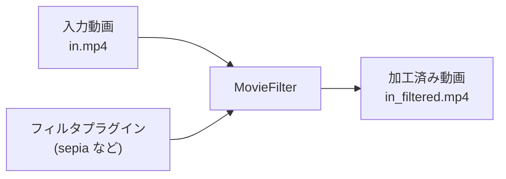
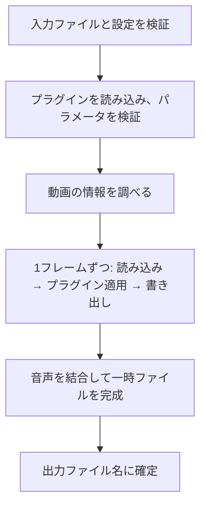

# MovieFilter 取扱説明書

| 項目 | 内容 |
|---|---|
| 対象バージョン | 第1段階(`docs/basic_design.md` v0.5 / `docs/detailed_design.md` v0.5 に基づく) |
| 位置づけ | 第1段階の実装(v0.1.0)の取扱説明書。表示例は実際の出力に合わせてある。Linux(WSL を含む)で動作確認済み。Windows は未検証 |

---

## 1. MovieFilter とは

動画ファイルと「フィルタプラグイン」を指定するだけで、自動的にエフェクトをかけた動画を保存するコマンドラインツールです。



- 動画の**映像だけ**を加工し、音声は元のまま引き継ぎます。
- 複数のプラグインを順番に重ねがけできます。
- プラグインはファイルを置くだけで追加できます(§9)。

できないこと: カット・結合などの編集、プレビュー表示、GUI 操作(いずれも第1段階の対象外。§7 参照)。

## 2. 動作環境と準備

| 項目 | 内容 |
|---|---|
| OS | Windows / Linux(WSL を含む) |
| Python | 3.11 以上 |
| FFmpeg | `ffmpeg` と `ffprobe` が必要(MovieFilter には同梱されません) |
| 追加ライブラリ | NumPy(インストール時に自動で入ります) |

### 2.1 FFmpeg の導入
- Linux(Debian/Ubuntu): `sudo apt install ffmpeg`
- Windows: 公式配布のビルドを展開し、`ffmpeg.exe` / `ffprobe.exe` のあるフォルダを `PATH` に追加する。

確認: `ffmpeg -version` と `ffprobe -version` が実行できればよい。`PATH` に追加できない場合は、設定ファイルでパスを指定できます(§8)。

### 2.2 MovieFilter の導入

**推奨: `pip install .` でインストールする**

プロジェクトのルートで実行します(NumPy も自動で入ります)。
```
# Linux / macOS / WSL
pip install .
moviefilter list       # 動作確認(プラグイン一覧が出れば成功)

# Windows(PowerShell / コマンドプロンプト)
py -3.11 -m pip install .
moviefilter list
```
- インストールすると `moviefilter` コマンドが作られ、**どのフォルダからでも** `moviefilter apply ...` と打てます(Linux は `bin/moviefilter`、Windows は Python の `Scripts\moviefilter.exe`)。
- Python の仮想環境(venv)を使う場合は、有効にした状態で実行してください。コマンドはその環境の中に作られます。
- Windows で「`moviefilter` が認識されません」と出る場合は、`Scripts` フォルダが `PATH` に入っていません(インストール時に pip が警告を出します)。`py -3.11 -m moviefilter list` のように `-m moviefilter` で呼べば、`PATH` に関係なく動きます。
- ソースを編集しながら使う場合は `pip install -e .` を使います。

**代替: インストールせずに、起動用スクリプトで使う**

プロジェクトのルートにある起動用スクリプトを直接実行します。
```
pip install numpy            # 使う Python に NumPy が入っていなければ
./moviefilter list           # Linux / macOS / WSL(プロジェクトのルートで)
.\moviefilter.cmd list       # Windows の PowerShell
moviefilter.cmd list         # Windows のコマンドプロンプト
```
- **PowerShell は、現在のフォルダのコマンドを名前だけでは実行しません。`.\` を付け、拡張子 `.cmd` まで書いてください**(拡張子のない `moviefilter` は Linux 用のファイルです)。
- どのフォルダからでも、スクリプトのパスを指定すれば実行できます(例: `/path/to/33_MovieFilter/moviefilter apply in.mp4 -p sepia`)。`PATH` の通ったフォルダにシンボリックリンクを作れば、`moviefilter` とだけ打てるようになります(Linux / WSL)。
- 使う Python を指定したいときは、環境変数 `MOVIEFILTER_PYTHON` に実行ファイルのパスを指定します(例: `MOVIEFILTER_PYTHON=~/.venvs/mf/bin/python ./moviefilter list`。PowerShell は `$env:MOVIEFILTER_PYTHON = "C:\...\python.exe"`)。
- Python が 3.11 未満、または NumPy がない場合は、その旨のメッセージ(`エラー: Python 3.11 以上が必要です ...`)を表示して終了します(終了コード 1)。

以降の説明の `moviefilter` は、起動用スクリプトで使う場合は `./moviefilter`(PowerShell は `.\moviefilter.cmd`)に読み替えてください。いずれの方法でも `python -m moviefilter list`(インストールしていない場合は `PYTHONPATH=src` が必要)で同じ操作ができます。

## 3. クイックスタート

### 3.1 セピア調にする

```
$ moviefilter apply holiday.mp4 -p sepia
[##########] 100%  1800/1800 frames  ETA 00:00:00
完了: /home/user/videos/holiday_filtered.mp4 (1800 フレーム, 00:01:12)
```

- 出力は、入力と同じフォルダに `<入力名>_filtered.mp4` として保存されます。
- 進捗は標準エラー出力に表示されます。

### 3.2 効果を弱める・保存先を指定する

```
$ moviefilter apply holiday.mp4 -p sepia:intensity=0.5 -o /home/user/out/holiday_soft.mp4
```

`-p` の書き方は「`プラグイン名:パラメータ名=値,パラメータ名=値`」です。パラメータを省略すると既定値が使われます。

## 4. コマンドリファレンス

### 4.1 コマンド一覧

| コマンド | 内容 |
|---|---|
| `moviefilter list` | 使えるプラグインの一覧 |
| `moviefilter info <プラグイン名>` | プラグインの説明とパラメータ |
| `moviefilter apply <入力> -p ...` | 動画に加工を施して保存 |
| `moviefilter profiles` | 出力形式(プロファイル)の一覧 |

全コマンド共通のオプション: `moviefilter --version`(版の表示)、`moviefilter -h`(ヘルプ。各サブコマンドでも使えます)。

### 4.2 `list` / `info` / `profiles` の出力例

```
$ moviefilter list
名前             種別   バージョン  説明
analog-tv        video  1.0.0       アナログ放送時代のテレビ風の画質にし、時々ノイズを入れます
glitch           video  1.0.0       デジタルグリッチ(RGBずれ・ブロック崩れ・横ずれ)を時々入れます
lens-distortion  video  1.0.0       レンズ歪み(樽型/糸巻き型)と色収差を加えます
old-film         video  1.0.0       古い映画フィルム風(色あせ・ちらつき・縦傷・ゴミ・粒子)にします
sepia            video  1.0.0       動画全体を一様にセピアカラーにします
```

```
$ moviefilter info sepia
sepia (video) v1.0.0
  動画全体を一様にセピアカラーにします
パラメータ:
  intensity  float  既定値 1.0  範囲 0.0〜1.0
      効果の強さ (0.0=元画像, 1.0=完全なセピア)
```

```
$ moviefilter profiles
名前      拡張子  説明
mp4-h264  .mp4    MP4 コンテナ / H.264 映像
```

### 4.3 `apply` のオプション

| オプション | 説明 | 既定値 |
|---|---|---|
| `-p, --plugin SPEC` | 適用するプラグイン。**複数指定可。書いた順に適用** | 必須(1つ以上) |
| `-o, --output PATH` | 出力ファイル | 入力と同じフォルダの `<入力名>_filtered.mp4` |
| `--profile NAME` | 出力形式 | `mp4-h264` |
| `--quality low\|medium\|high` | 画質(`high` ほど高画質・大容量) | `medium` |
| `--no-audio` | 音声を出力しない | 音声を引き継ぐ |
| `--overwrite` | 出力先に同名ファイルがあっても上書きする | 上書きしない(エラー) |
| `--seed N` | 乱数を使うプラグインのシード(0 以上 4294967295 以下の整数) | `0` |
| `--config PATH` | 設定ファイルを明示指定 | 自動探索(§8) |
| `-v, --verbose` | 詳細ログ。実行する FFmpeg コマンドも表示 | 無効 |
| `-q, --quiet` | 進捗表示を出さない | 表示する |

`--profile` と `--quality` の既定値は、設定ファイル(§8)で変えられます。優先順位は「コマンドライン引数 > 設定ファイル > 組み込みの既定値」です。

### 4.4 プラグイン指定(`SPEC`)の書式
```
プラグイン名[:パラメータ名=値[,パラメータ名=値 ...]]
```
- プラグイン名は小文字英字で始まり、小文字英数字・`_`・`-` が使えます。
- 値に `,` と `=` は使えません(引用符・エスケープは未対応)。
- 真偽値は `true/false/1/0/yes/no`(大文字小文字は区別しない)。

### 4.5 品質の目安

| 指定 | 内容 | 使いどころ |
|---|---|---|
| `low` | 小さいファイル、画質は控えめ | 確認用の試し書き出し |
| `medium` | 標準 | 通常 |
| `high` | 高画質、ファイルは大きめ | 保存・再編集用 |

## 5. 使い方の例

### 5.1 複数プラグインを重ねる(適用順に注意)
```
moviefilter apply in.mp4 -p プラグインA -p プラグインB
```
A を適用した結果に B が適用されます。順序を入れ替えると結果が変わりえます。例えば `-p sepia -p analog-tv` のように同梱プラグイン同士や、自作・追加プラグイン(§9)と重ねられます。

### 5.2 音声を除いて保存する
```
moviefilter apply in.mp4 -p sepia --no-audio -o silent.mp4
```

### 5.3 既存ファイルを上書きして再実行する
```
moviefilter apply in.mp4 -p sepia:intensity=0.8 -o out.mp4 --overwrite
```

### 5.4 まず短い動画で効果を確かめる
MovieFilter には「一部だけ処理する」オプションはありません(第1段階の対象外)。長い動画で試す前に、FFmpeg で切り出した短い動画で確認することをお勧めします。
```
ffmpeg -i long.mp4 -t 10 -c copy sample.mp4
moviefilter apply sample.mp4 -p sepia:intensity=0.7 --quality low
```

### 5.5 乱数を使うプラグインで同じ結果を得る/変える
```
moviefilter apply in.mp4 -p filmgrain --seed 42     # 何度実行しても同じ結果
moviefilter apply in.mp4 -p filmgrain --seed 43     # 別の乱数パターン
```
`filmgrain` は説明用の仮想的な名前です(同梱はされていません)。`--seed` を省略すると `0` が使われ、同じ入力なら毎回同じ結果になります。

### 5.6 フォルダ内の動画をまとめて処理する(シェルのループ)
MovieFilter 自体は1回に1ファイルのみ処理します。まとめて処理するにはシェルのループを使います。

```
# Linux / WSL
for f in *.mp4; do moviefilter apply "$f" -p sepia -q; done
```
```
:: Windows (cmd)
for %f in (*.mp4) do moviefilter apply "%f" -p sepia -q
```
出力ファイル(`*_filtered.mp4`)が `*.mp4` に含まれ、再処理の対象にならないよう、出力先を別フォルダにする(`-o` を指定する)ことをお勧めします。

## 6. 処理内容と出力の仕様

### 6.1 処理の流れ


処理中は、出力先フォルダに一時ファイル(例: 出力が `out.mp4` なら `.out.1234.tmp.mp4`)が作られます。**正常に完了したときだけ**正式な出力名になります。失敗・中断したときは自動で削除されます。

### 6.2 出力ファイルの形式
- コンテナ: MP4、映像コーデック: H.264(`mp4-h264` のみ)、ピクセル形式 yuv420p。
- 画質は `--quality` で調整(内部の CRF 値: low=28 / medium=23 / high=18)。
- 解像度とフレーム数は入力と同じ。幅または高さが奇数の動画は、1画素分の黒い余白を付けて偶数サイズにします。
- 元動画のタイトルなどのグローバルメタデータは引き継がれます。チャプターは引き継がれません。
- 色情報は BT.709 として出力されます。

### 6.3 音声の扱い
音声は**加工せず**引き継ぎます。

| 元の音声 | 出力 |
|---|---|
| AAC / MP3 / AC-3 / E-AC-3 / ALAC | そのままコピー(劣化なし) |
| 上記以外(Opus、Vorbis、FLAC など) | MP4 に格納できるよう AAC(192kbps)へ変換 |
| 音声なし、または `--no-audio` | 音声なしで出力 |

映像の開始時刻が 0 でない動画(映像が遅れて始まる動画)は、映像と音声の相対位置が保たれるよう、自動で補正します。音声が遅れて始まる動画は、そのまま保たれます。

## 7. 制約事項(必ずお読みください)

| 分類 | 制約 | 影響・対処 |
|---|---|---|
| 入力形式 | 拡張子では制限しない。**お使いの FFmpeg が読める動画ファイル**なら処理できる(MP4、MOV、MKV、AVI、WebM、アニメーション GIF など) | FFmpeg のビルドが対応していない形式は読み込みに失敗する(`E_PROBE_FAILED` / `E_DECODE_FAILED`)。映像のないファイルは `E_NO_VIDEO_STREAM`(カバー画像だけが付いた音声ファイルも「映像なし」として扱う) |
| 入力の指定方法 | 入力は**ローカルのファイルパスのみ** | URL、ネットワークストリーム、カメラなどのデバイス、連番画像(`img_%04d.png` 形式)は指定できない(`E_INPUT_NOT_FOUND`)。必要なら先に FFmpeg で動画ファイルにする |
| 静止画 | JPEG・PNG などの静止画は想定外 | 1フレームだけの動画が出力される。静止画の加工には向かない |
| 透明(アルファ) | 透明情報のある動画(WebM の VP9 アルファ、ProRes 4444 など)は透明情報が失われる | RGB 3チャンネルで処理するため、透明部分が黒などの色に置き換わることがある |
| インターレース | デインターレース(縞の除去)は行わない | インターレース動画は縞が残ったまま加工・出力される。必要なら先に FFmpeg で変換する |
| 入力の音声 | 音声は FFmpeg がデコードできるものに限る | FFmpeg が扱えない音声コーデックを含む動画は、書き出しに失敗する(`E_ENCODE_FAILED`)ことがある。その場合は `--no-audio` で映像だけ出力できる |
| 色 | 映像は内部で 8bit の RGB に変換される | 10bit / HDR 動画は SDR 相当の 8bit になり、**色味が変わることがある**(トーンマッピングは行わない) |
| フレームレート | 可変フレームレート(VFR)は固定フレームレート(CFR)に変換される | スマートフォンで撮影した動画に多い。再生時間は維持されるが、フレーム間隔は均等になる。実行時に警告が出る |
| ストリーム | 映像・音声とも**先頭の1本だけ**を処理する | 字幕、チャプター、複数音声トラック、複数映像トラックは**出力に含まれない** |
| 出力形式 | MP4(H.264)のみ | WebM、MKV、MOV などへは出力できない。必要なら出力後に FFmpeg で変換する |
| 音声 | 音声エフェクトは使えない | 音声は元のまま引き継ぐ。音楽用エフェクトのプラグインは、一覧に表示されても適用できない |
| フレーム処理 | 1フレームずつの処理のみ | 前後のフレームを参照するエフェクトは使えない |
| 範囲指定 | 動画の一部区間だけの処理はできない | 全編が処理される(§5.4 の方法で事前に切り出す) |
| 一括処理 | 1回の実行で1ファイル | §5.6 のシェルループで代用する |
| 画面 | GUI・プレビューはない | 出力ファイルを動画プレーヤーで確認する |
| 速度 | 目安は 1080p・30fps のセピアで 10fps 以上(参考値、環境で変わる) | 長い動画は時間がかかる。まず `--quality low` と短い動画で試す |
| ディスク | 処理中は出力先に一時ファイルが作られる | 出力先に、出力動画1本分の空き容量が必要 |
| 強制終了 | `kill -9` やパソコンの電源断では一時ファイルが残ることがある | `.<名前>.<数字>.tmp.mp4` を手動で削除する |
| 再現性 | `--seed` が同じなら乱数プラグインの結果は同じだが、NumPy のバージョンが違うと変わることがある | 完全に同じ結果が必要なら、環境(NumPy のバージョン)を揃える |
| 安全性 | プラグインは任意のプログラムとして実行される | **信頼できる入手元のプラグインだけ**を置く |

## 8. 設定ファイル(任意)

設定は、次の順で最初に見つかったファイルが使われます。
1. `--config` で指定したファイル
2. カレントディレクトリの `moviefilter.toml`
3. Linux: `~/.config/moviefilter/config.toml` / Windows: `%APPDATA%\moviefilter\config.toml`

```toml
[tools]
ffmpeg  = "C:/tools/ffmpeg/bin/ffmpeg.exe"   # PATH にない場合に指定
ffprobe = "C:/tools/ffmpeg/bin/ffprobe.exe"

[plugins]
extra_dirs = ["~/my_moviefilter_plugins"]     # 自作プラグインの置き場

[defaults]
profile = "mp4-h264"
quality = "medium"                            # low / medium / high
```
- `profile` と `quality` は、コマンドラインで指定した場合はそちらが優先されます。
- 未知の項目は警告が出るだけで無視されます。値の型が違うと `E_CONFIG_INVALID` で終了します。
- プラグインの置き場は、環境変数 `MOVIEFILTER_PLUGIN_PATH`(Linux は `:` 区切り、Windows は `;` 区切り)でも追加できます。

## 9. プラグインを追加する(自作の手引き)

本章は概要です。プラグインを本格的に作る場合は、**`docs/plugin_author_guide.md`(プラグイン作成ガイド)**と、ひな形 `templates/plugin_template.py` を参照してください。

### 9.1 置き場所
次のいずれかに、プラグインのファイルを置きます(同梱 → 環境変数 → 設定ファイルの順に探します)。
- `MOVIEFILTER_PLUGIN_PATH` に指定したフォルダ
- 設定ファイル `extra_dirs` に書いたフォルダ

**ファイル名はプラグイン名と一致させます**(`-` は `_` に置き換えて比較)。例: プラグイン名 `film-grain` → `film_grain.py`。名前が同じプラグインが複数ある場合、先に見つかった方(同梱が最優先)だけが使われます。

### 9.2 最小のプラグイン例(画像を明るくする)
```python
# ~/my_moviefilter_plugins/brighten.py
import numpy as np
from moviefilter.plugin_api import VideoPlugin, ParamSpec, ParamType

class BrightenPlugin(VideoPlugin):
    name = "brighten"
    description = "明るさを加算します"
    version = "1.0.0"
    requires_api = (1, 0)
    params = (
        ParamSpec("amount", ParamType.INT, 30, "加算する値", min=-255, max=255),
    )

    def process(self, frame, ctx):
        out = frame.astype(np.int16) + self.params_values["amount"]
        return np.clip(out, 0, 255).astype(np.uint8)
```
```
moviefilter list
moviefilter apply in.mp4 -p brighten:amount=50
```

### 9.3 作者が守るルール

| ルール | 内容 |
|---|---|
| 入出力 | `process` は `(高さ, 幅, 3)` の uint8 RGB 配列を受け取り、**同じ形・型**の配列を返す(サイズ変更は不可) |
| 入力は読み取り専用 | 入力 `frame` を書き換えない。呼び出し後も使いたい場合はコピーを取る |
| 戻り値の再利用 | 戻り値は、プラグインが保持する再利用バッファでもよい(次の呼び出しまで有効) |
| 状態 | 過去フレームの情報はインスタンス変数に持てる(`setup` で初期化) |
| フレームサイズ | 解像度が必要なら `setup(info)` で `info.width` などを取得して保存する |
| 乱数 | `np.random.default_rng(ctx.seed)` を使う。`random` モジュールや時刻による乱数は使わない |
| 将来機能 | 音声用(`AudioPlugin`)や前後フレーム参照(`temporal_window`)は現在使えない(§10 の該当エラー) |

## 10. エラー出力の説明

### 10.1 表示の形式
エラーは標準エラー出力に、次の形式で表示されます。
```
エラー [E_コード]: メッセージ
詳細: 補足情報(ある場合)
```
`-v` を付けると、原因の詳細(スタックトレース、FFmpeg のコマンドと出力)も表示されます。

### 10.2 終了コード

| コード | 意味 | 出力ファイル |
|---|---|---|
| 0 | 成功 | 作られる |
| 1 | 予期しない内部エラー | 作られない |
| 2 | 指定の誤り(入出力・プラグイン・パラメータ・設定・FFmpeg 未導入)。**処理を始める前に検出** | 作られない |
| 3 | 処理中のエラー(FFmpeg の失敗、プラグインの実行時エラー) | 作られない(一時ファイルも削除) |
| 130 | Ctrl+C による中断 | 作られない(一時ファイルも削除) |

スクリプトから使う場合は、終了コードで成否を判定できます。

### 10.3 エラーコード一覧

#### 入力・出力・設定(終了コード 2)

| コード | 表示例 | 原因 | 対処 |
|---|---|---|---|
| `E_USAGE` | `必須の引数がありません: -p/--plugin` | コマンドラインの書き方の誤り(必須引数の不足、不明なオプション、`--quality` の不正値など) | `moviefilter apply -h` で書式を確認する |
| `E_INPUT_NOT_FOUND` | `入力ファイルが見つかりません: in.mp4` | パスの誤り、権限なし | パス・ファイル名を確認する |
| `E_NO_VIDEO_STREAM` | `映像ストリームが見つかりません: music.mp3` | 音声ファイルなど、映像がないファイル | 動画ファイルを指定する |
| `E_PROBE_FAILED` | `動画情報を取得できません: broken.mp4` | ファイルが壊れている、非対応形式 | `-v` で FFprobe の出力を確認。別の動画で試す |
| `E_OUTPUT_EXISTS` | `出力ファイルが既に存在します: out.mp4` | 同名ファイルがある | 別名にするか `--overwrite` を付ける |
| `E_OUTPUT_SAME_AS_INPUT` | `入力と出力が同じファイルです` | `-o` が入力と同じ(別名・シンボリックリンク経由も検出) | 別のファイル名にする |
| `E_OUTPUT_EXT_MISMATCH` | `出力の拡張子が形式と一致しません (.mp4 が必要): out.mov` | `-o` の拡張子が `.mp4` ではない | `.mp4` にする |
| `E_OUTPUT_DIR_INVALID` | `出力先フォルダが存在しないか、書き込めません: /no/such/dir` | 出力先のフォルダがない、または書き込み権限がない | フォルダを作成する、または別の場所を指定する(フォルダは自動作成されない) |
| `E_PROFILE_UNKNOWN` | `不明な出力形式です: webm` | `--profile` の誤り | `moviefilter profiles` で確認する |
| `E_CONFIG_INVALID` | `設定ファイルの値が不正です: defaults.quality` | 設定の型・値の誤り | 設定ファイルを修正する |
| `E_FFMPEG_NOT_FOUND` | `ffmpeg が見つかりません` | FFmpeg 未導入、`PATH` の誤り | §2.1 に従い導入。または設定の `[tools]` でパス指定 |

#### プラグイン指定(終了コード 2)

| コード | 表示例 | 原因 | 対処 |
|---|---|---|---|
| `E_PLUGIN_NOT_FOUND` | `プラグインが見つかりません: sepya` / `詳細: 利用可能: sepia` | 名前の誤り、置き場所・ファイル名の不一致 | `moviefilter list` で確認。ファイル名と名前の一致も確認 |
| `E_PARAM_UNKNOWN` | `sepia に不明なパラメータがあります: power` / `詳細: 指定可能: intensity` | パラメータ名の誤り | `moviefilter info sepia` で確認 |
| `E_PARAM_INVALID` | `intensity の値が数値ではありません: abc` | 値の型が違う、`-p` の書式誤り、`--seed` が整数でない・範囲外 | 型と書式(§4.4)を確認 |
| `E_PARAM_RANGE` | `intensity は 0.0〜1.0 で指定してください: 1.5` | 範囲外の値 | 範囲内にする |
| `E_PLUGIN_INIT` | `プラグインの初期化に失敗しました: brighten` | プラグイン内部の初期化エラー(コンストラクタまたは `setup` での例外) | `-v` で原因を確認(自作の場合は修正) |
| `E_PLUGIN_KIND_UNSUPPORTED` | `音声プラグインは現在使用できません: reverb` | 音声用プラグインを指定した | 映像用プラグインを使う(§7) |
| `E_TEMPORAL_UNSUPPORTED` | `前後フレームを参照するプラグインは現在使用できません: denoise3d` | 前後フレーム参照が必要なプラグインを指定した | 使用不可(§7) |

#### 処理中(終了コード 3)

| コード | 表示例 | 原因 | 対処 |
|---|---|---|---|
| `E_DECODE_FAILED` | `動画の読み込みに失敗しました` / `詳細: (FFmpeg の出力末尾)` | ファイルが途中で壊れている、コーデック非対応 | `-v` で詳細確認。別の形式に変換して再試行 |
| `E_ENCODE_FAILED` | `動画の書き出しに失敗しました` / `詳細: (FFmpeg の出力末尾)` | **ディスク容量不足**、出力先の権限なし、FFmpeg の異常終了 | 空き容量・書き込み権限を確認。一時ファイルは自動削除される |
| `E_NO_FRAMES` | `処理できるフレームがありませんでした` | 映像が0フレームの動画 | 別の動画で確認 |
| `E_PLUGIN_RUNTIME` | `プラグイン brighten がフレーム 342 で失敗しました` / `詳細: (原因の例外)` | プラグインの実行時エラー | プラグインの不具合。作者に連絡(自作なら `-v` で原因を確認) |
| `E_PLUGIN_BAD_OUTPUT` | `プラグイン brighten の出力が不正です (フレーム 0): 形状 (540, 960, 3)・型 uint8 が期待値 (1080, 1920, 3)・uint8 と異なります` | プラグインが違うサイズ・型の画像を返した | プラグインの修正が必要(§9.3) |

#### 中断

| コード | 表示例 | 原因 |
|---|---|---|
| `E_CANCELLED` | `中断しました` | Ctrl+C。一時ファイルは削除され、終了コードは 130 |

### 10.4 警告メッセージ(処理は継続)

| メッセージの例 | 意味 |
|---|---|
| `可変フレームレートの動画です。固定フレームレートに変換して出力します` | VFR → CFR 変換が行われる(§7) |
| `名前が重複するプラグインを無視しました: sepia (~/my_plugins/sepia.py)` | 同梱など先に見つかったものが使われる |
| `プラグインの読み込みに失敗しました: bad_plugin.py (原因)` | `list` で表示される。他のプラグインの利用には影響しない |
| `設定ファイルに不明な項目があります: defaults.foo` | 無視される |
| `映像・音声の開始時刻のずれを補正しました (-0.500 秒)` | `-v` 指定時のみ表示(音声側の補正値) |

## 11. トラブルシューティング

| 症状 | 確認すること |
|---|---|
| `moviefilter` コマンドが見つからない(PowerShell では「用語 'moviefilter' は、コマンドレット … として認識されません」) | `pip install .` を実行していない、または Python の `Scripts` フォルダが `PATH` に入っていない・venv が有効でない。`py -3.11 -m moviefilter list` で試す。インストールせずに使うなら、PowerShell では `.\moviefilter.cmd`(`.\` と `.cmd` が必要) |
| 起動用スクリプトで `Permission denied` | 実行権限がない。`chmod +x moviefilter` を実行する(`sh moviefilter ...` でも可) |
| 起動用スクリプトで `Python 3.11 以上が必要です` / `NumPy がインストールされていません` | `MOVIEFILTER_PYTHON` で 3.11 以上の Python を指定する。`pip install numpy` を実行する |
| 進捗が出ない | `-q` を付けていないか。リダイレクト時(画面でない出力)は10秒ごとに1行表示される |
| 「プラグインが見つかりません」なのにファイルは置いてある | ファイル名とプラグイン名が一致しているか(`-` は `_` に置換して比較)。`MOVIEFILTER_PLUGIN_PATH` や `extra_dirs` が正しいか。`list` の末尾に読み込み失敗が出ていないか |
| 特定の動画だけ読み込めない | `ffprobe <ファイル>` を直接実行して読めるか確認する。読めない場合は FFmpeg 側の対応の問題(新しいビルドへの更新、または別形式への変換) |
| 透明な背景が黒くなった | 仕様(§7)。透明情報は引き継がれない |
| 縞模様(くし状のノイズ)が残る | インターレース動画の可能性。先に FFmpeg でデインターレース(例: `-vf yadif`)してから処理する |
| 音声付き動画だけ書き出しに失敗する | `--no-audio` を付けて成功するか確認する。成功する場合、音声コーデックが FFmpeg で扱えない可能性がある |
| 出力の色がおかしい(暗い、淡い) | 元動画が HDR / 10bit ではないか(§7)。SDR 動画に変換してから処理する |
| 出力で映像と音声がずれる | `-v` で補正の有無を確認。元動画の再生時点でずれていないか確認する。解決しなければ元動画の情報(`ffprobe` の結果)を添えて報告する |
| 字幕や複数音声が消えた | 仕様(§7)。必要なら出力後に FFmpeg で追加する |
| 出力ファイルが大きい / 画質が足りない | `--quality` で調整する |
| 動画の長さは同じなのにフレーム数が変わった | VFR 動画は CFR に変換されるため(§7) |
| 処理を途中で止めたい | Ctrl+C。一時ファイルは自動削除される |
| 作業フォルダに `.xxx.tmp.mp4` が残っている | 強制終了の名残。削除してよい |

## 12. 用語

| 用語 | 意味 |
|---|---|
| プラグイン | 動画にかけるエフェクト1つを実装した部品。名前で指定する |
| フレーム | 動画を構成する1枚1枚の静止画 |
| CFR / VFR | 固定 / 可変フレームレート |
| プロファイル | 出力形式の設定(コンテナ・コーデック・音声の扱い)。現在は `mp4-h264` のみ |
| シード(seed) | 乱数を使うプラグインに渡す、結果を固定するための数値 |
